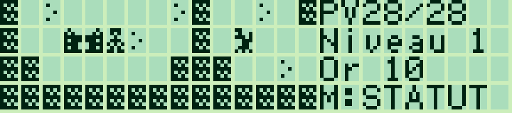
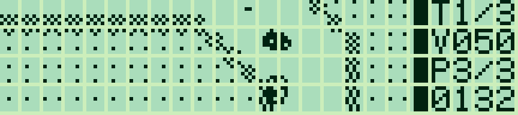
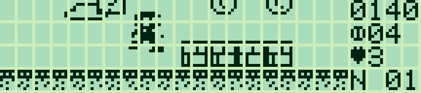
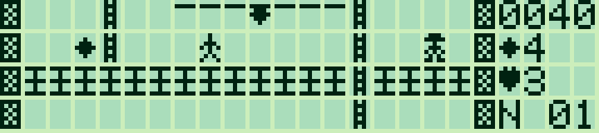
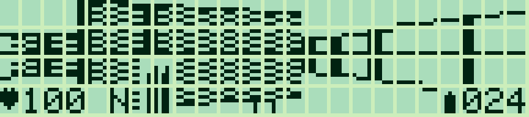
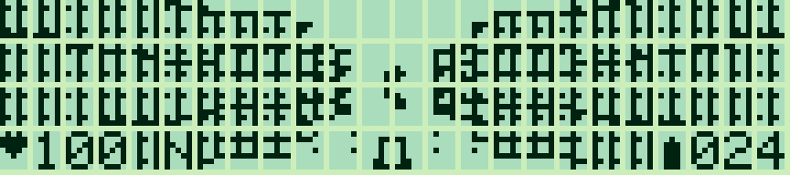
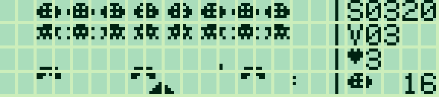
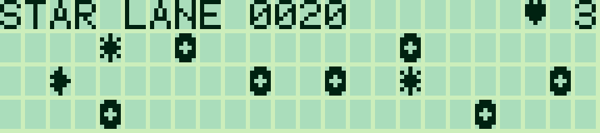

# Sharp PC-G Games

Collection **0.8.1** · [Français](#francais) · [English](#english)

<a id="francais"></a>

## Français

Des jeux en assembleur Z80 pour **Sharp PC-G801 / PC-G805**, en français et en anglais, avec graphismes personnalisés, sources modifiables et fichiers prêts à charger. Voir les [modèles ciblés et limites mémoire](docs/COMPATIBILITY.md).

### Les jeux

#### Sharp PC-G80X Quest

RPG : carte, boutiques, équipement et cinq boss. Les combats intègrent un défi de frappe. Portage de [Canon X-07 Quest](https://github.com/pR-0000/Canon_X-07_RPG).



[FR — HEX](games/quest/build/quest_FR.hex) · [EN — HEX](games/quest/build/quest_EN.hex) · [Guide](games/quest/README.md)

#### Pocket Rally — 0.1.0

Course vue de dessus : deux circuits, deux adversaires, seize orientations, accélération/freinage et défilement au pixel sur les deux axes. Tilemapper 4 × 4, caméra anticipée et commandes simultanées. Un jeu original pour Sharp inspiré de [Tiny CarZ](https://www.ticalc.org/archives/files/fileinfo/391/39185.html).



[FR — HEX](games/pocket-rally/build/rally_FR.hex) · [EN — HEX](games/pocket-rally/build/rally_EN.hex) · [Guide](games/pocket-rally/README.md)

#### Pocket Jumper — prototype 0.1.1

Plateformes à défilement au pixel : héros de 12 × 12 points, sauts avec élan et lecture simultanée flèches/ESPACE, pièces, blocs bonus, ennemis à écraser et point de reprise. Un premier niveau original de 768 × 48 points.



[FR — HEX](games/pocket-jumper/build/jumper_FR.hex) · [EN — HEX](games/pocket-jumper/build/jumper_EN.hex) · [Guide](games/pocket-jumper/README.md)

#### Pocket Runner

Inspiré de Lode Runner : trois niveaux, échelles, cordes, or à ramasser et pièges à creuser pour les gardes.



[FR — HEX](games/pocket-runner/build/runner_FR.hex) · [EN — HEX](games/pocket-runner/build/runner_EN.hex) · [Guide](games/pocket-runner/README.md)

#### Pocket Depths 2

FPS à raycaster DDA Q8.8 calculé sur Z80 : positions fractionnaires, 32 orientations, murs texturés, colonnes, portes, sentinelles, clé et sortie.



[FR — HEX](games/pocket-depths-2/build/depths2_FR.hex) · [EN — HEX](games/pocket-depths-2/build/depths2_EN.hex) · [Guide](games/pocket-depths-2/README.md)

#### Pocket Depths

FPS d’exploration par cases : trois armes, monstres, portes, deux balises et 255 dispositions modulaires. Édition complète pour G805 ; Lite à carte fixe pour G801/G805.



[FR — HEX](games/pocket-depths/build/depths_FR.hex) · [EN — HEX](games/pocket-depths/build/depths_EN.hex) · [Guide](games/pocket-depths/README.md)

#### Pocket Invaders

Arcade : seize envahisseurs animés, tirs au pixel, abris destructibles et vagues successives. Arène 90 × 28 points et panneau à droite.



[FR — HEX](games/pocket-invaders/build/invaders_FR.hex) · [EN — HEX](games/pocket-invaders/build/invaders_EN.hex) · [Guide](games/pocket-invaders/README.md)

#### Star Lane

Éviter les astéroïdes et ramasser les étoiles en changeant de couloir. Trois vies, score et pause.



[FR — HEX](build/star_lane_FR.hex) · [EN — HEX](build/star_lane_EN.hex) · [Guide](games/star-lane/README.md)

Captures LCD : **g800**.

### Charger un jeu

Utiliser une interface série compatible Sharp PC-G et **[Sharp PC-G Link](https://github.com/pR-0000/Sharp-PC-G-Link)**, disponible séparément en [version Windows autonome](https://github.com/pR-0000/Sharp-PC-G-Link/releases/latest). Aucun assembleur n’est nécessaire pour jouer.

1. Sauvegarder les programmes à conserver.
2. Régler **TEXT → Sio → Format** et Sharp PC-G Link sur **4800 bauds, 8N1, RS/CS, CR LF, EOF 1A**. Les deux côtés doivent correspondre ; **1200 / 7N1** reste utilisable.
3. Depuis BASIC RUN, saisir **MON**, puis la commande **USER** ci-dessous et **R**, avec ENTER après chaque commande.
4. Choisir le HEX français ou anglais et cliquer sur **Envoyer ASM**. Attendre la fin de réception sur le Sharp.
5. Saisir **G100**, puis ENTER sur le titre.

| Jeu | Octets FR / EN, état et tampons inclus | Réservation |
|---|---:|---|
| Sharp PC-G80X Quest | 5 848 / 5 783 | `USER17E2` |
| Pocket Rally | 5 783 / 5 762 | `USER17E2` |
| Pocket Jumper | 5 003 / 4 990 | `USER14FF` |
| Pocket Runner | 3 704 / 3 684 | `USER0FFF` |
| Pocket Depths 2 | 4 800 / 4 782 | `USER13FF` |
| Pocket Depths (G805) | 6 295 / 6 286 | `USER19FF` |
| Pocket Invaders | 2 666 / 2 653 | `USER0BFF` |
| Star Lane | 1 195 / 1 192 | `USER05FF` |
| Pocket Depths Lite | 5 818 / 5 805 | `USER17E2` |

Tous les jeux se chargent en **0100h**. Charger un autre jeu remplace le précédent et sa sauvegarde en RAM. **Q / BREAK** revient à l’appelant. Après réservation et chargement, **CALL &H100** lance aussi le jeu depuis BASIC.

[Chargement et dépannage](docs/LOADING.md) · [Utilitaire de transfert](docs/TRANSFER_TOOL.md) · [Lancement BASIC](docs/BASIC_CALL.md)

### Construire et modifier

Installer Python 3.10+ et [SjASMPlus](https://github.com/z00m128/sjasmplus), puis depuis la racine du dépôt :

```text
python tools/build_all.py --lang fr --assembler "chemin/vers/sjasmplus.exe"
```

Les deux langues sont construites. Chaque dossier de jeu contient ses sources, graphismes, guide et binaires. Les définitions communes sont dans `include/` et les wrappers IOCS dans `lib/`.

[Développement](docs/DEVELOPMENT.md) · [Routines du firmware](docs/ROM_G801.md)

### Crédits et licence

© 2026 P.RAIMBAULT. Jeux originaux, graphismes et outils Sharp : [MIT](LICENSE.txt) ([traduction française](LICENSE_FR.txt)). Quest conserve les conditions de ses sources héritées ; voir [sa notice](games/quest/NOTICE.md). Aucune ROM Sharp, aucun émulateur, assembleur ou pilote FTDI n’est inclus. Projet indépendant, sans affiliation à Sharp.

---

<a id="english"></a>

## English

Z80 assembly games for **Sharp PC-G801 / PC-G805**, with French and English versions, original graphics, editable sources and ready-to-load files. See the [target models and memory limits](docs/COMPATIBILITY_EN.md).

### Games

#### Sharp PC-G80X Quest

RPG with exploration, shops, equipment and five bosses. Battles include a typing challenge. Ported from [Canon X-07 Quest](https://github.com/pR-0000/Canon_X-07_RPG).


[FR — HEX](games/quest/build/quest_FR.hex) · [EN — HEX](games/quest/build/quest_EN.hex) · [Guide](games/quest/README.md#english)

#### Pocket Rally — 0.1.0

Overhead racing with two circuits, two opponents, sixteen headings, acceleration/braking and pixel scrolling on both axes. A 4 × 4 tilemapper, look-ahead camera and simultaneous controls. An original Sharp game inspired by [Tiny CarZ](https://www.ticalc.org/archives/files/fileinfo/391/39185.html).


[FR — HEX](games/pocket-rally/build/rally_FR.hex) · [EN — HEX](games/pocket-rally/build/rally_EN.hex) · [Guide](games/pocket-rally/README.md#english)

#### Pocket Jumper — prototype 0.1.1

Pixel-scrolling platformer: 12 × 12 hero, momentum-based jumps with simultaneous arrow/SPACE input, coins, bonus blocks, enemies to stomp and a checkpoint. One original 768 × 48 level.


[FR — HEX](games/pocket-jumper/build/jumper_FR.hex) · [EN — HEX](games/pocket-jumper/build/jumper_EN.hex) · [Guide](games/pocket-jumper/README.md#english)

#### Pocket Runner

Inspired by Lode Runner: three levels, ladders, ropes, gold to collect and traps to dig for pursuing guards.


[FR — HEX](games/pocket-runner/build/runner_FR.hex) · [EN — HEX](games/pocket-runner/build/runner_EN.hex) · [Guide](games/pocket-runner/README.md#english)

#### Pocket Depths 2

Z80 runtime Q8.8 DDA raycaster: fractional positions, 32 headings, textured walls, pillars, doors, sentries, a key and an exit.


[FR — HEX](games/pocket-depths-2/build/depths2_FR.hex) · [EN — HEX](games/pocket-depths-2/build/depths2_EN.hex) · [Guide](games/pocket-depths-2/README.md#english)

#### Pocket Depths

Grid-based exploration FPS: three weapons, monsters, doors, two beacons and 255 modular layouts. Full edition for G805; fixed-map Lite for G801/G805.


[FR — HEX](games/pocket-depths/build/depths_FR.hex) · [EN — HEX](games/pocket-depths/build/depths_EN.hex) · [Guide](games/pocket-depths/README.md#english)

#### Pocket Invaders

Arcade with sixteen animated invaders, pixel projectiles, destructible shields and successive waves. A 90 × 28 arena with a right-hand HUD.


[FR — HEX](games/pocket-invaders/build/invaders_FR.hex) · [EN — HEX](games/pocket-invaders/build/invaders_EN.hex) · [Guide](games/pocket-invaders/README.md#english)

#### Star Lane

Switch lanes to avoid asteroids and collect stars. Three lives, score and pause.


[FR — HEX](build/star_lane_FR.hex) · [EN — HEX](build/star_lane_EN.hex) · [Guide](games/star-lane/README.md#english)

LCD screenshots: **g800**.

### Load a game

Use a Sharp PC-G serial interface and **[Sharp PC-G Link](https://github.com/pR-0000/Sharp-PC-G-Link)**, available separately as a [standalone Windows release](https://github.com/pR-0000/Sharp-PC-G-Link/releases/latest). No assembler is required to play.

1. Back up programs you want to keep.
2. Set **TEXT → Sio → Format** and Sharp PC-G Link to **4800 baud, 8N1, RS/CS, CR LF, EOF 1A**. Both sides must match; **1200 / 7N1** can also be used.
3. From BASIC RUN, enter **MON**, then the **USER** command below, then **R**, pressing ENTER after each.
4. Select the FR or EN HEX and click **Send ASM**. Wait for reception to finish on the Sharp.
5. Enter **G100**, then ENTER on the title screen.

| Game | Bytes FR / EN, including state and buffers | Reservation |
|---|---:|---|
| Sharp PC-G80X Quest | 5 848 / 5 783 | `USER17E2` |
| Pocket Rally | 5 783 / 5 762 | `USER17E2` |
| Pocket Jumper | 5 003 / 4 990 | `USER14FF` |
| Pocket Runner | 3 704 / 3 684 | `USER0FFF` |
| Pocket Depths 2 | 4 800 / 4 782 | `USER13FF` |
| Pocket Depths (G805) | 6 295 / 6 286 | `USER19FF` |
| Pocket Invaders | 2 666 / 2 653 | `USER0BFF` |
| Star Lane | 1 195 / 1 192 | `USER05FF` |
| Pocket Depths Lite | 5 818 / 5 805 | `USER17E2` |

All games load at **0100h**. Loading another game replaces the previous one and its RAM save. **Q / BREAK** returns to the caller. Once reserved and loaded, **CALL &H100** also starts the game from BASIC.

[Loading and troubleshooting](docs/LOADING_EN.md) · [Transfer utility](docs/TRANSFER_TOOL_EN.md) · [BASIC launcher](docs/BASIC_CALL_EN.md)

### Build and modify

Install Python 3.10+ and [SjASMPlus](https://github.com/z00m128/sjasmplus), then run from the repository root:

```text
python tools/build_all.py --lang en --assembler "path/to/sjasmplus.exe"
```

Both languages are built. Each game folder contains its source, assets, guide and binaries. Shared definitions are in `include/`; reusable IOCS wrappers are in `lib/`.

[Development](docs/DEVELOPMENT_EN.md) · [Firmware routines](docs/ROM_G801_EN.md)

### Credits and license

© 2026 P.RAIMBAULT. Original games, graphics and Sharp tools: [MIT](LICENSE.txt). Quest retains the conditions of its inherited sources; see [its notice](games/quest/NOTICE_EN.md). No Sharp ROM, emulator, assembler or FTDI driver is included. Independent project, unaffiliated with Sharp.
