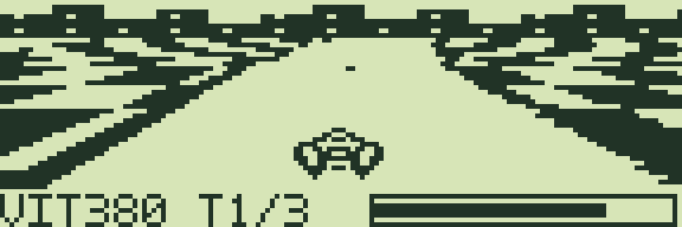

# Pocket Vector — étude de course en perspective / perspective racer study

[Français](#francais) · [English](#english)

<a id="francais"></a>

## Français

Pour jouer, consulter le [prototype Pocket Vector pour PC-G850](../../games/pocket-vector/README.md#francais). Ce dossier décrit le modèle de référence et le noyau de projection, indépendamment des règles et graphismes du jeu.

**Pocket Vector** est un projet de course futuriste pour **Sharp PC-G850** : piste plane projetée en perspective, rotation de la caméra, vaisseaux et graphismes monochromes. Cette étude fournit un noyau de rendu Z80, un modèle de référence et des maquettes. Le [jeu complet G850 et G80X 32 Ko](../../games/pocket-vector/README.md) fournit les fichiers à charger.

### Composition visuelle envisagée



Cette image illustre la composition proposée. Le sol utilise la projection décrite ci-dessous ; la ville, les vaisseaux et le panneau sont composés par le modèle Python. Ce n’est pas une capture d’un jeu sur machine. Les [BMP natifs](docs/concept_1x1.bmp) sont en 144 × 48 pixels ; [version 2 × 1](docs/concept_2x1.png) et [version 2 × 2](docs/concept_2x2.png) permettent de comparer les compromis.

La piste offre **11 unités de largeur utile**, soit 41 % de plus que la première composition. Le [vaisseau de 19 × 11 pixels](docs/ship.bmp) reprend l’idée d’une silhouette arrière large et de deux propulseurs, avec un dessin original inspiré de QL-Zero. Voir l’[étude de G-KART et des niveaux de gris](RESEARCH.md#francais) pour les choix de rendu et de mémoire.

### Architecture

Pocket Depths 2 fournit un tampon graphique, des sprites projetés et des calculs en virgule fixe. Son DDA cherche les intersections avec les murs ; son moteur actuel ne projette pas de texture de sol. La course utilise un **nouveau floorcaster par lignes**, avec une carte originale vue du dessus.

Pour chaque ligne sous l’horizon, calculer la distance au plan, la position de départ dans la carte et deux incréments Q8.8. Ensuite, chaque échantillon ne demande que des additions et une lecture de texture. Le [noyau Z80](floor_kernel.asm) exécute réellement ce parcours et remplit le tampon au format G850.

- Affichage : **144 × 48 pixels continus**, tampon de **864 octets**, six pages de huit bits.
- Sol : 144 × 32 pixels ; bande haute pour l’horizon et bande basse pour les informations.
- Carte de référence : **128 × 128 pixels, 1 bit par point**, soit **2048 octets** ; [plan BMP](docs/track.bmp).
- 64 orientations de caméra ; positions fractionnaires ; divisions remplacées par des tables de réciproques.
- Modes 1 × 1, 2 × 1 ou 2 × 2 pour le sol. Les vaisseaux et les chiffres peuvent rester dessinés à la résolution native.
- Les modes échantillonnés projettent aussi la carte ; ils ne se limitent pas à déformer une route prédessinée.

### Budget de calcul et de mémoire

Sur une base de **8 MHz**, le noyau Z80 du sol seul représente approximativement :

| Mode | Échantillons / image | Temps de calcul du sol seul |
|---|---:|---:|
| 1 × 1 | 4608 | 148 ms |
| 2 × 1 | 2304 | 80 ms |
| 2 × 2 | 1152 | 41 ms |

Ces temps proviennent du nombre de cycles exécutés par le noyau, avec les tables de lignes déjà préparées. Ils **excluent** leur préparation, les transferts LCD, le clavier, les sprites, les règles et les interruptions. Ce ne sont pas des mesures de cadence sur un Sharp. Les 8 MHz servent de référence de calcul ; la fréquence et les attentes mémoire du modèle exact restent à vérifier. Le modèle IOCS de g800 ajoute environ 18 ms pour un transfert complet à cette fréquence ; le coût réel du firmware reste à mesurer.

Le budget visé pour un premier jeu est **8–10 images/s en 2 × 1**, ou **12–15 en 2 × 2**, sous réserve du reste du moteur et du pilote LCD. Un mode photo figé peut recalculer le sol en 1 × 1 sans contrainte de cadence. Un pilote LCD direct pourrait réduire le coût d’affichage, après validation du contrôleur et de l’état du firmware.

Avec une carte graphique de 2 Kio, une carte de collision de 2 Kio, 1–2 Kio de tampons logiciels, quelques centaines d’octets de tables et les sprites, un jeu initial d’environ **10–16 Kio** paraît réaliste. Il s’agit d’un budget de conception. Un double tampon logiciel ne constitue pas un changement instantané de page LCD.

### Premier jeu proposé

Un circuit original fermé, trois tours et deux adversaires. Accélération, freinage, direction simultanée et glissade modérée ; bordures qui ralentissent, zones de recharge et turbo consommant de l’énergie. Le panneau garde des chiffres de vitesse, de tour et d’énergie lisibles. La première version reste sur un terrain plat, sans sauts ni relief.

Un mode démonstration piloterait automatiquement le vaisseau. Pause, point de vue ajustable et rendu natif figé permettraient de préparer les photos. Des circuits supplémentaires peuvent ensuite réutiliser le même moteur.

Les risques principaux sont la rémanence du LCD, le coût des IOCS, l’aliasing de la texture lointaine et le délai de stabilisation de la matrice clavier. Prévoir une texture simplifiée près de l’horizon, limiter les motifs fins et vérifier le pilotage sur la machine.

<a id="portage-g80x-32-kio"></a>

### Portage G80X 32 Kio

Le [portage G801/G805 32 Ko](../../games/pocket-vector/README.md) est disponible : trois circuits et règles partagés, floorcaster 2 × 2, scène adaptée en 120 × 21, vaisseau 23 × 11, HUD 3 × 5, minimap 16 × 8 et menus quatre lignes. Un tampon LCD de 480 octets contient les bandes de sept bits. Les tables de projection occupent 2 560 octets ; les cartes et la physique restent communes. Les binaires FR/EN occupent 27 392 octets, réservation USER6BFF. Voir le [guide mémoire et chargement](../../docs/G80X_32K.md#francais). Le profil G815 reste distinct.

### Définitions et ROM

L’include [sharp_pc_g850.inc](../../include/sharp_pc_g850.inc) utilise son propre espace de noms `PCG850_*`. Les [wrappers G850](../../lib/pcg850_runtime.asm) couvrent affichage, effacement et clavier. Voir la [référence G850](../../docs/G850.md#francais).

Un dump ROM n’est pas nécessaire au noyau de projection ni à la première version par IOCS publics. Celui du **modèle exact PC-G850** serait utile pour vérifier les contrats et coûts des routines d’affichage, préserver leurs variables d’état et préparer un pilote rapide. Les routines internes de série et de son demanderaient également cette vérification ; elles ne sont pas transposées depuis le G805.

### Reproduire l’étude

Depuis la racine, Python standard suffit pour les maquettes. Le noyau demande SjASMPlus et `z80==1.2.0` pour être exécuté sur une CPU simulée :

```text
python designs/pocket-vector/reference.py --lang fr
python designs/pocket-vector/benchmark.py --lang fr --assembler "chemin/vers/sjasmplus.exe"
python tests/check_g850_backend.py --lang fr --assembler "chemin/vers/sjasmplus.exe"
```

Les tests comparent chaque pixel du noyau à la référence sur plusieurs positions et les 64 orientations, et contrôlent les zones mémoire écrites.

Inspiration : [F-Zero 83+ de calc84maniac](https://www.omnimaga.org/f-zero-83/) et [présentation de son moteur](https://maxcoderz.benryves.com/forum/viewtopic.php?t=2652&start=15). Aucun code ni graphisme de ces projets n’est repris. Références matérielles : [g800, sources](https://ver0.sakura.ne.jp/pc/) et [MAME, pilote PC-G850V](https://github.com/mamedev/mame/blob/master/src/mame/sharp/pce220.cpp). Code et graphismes originaux de cette étude : MIT, © 2026 P.RAIMBAULT.

---

<a id="english"></a>

## English

To play, see the [Pocket Vector PC-G850 prototype](../../games/pocket-vector/README.md#english). This folder describes the reference model and projection kernel, separately from the game’s rules and artwork.

**Pocket Vector** is a proposed futuristic racer for **Sharp PC-G850**: perspective-projected flat track, rotating camera, ships and monochrome graphics. This study provides a Z80 rendering kernel, a reference model and concept artwork. The [complete G850 and G80X 32 KiB game](../../games/pocket-vector/README.md#english) provides ready-to-load files.

### Proposed composition


The floor uses the projection described below; the skyline, ships and HUD are composed by the Python reference. This is not an on-device game screenshot. [Native BMP](docs/concept_1x1.bmp), [2 × 1 rendering](docs/concept_2x1.png) and [2 × 2 rendering](docs/concept_2x2.png) illustrate the tradeoffs.

The road has **11 units of usable width**, 41% wider than the first composition. The original [19 × 11 ship](docs/ship.bmp) uses a broad rear silhouette and twin engines inspired by QL-Zero. See the [G-KART and greyscale study](RESEARCH.md#english) for rendering and memory choices.

### Architecture

Pocket Depths 2 provides a graphics buffer, projected sprites and fixed-point maths. Its DDA finds wall intersections; its existing engine does not project a floor texture. The racer needs a **new scanline floorcaster**, sampling an original overhead track map.

For each row below the horizon, calculate its distance to the plane, first texture coordinate and two Q8.8 increments. Each sample then requires additions and a texture lookup. The [Z80 kernel](floor_kernel.asm) performs this work and writes the G850 page buffer.

- Display: **144 × 48 continuous pixels**, **864-byte** buffer, six full eight-bit pages.
- Floor: 144 × 32 pixels, with skyline above and HUD below.
- Reference world: **128 × 128 pixels at 1 bpp**, **2048 bytes**; [BMP map](docs/track.bmp).
- 64 camera headings, fractional positions and reciprocal tables instead of divisions.
- 1 × 1, 2 × 1 and 2 × 2 floor sampling; ships and digits can retain native resolution.
- Sampled modes still project the world map rather than merely distorting a preset road.

### Processing and memory budgets

Normalized to **8 MHz**, the Z80 floor kernel alone takes approximately:

| Mode | Samples / frame | Floor computation only |
|---|---:|---:|
| 1 × 1 | 4608 | 148 ms |
| 2 × 1 | 2304 | 80 ms |
| 2 × 2 | 1152 | 41 ms |

These are executed kernel cycle counts with prepared scanline tables. They **exclude** table preparation, LCD transfers, keyboard, sprites, gameplay and interrupts. They are not measured Sharp frame rates. The 8 MHz clock is a calculation reference; the exact model’s clock and memory waits still need verification. g800’s IOCS model adds about 18 ms for a full upload at that clock; actual firmware cost needs measurement.

Initial design targets are **8–10 fps at 2 × 1**, or **12–15 fps at 2 × 2**, subject to the rest of the engine and LCD driver. A frozen photo mode can recalculate native 1 × 1 frames without a frame-rate constraint. A direct LCD backend may reduce upload cost after validating the controller and firmware state.

With a 2 KiB visual map, 2 KiB collision map, 1–2 KiB of software buffers, small tables and sprites, roughly **10–16 KiB** seems a realistic initial game budget. This is an estimate. Software double buffering does not provide instantaneous LCD page flipping.

### Proposed first game

One original closed circuit, three laps and two opponents. Simultaneous steering, throttle and brake, modest drift, slowing borders, recharge areas and energy-consuming boost. Keep speed, lap and energy readable. Initial terrain stays flat, without hills or jumps.

An automatic demonstration driver, adjustable camera, pause and frozen native rendering would support photography. Further tracks could reuse the engine. Main risks are LCD persistence, IOCS cost, distant texture aliasing and keyboard-matrix settling time; simplify far textures and verify controls on hardware.

<a id="g80x-32-kib-port"></a>

### G80X 32 KiB port

The [32 KiB G801/G805 port](../../games/pocket-vector/README.md#english) is available: shared circuits/rules, 2 × 2 floorcaster, scene adapted to 120 × 21, 23 × 11 ship, 3 × 5 HUD, 16 × 8 minimap and four-row menus. A 480-byte LCD buffer stores the seven-bit bands. Projection tables occupy 2,560 bytes; maps and physics remain shared. Both language files occupy 27,392 bytes with USER6BFF. See the [memory and loading guide](../../docs/G80X_32K.md#english). G815 remains a separate profile.

### Definitions and ROM

[sharp_pc_g850.inc](../../include/sharp_pc_g850.inc) uses its own `PCG850_*` namespace. [G850 wrappers](../../lib/pcg850_runtime.asm) cover display, clearing and keyboard. See the [G850 reference](../../docs/G850.md#english).

A ROM dump is unnecessary for the projection kernel or an initial public-IOCS implementation. A dump of the **exact PC-G850 model** would help verify display contracts and costs, preserve firmware state and prepare a faster backend. Internal serial and sound routines also need verification; G805 internals are not transferred to this target.

### Reproduce the study

From the repository root, standard Python can generate the artwork. Running the Z80 kernel needs SjASMPlus and `z80==1.2.0`:

```text
python designs/pocket-vector/reference.py --lang en
python designs/pocket-vector/benchmark.py --lang en --assembler "path/to/sjasmplus.exe"
python tests/check_g850_backend.py --lang en --assembler "path/to/sjasmplus.exe"
```

Checks compare every kernel pixel against the reference at multiple positions and all 64 headings and verify memory write boundaries.

Inspiration: [calc84maniac’s F-Zero 83+](https://www.omnimaga.org/f-zero-83/) and [engine presentation](https://maxcoderz.benryves.com/forum/viewtopic.php?t=2652&start=15). No code or artwork is reused. Hardware references: [g800 source](https://ver0.sakura.ne.jp/pc/) and [MAME’s PC-G850V driver](https://github.com/mamedev/mame/blob/master/src/mame/sharp/pce220.cpp). Original study code and artwork: MIT, © 2026 P.RAIMBAULT.
