# Screenshot gallery

[Français](DEMONSTRATION.md) · **English** · [Collection](../README.md#english)

LCD-only captures in **g800**, without window borders. Five G850 animations show Vector, Clash, Jumper, Depths 2 and Rally. GIF timing is illustrative. Each game’s guide provides controls and downloads.

## PC-G850

### Pocket Vector

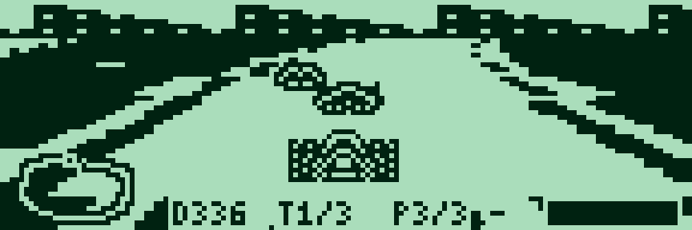

[Guide](../games/pocket-vector/README.md#english)

### Pocket Clash

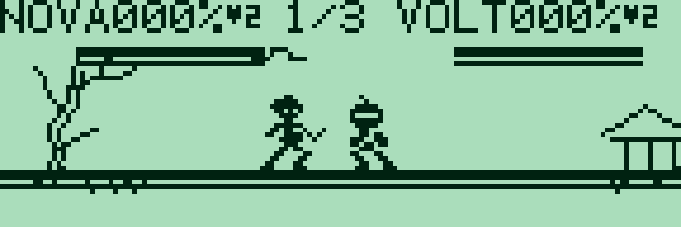

[Guide](../games/pocket-clash/README.md#english)

### Sharp PC-G Quest

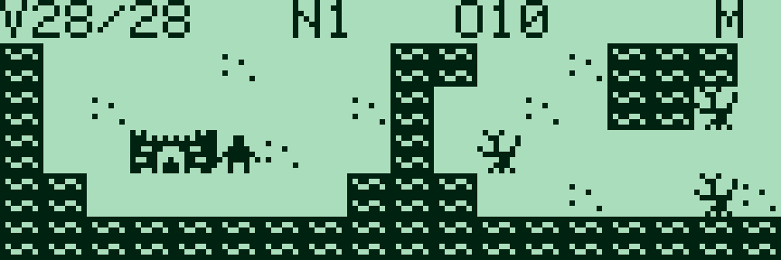

[Guide](../games/quest/README.md#english)

### Pocket Jumper

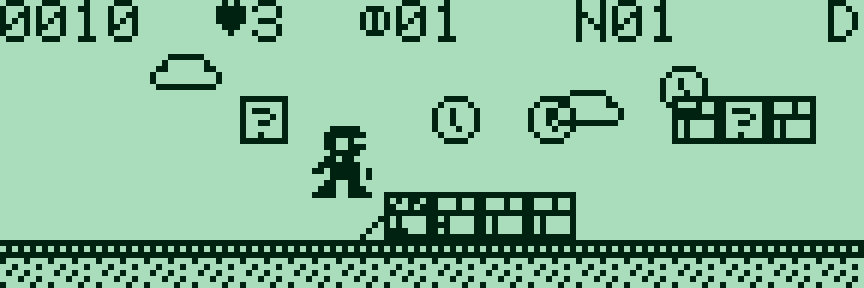

[Guide](../games/pocket-jumper/README.md#english)

### Pocket Depths 2

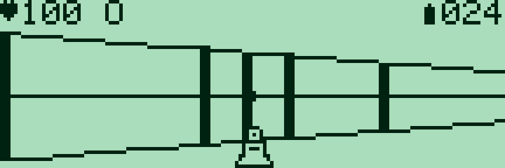

[Guide](../games/pocket-depths-2/README.md#english)

### Pocket Rally

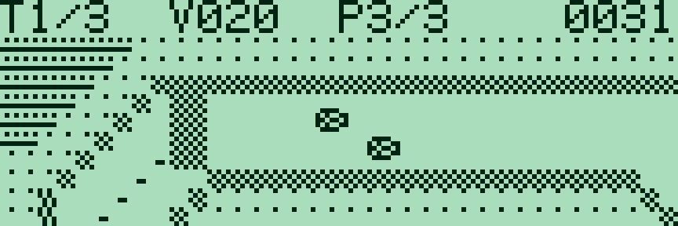

[Guide](../games/pocket-rally/README.md#english)

### Pocket Runner

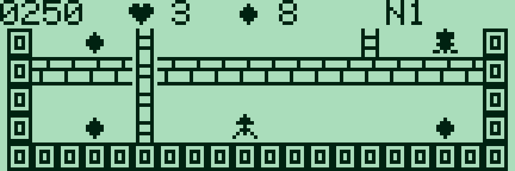

[Guide](../games/pocket-runner/README.md#english)

### Pocket Invaders

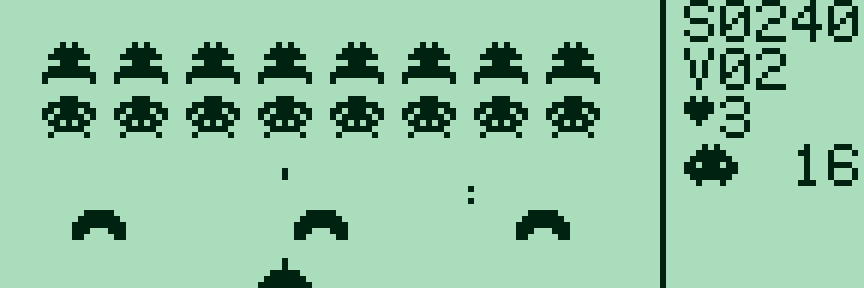

[Guide](../games/pocket-invaders/README.md#english)

### Pocket Depths

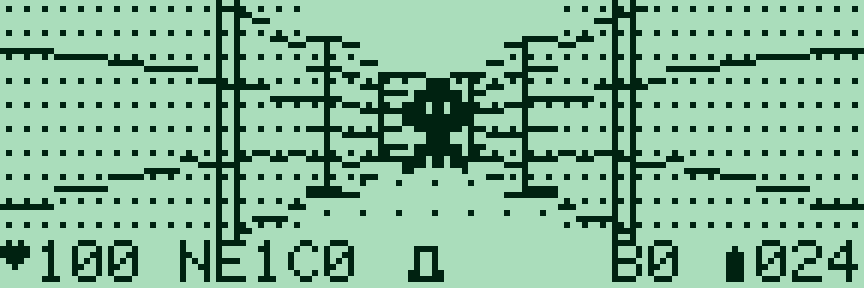

[Guide](../games/pocket-depths/README.md#english)

### Star Lane

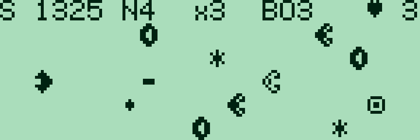

[Guide](../games/star-lane/README.md#english)

## PC-G801 / PC-G805

### Pocket Vector — 32 KiB

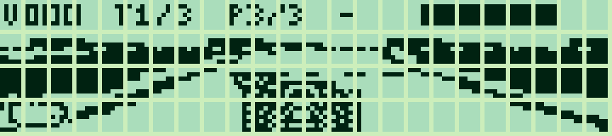

[Guide](../games/pocket-vector/README.md#english)

### Pocket Clash — 32 KiB

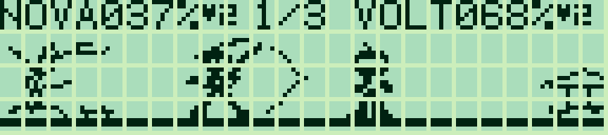

[Guide](../games/pocket-clash/README.md#english)

### Sharp PC-G Quest

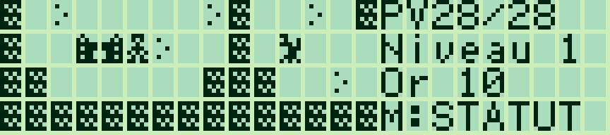

[Guide](../games/quest/README.md#english)

### Pocket Jumper

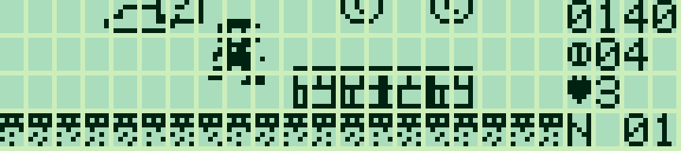

[Guide](../games/pocket-jumper/README.md#english)

### Pocket Depths 2

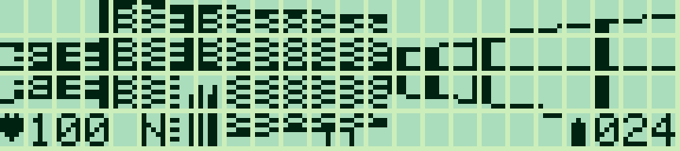

[Guide](../games/pocket-depths-2/README.md#english)

### Pocket Rally

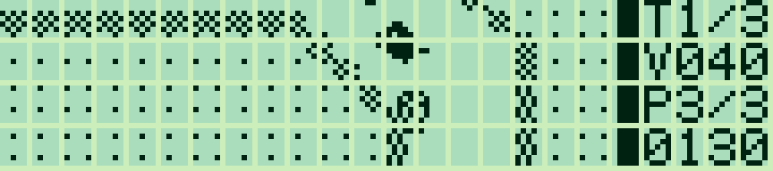

[Guide](../games/pocket-rally/README.md#english)

### Pocket Runner

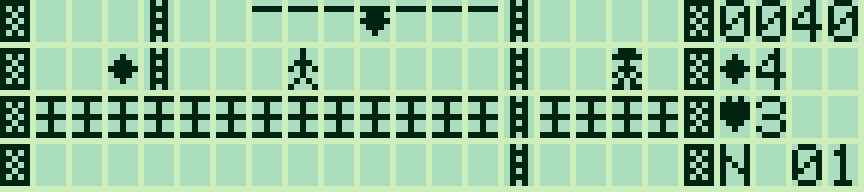

[Guide](../games/pocket-runner/README.md#english)

### Pocket Invaders

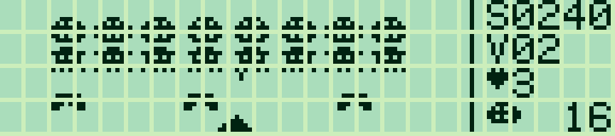

[Guide](../games/pocket-invaders/README.md#english)

### Pocket Depths

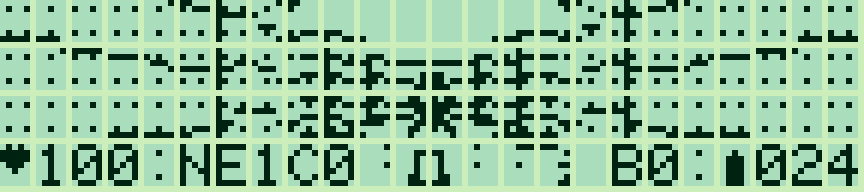

[Guide](../games/pocket-depths/README.md#english)

### Star Lane

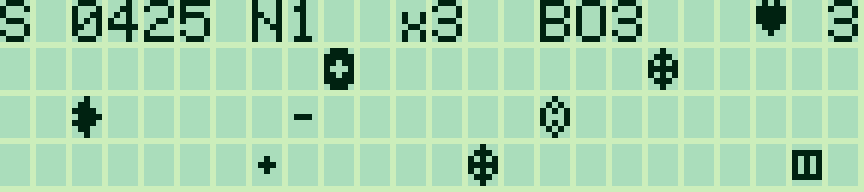

[Guide](../games/star-lane/README.md#english)
