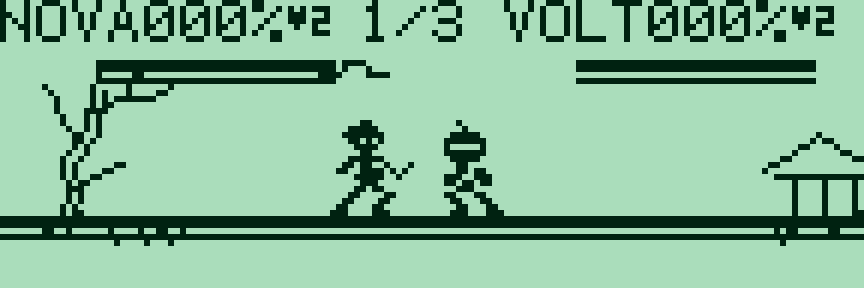
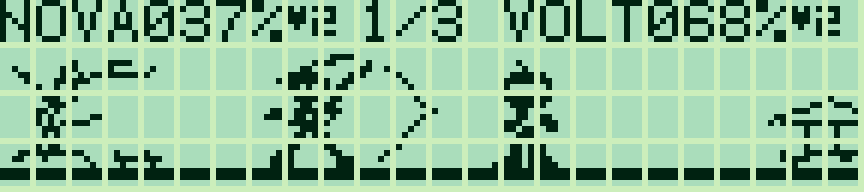
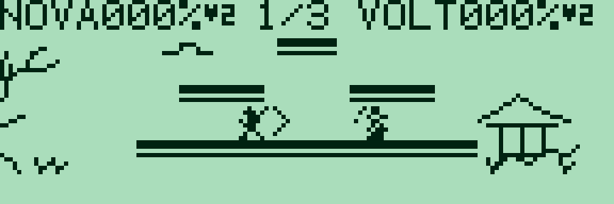
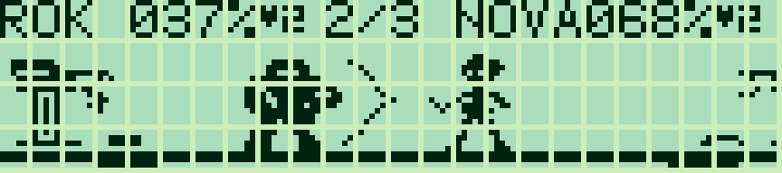

# Pocket Clash — 0.1.1

[Français](#francais) · [English](#english) · [Collection](../../README.md)

<a id="francais"></a>

## Français

Les animations G850 sont capturées dans g800, limitées au LCD ; leur cadence est indicative.

Jeu de combat sur plateformes en assembleur Z80 pour **Sharp PC-G850**. Quatre combattants originaux, trois arènes et une coupe de **trois combats contre l’ordinateur**, avec classement. Plus le pourcentage de dégâts augmente, plus les coups projettent loin. La victoire se joue en éjectant l’adversaire de l’arène.



### Version G80X — 32 Ko

Version distincte pour **G801/G805 avec 32 Kio de RAM reconnus** :

| Français | English | Octets FR / EN | Réservation |
|---|---|---:|---|
| [IHX FR](build/g80x-32k/clash_g80x_32k_FR.ihx) | [IHX EN](build/g80x-32k/clash_g80x_32k_EN.ihx) | 22 623 / 22 615 | **USER59FF** |



Quatre personnages, six poses chacun, trois arènes et coupe conservés. Vue **120 × 21** sous le HUD, caméra avec **treize tailles de 4 à 16 pixels**, menus et classement sur quatre lignes. **MON → USER59FF → R**, Envoyer ASM, puis **G100**. Sur G801 étendu, activer **Extension RAM 32 Ko (G80X)** dans PC-G Link. [Mémoire et chargement G80X 32 Ko](../../docs/G80X_32K.md#francais).

### Charger sur PC-G850

| Français | English | Octets FR / EN | Réservation | Départ |
|---|---|---:|---|---|
| [IHX FR](build/g850/clash_g850_FR.ihx) | [IHX EN](build/g850/clash_g850_EN.ihx) | 21 545 / 21 527 | **USER55FF** | **G100** |

Cette version vise le **PC-G850 à écran 144 × 48**. Le profil G80X 32 Ko est disponible ci-dessus ; aucun binaire G815 n’est fourni. BIN, IHX et manifeste incluent le code, les images et tous les tampons.

1. Sauvegarder les programmes à conserver. Le chargement remplace le programme en mémoire à 0100h.
2. Dans **TEXT → Sio → Format** et [Sharp PC-G Link](https://github.com/pR-0000/Sharp-PC-G-Link), sélectionner les mêmes paramètres : **4800 bauds / 8N1 / RS/CS / CR LF / EOF 1A** conseillés.
3. Depuis BASIC RUN : **MON**, **USER55FF**, puis **R**, avec ENTRÉE après chaque commande.
4. Envoyer le fichier IHX avec **Envoyer ASM**, attendre la fin sur le Sharp, puis saisir **G100**.

Après réservation et chargement, **CALL &H100** lance également le jeu depuis BASIC. [Guide et dépannage](../../docs/LOADING.md).

### Personnages

Choisir avec **← / →**, ou les touches **1 à 4**, puis ENTRÉE.

| Personnage | Style | Spécial X |
|---|---|---|
| **Nova** | Équilibré, lame et bonne mobilité | Ruée rapide, brève protection pendant son départ |
| **Volt** | Léger, attaques à distance | Orbe d’énergie ; un projectile à la fois |
| **Rok** | Lent, puissant, moins sensible aux projections | Frappe de zone à portée et dégâts augmentés |
| **Lynx** | Très mobile, saut plus haut, plus facile à projeter | Coup ascendant avec impulsion verticale |

Les spéciaux ont un délai de récupération. En l’air, X apporte une remontée supplémentaire, **une fois avant de retoucher une plateforme**. Nova termine sa ruée en revenant à une vitesse de course contrôlable.

### Commandes

| Touche | Action |
|---|---|
| ← / → | Se déplacer et orienter le personnage |
| ESPACE ou ↑ | Sauter ; un second saut est disponible en l’air |
| **Z** | Attaque normale, déclenchée à la pression |
| **X** | Attaque spéciale / récupération aérienne |
| ↓ au sol | Garde ; son endurance diminue pendant l’utilisation et les impacts |
| ↓ en l’air | Chute accélérée |
| ↓ + ESPACE sur une plateforme | Traverser la plateforme vers le bas |
| **P** | Pause / reprise |
| **TAB** | Gel photo / reprise, sans message au milieu du combat |
| **M** | Aide ; une touche revient au jeu |
| **D** | Démonstration au titre ; activer/désactiver le pilotage automatique en combat |
| **R** | Recommencer la coupe |
| **Q / BREAK** | Revenir au moniteur ou au BASIC appelant |

Les directions, le saut et les attaques sont lus simultanément dans la matrice clavier. Relâcher Z, X ou le saut avant de les déclencher de nouveau. Maintenir une direction conserve le déplacement.

### Règles et classement

Chaque combat commence avec **deux vies** et 0 % de dégâts. Un coup augmente le pourcentage et provoque un recul, dont la force dépend des dégâts accumulés et du poids du personnage. Sortir des limites retire une vie ; le retour sur la plateforme donne une courte protection clignotante. La garde bloque les dégâts tant qu’il reste de l’endurance ; une garde épuisée peut être brisée et étourdir le combattant.

Le panneau affiche les noms, les pourcentages, les **cœurs suivis des vies restantes** et le numéro du combat sur trois. Les noms et pourcentages utilisent la police normale du Sharp.

La coupe rencontre chacun des trois autres personnages : **Jardin suspendu**, **Temple** et **Pont nocturne** ont des plateformes et des décors différents. Un compte à rebours précède chaque manche. La partie continue après une défaite : les trois combats sont toujours joués. Chaque manche a une limite de 1 800 mises à jour de jeu ; à son terme, le nombre de vies, puis le plus faible pourcentage, départagent les combattants.

**Victoire : 3 points ; égalité : 1 ; défaite : 0.** Les autres rencontres entre les participants sont simulées. Le classement départage les points, puis les éjections obtenues, puis les dégâts infligés. ENTRÉE passe au combat suivant après le tableau ; après le troisième, le classement final reste affiché jusqu’à validation.

### Caméra et graphismes

Le jeu utilise une vue de **144 × 40 pixels**, sous le panneau. La caméra se déplace et réduit le zoom quand les combattants s’éloignent, avec **neuf tailles de 8 à 16 pixels**. Les décors lointains défilent plus lentement. Les sprites masqués restent lisibles sur le décor ; les orientations gauche/droite réutilisent les mêmes images par miroir.

Les quatre combattants disposent de six poses en **16 × 16 pixels** : repos, course, saut, attaque, impact et garde. Les décors concentrent leurs détails sur les côtés pour préserver la lisibilité du combat.



Cette animation montre les échelles du moteur avec une caméra préparée ; sa cadence illustre le zoom et ne mesure pas la vitesse sur matériel.


Pour construire ou lancer la version 32 Ko, ajouter **`--target g80x-32k`** aux commandes correspondantes. `--target g850` sélectionne le G850 ; sans sélecteur, la construction produit les deux profils. [Contrôles G80X 32 Ko](../../docs/DEVELOPMENT.md).

### Modifier et construire

- **[sprites.bmp](sprites.bmp)** : atlas éditable **16 × 432 pixels**, 27 images 16 × 16 empilées, noir/blanc. Pour chaque personnage : repos, course, saut, attaque, impact, garde ; puis trois effets. Ordre détaillé dans [sprites.json](sprites.json), aperçu dans [sprites.png](docs/sprites.png).
- **backgrounds/arena_1.bmp**, **arena_2.bmp**, **arena_3.bmp** : trois décors modifiables **192 × 40**.
- `assets.py` génère les neuf échelles depuis les BMP existants, sans les remplacer. `generated.inc` est un résultat de construction.
- `physics.asm`, `combat.asm`, `cup.asm` et `input.asm` : déplacements, coups, tournoi et clavier ; `render.asm` et `interface.asm` : caméra, rendu, menus FR/EN.

Depuis la racine, avec Python 3.10+ et SjASMPlus :

```text
python games/pocket-clash/build_clash.py --lang fr --assembler "sjasmplus.exe"
```


Inspiration de conception : Super Smash Bros. et [Super Smash Bros. Open de Hayleia](https://tiplanet.org/forum/archives_voir.php?id=110486), notamment son principe de caméra avec zoom. Code Z80, routine de mise à l’échelle et graphismes de Pocket Clash originaux. © 2026 P.RAIMBAULT, [MIT](../../LICENSE.txt).

---

<a id="english"></a>

## English

G850 animations are captured in g800, cropped to the LCD; their timing is illustrative.

A Z80 platform fighter for **Sharp PC-G850**. Four original fighters, three arenas and a **three-battle cup against the computer**, with standings. Damage percentages increase launch distance. Win by knocking the opponent out of the arena.


### G80X version — 32 KiB

Separate build for **G801/G805 with 32 KiB of recognized RAM**:

| French | English | Bytes FR / EN | Reservation |
|---|---|---:|---|
| [FR IHX](build/g80x-32k/clash_g80x_32k_FR.ihx) | [EN IHX](build/g80x-32k/clash_g80x_32k_EN.ihx) | 22,623 / 22,615 | **USER59FF** |



Four fighters, six poses each, three arenas and the cup are retained. **120 × 21** scene below the HUD, **thirteen sprite sizes from 4 to 16 pixels**, four-row menus and standings. **MON → USER59FF → R**, Send ASM, then **G100**. For an expanded G801, enable **32 KiB RAM expansion (G80X)** in PC-G Link. [G80X 32 KiB memory and loading](../../docs/G80X_32K.md#english).

### Load on PC-G850

| French | English | Bytes FR / EN | Reservation | Entry |
|---|---|---:|---|---|
| [FR IHX](build/g850/clash_g850_FR.ihx) | [EN IHX](build/g850/clash_g850_EN.ihx) | 21,545 / 21,527 | **USER55FF** | **G100** |

This build targets the **144 × 48 PC-G850**. The G80X 32 KiB build is available above; no G815 build is supplied. BIN, IHX and manifest include code, graphics and all working buffers.

1. Back up programs you want to keep. Loading replaces the program at 0100h.
2. Match **TEXT → Sio → Format** and [Sharp PC-G Link](https://github.com/pR-0000/Sharp-PC-G-Link): **4800 baud / 8N1 / RS/CS / CR LF / EOF 1A** recommended.
3. From BASIC RUN: **MON**, **USER55FF**, then **R**, pressing ENTER after each.
4. Use **Send ASM** for the IHX file, wait for reception to finish on the Sharp, then enter **G100**.

Once reserved and loaded, **CALL &H100** also starts the game from BASIC. [Loading and troubleshooting](../../docs/LOADING_EN.md).

### Fighters and controls

Choose with **← / →** or **1–4**, then ENTER.

| Fighter | Style | X special |
|---|---|---|
| **Nova** | Balanced sword fighter, good mobility | Fast dash with brief initial protection |
| **Volt** | Light ranged fighter | Energy orb; one projectile at a time |
| **Rok** | Slow, powerful and resistant to launch | Longer-range heavy area strike |
| **Lynx** | Fast, high jumper, easier to launch | Rising kick with vertical momentum |

Specials have a cooldown. In the air, X supplies extra upward recovery **once before landing on a platform**. Nova returns to controllable running speed after the dash burst.

| Key | Action |
|---|---|
| ← / → | Move and face left/right |
| SPACE or ↑ | Jump; a second jump is available in the air |
| **Z** | Normal attack on key press |
| **X** | Special attack / aerial recovery |
| ↓ on the ground | Guard; stamina drains while held and on impact |
| ↓ in the air | Fast fall |
| ↓ + SPACE on a platform | Drop through |
| **P** | Pause / resume |
| **TAB** | Clean photo freeze / resume |
| **M** | Help; any key returns |
| **D** | Demo from title; toggle automatic player control during battle |
| **R** | Restart cup |
| **Q / BREAK** | Return to monitor or calling BASIC program |

Movement, jump and attack buttons are sampled simultaneously. Release Z, X or jump before triggering another press. Hold a direction to keep moving.

### Rules and standings

Each battle starts with **two stocks** and 0 % damage. Hits add damage and launch the victim; force depends on accumulated damage and character weight. Crossing the blast boundaries costs a stock. Respawn grants brief blinking protection. Guarding blocks damage while stamina remains; an exhausted shield can break and stun its owner.

The HUD shows names, percentages, **hearts followed by remaining stocks** and the battle number out of three. Names and percentages use the Sharp’s normal font.

Fight each other character in turn. **Hanging Garden**, **Temple** and **Night Bridge** feature distinct platform layouts and scenery. Each battle has a starting countdown. Defeat does not end the cup: all three battles are played. A round lasts at most 1,800 game updates; remaining stocks, then lower damage, decide a timeout.

**Win: 3 points; draw: 1; loss: 0.** Other entrants’ fixtures are simulated. Standings compare points, then knockouts, then damage dealt. ENTER advances after each table; the final standings wait for confirmation after battle three.


Add **`--target g80x-32k`** to build or launch the 32 KiB profile. `--target g850` selects G850; builds without a selector produce both profiles. [G80X 32 KiB checks](../../docs/DEVELOPMENT_EN.md).

### Camera, graphics and sources

The **144 × 40 viewport** sits below the HUD. The camera follows the fighters and zooms out with separation, using **nine sprite sizes from 8 to 16 pixels**. Distant scenery scrolls more slowly. Masked sprites remain readable; mirrored columns share the left/right artwork.

Each fighter has six **16 × 16 pixel** poses: idle, run, jump, attack, hit and guard. Scenery details stay near the sides to keep the fighting area readable.


The animation illustrates the renderer with prepared camera states; playback timing is not a hardware speed measurement.

- **[sprites.bmp](sprites.bmp)**: editable **16 × 432** black/white atlas, 27 stacked 16 × 16 images. For each fighter: idle, run, jump, attack, hit, guard; then three effects. See [sprites.json](sprites.json) and [preview](docs/sprites.png).
- **backgrounds/arena_1.bmp**, **arena_2.bmp**, **arena_3.bmp**: editable **192 × 40** scenery.
- `assets.py` generates nine scales while preserving existing BMPs; `generated.inc` is generated output.
- `physics.asm`, `combat.asm`, `cup.asm`, `input.asm`: movement, attacks, cup and keyboard. `render.asm`, `interface.asm`: camera, graphics and FR/EN menus.

From the repository root, with Python 3.10+ and SjASMPlus:

```text
python games/pocket-clash/build_clash.py --lang en --assembler "sjasmplus.exe"
```


Design inspiration: Super Smash Bros. and [Hayleia’s Super Smash Bros. Open](https://tiplanet.org/forum/archives_voir.php?id=110486), particularly its zoom-camera concept. Pocket Clash’s Z80 code, scaling routine and graphics are original. © 2026 P.RAIMBAULT, [MIT](../../LICENSE.txt).
