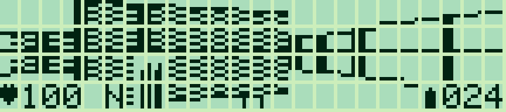
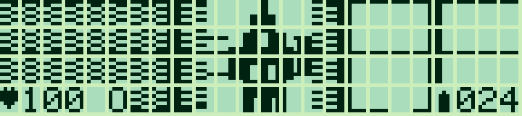
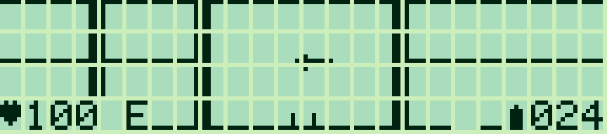
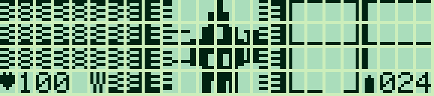

# Pocket Depths 2 — 0.1.0

[Français](#francais) · [English](#english)

<a id="francais"></a>

## Français

[Collection](../../README.md#francais)

Un FPS en **assembleur Z80 avec DDA à virgule fixe**, pour les budgets mémoire des **Sharp PC-G801 et PC-G805**. Le moteur calcule les intersections avec les murs à l'exécution : positions fractionnaires, rotations de 11,25°, perspective corrigée et sprites projetés. Il utilise le même binaire sur les deux modèles, sans extension mémoire.

| Salle et colonnes | Sentinelle |
|---|---|
|  |  |


Animation de rotation dans g800.



Captures LCD : **g800**.

### Jouer et charger

[Français — HEX](build/depths2_FR.hex) · [English — HEX](build/depths2_EN.hex) · [Tailles et SHA-256](build/manifest.json)

1. Dans **TEXT → Sio → Format**, sélectionner **4800 / 8N1, RS/CS, CR LF, EOF 1A**. Régler Sharp PC-G Link à l'identique. Les réglages initiaux sont 1200 / 7N1 : il faut modifier les deux côtés pour accélérer le transfert.
2. Depuis BASIC RUN : `MON`, puis **`USER13FF`**, puis `R` (ENTER après chaque commande).
3. Envoyer `depths2_FR.hex` avec **Envoyer ASM** dans Sharp PC-G Link. Attendre la réception sur le Sharp.
4. Saisir **`G100`**, puis ENTER sur le titre pour commencer. Après chargement, **`CALL &H100`** fonctionne aussi depuis BASIC.

| Version | Taille, état et tampon inclus | Réservation | Lancement |
|---|---:|---|---|
| Français | 4 800 octets | `USER13FF` | `G100` |
| Anglais | 4 782 octets | `USER13FF` | `G100` |

La limite retenue pour le G801 est 5 859 octets jusqu'à 17E2h. Tout le tampon graphique et l'état du jeu sont inclus dans les tailles ci-dessus ; aucune RAM de travail de la ROM n'est empruntée. Le jeu partage 0100h avec les autres programmes de la collection ; le chargement remplace le précédent. [Guide de transfert](../../docs/LOADING.md).

### Commandes et objectif

| Touche | Action |
|---|---|
| ↑ / ↓ | Avancer / reculer, environ un quart de case |
| ← / → | Tourner de 11,25° |
| `,` / `;` | Pas de côté gauche / droite |
| ESPACE | Un tir de pistolet ; relâcher pour tirer à nouveau |
| E | Ouvrir une porte à moins d'une case et demie devant soi |
| M / P | Aide / pause ; une touche reprend |
| R | Recommencer le niveau |
| Q / BREAK | Quitter vers l'appelant |

**Maintenir** les flèches ou la ponctuation répète les déplacements. Un seul code de touche est traité à la fois. La cadence suit le calcul d'une image. Pause et absence de mouvement n'avancent pas les attaques.

Trouver la **clé dans la partie nord-est**, puis rejoindre la **sortie au nord-ouest**. Trois sentinelles gardent le niveau ; elles restent en place, ont trois PV et attaquent à courte portée, avec ligne de vue, tous les huit déplacements/rotations/tirs. Le pistolet les abat en trois coups. Départ : 100 PV et 24 balles. Les cartouches ajoutent 12 balles, les croix restaurent les PV à 100. Les portes ouvertes restent ouvertes. Le cœur clignote après les dégâts, les chiffres restent visibles. Le panneau indique **cœur/PV, N/E/S/O, clé obtenue et balles**.

Cette première version a un niveau fixe de 16 × 16, des salles à colonnes, trois portes et une arme. La génération aléatoire et les trois armes du premier Depths n'ont pas été reprises dans cette version. Le premier [Pocket Depths](../pocket-depths/README.md) reste disponible séparément.

### Moteur et sources

Les coordonnées et distances sont en **Q8.8** : huit bits de case et huit bits de fraction. L'angle occupe un octet (256 unités par tour) ; les commandes avancent de huit unités. **40 rayons de trois colonnes** couvrent le tampon actif **120 × 28 points**, composé de quatre bandes de 120 octets à sept bits utiles. Le chemin graphique conserve les espaces physiques entre cellules du LCD.

Chaque rayon calcule ses deux premières distances aux frontières, compare `sideX` et `sideY`, traverse la case choisie et ajoute `deltaX` ou `deltaY`, jusqu'au mur ou à la porte. Les composantes nulles sont traitées explicitement et les sommes saturent à 7FFFh. Une petite table de sinus/reciproques remplace les divisions trigonométriques ; **aucun trajet de rayon, profil de mur ou vue de caméra n'est précalculé**. Seul le générateur Python utilise des flottants pour ces constantes. Le Z80 emploie des entiers, avec intermédiaires de multiplication sur 24 bits.

Les angles des rayons suivent `atan(cameraX)` sur un champ horizontal voisin de 90°. La correction par le cosinus de l'écart donne une distance perpendiculaire et évite l'effet de lentille. La hauteur est calculée par division entière `min(28,15360/distanceQ8.8)` (focale de 60 points). Les coordonnées de texture suivent l'intersection avec le mur. Les sprites sont transformés dans le repère de la caméra, triés du plus loin au plus proche et découpés par le tampon de profondeur des murs. Les collisions testent les quatre coins d'une petite boîte et glissent sur les axes. La ligne de vue des tirs utilise aussi un DDA vers le centre de la cible.

| Fichier | Rôle |
|---|---|
| [depths2.asm](depths2.asm) | Commandes, déplacement, combat, objets et état |
| [raycaster.asm](raycaster.asm) | DDA, entiers, transformation et projection |
| [render.asm](render.asm) | Murs, textures, sprites et tampon graphique |
| [interface.asm](interface.asm) | Textes FR/EN, chiffres Sharp et dégâts |
| [assets.py](assets.py) | Niveau, motifs et constantes mathématiques |
| [check_depths2.py](check_depths2.py) | Scénarios CPU et références indépendantes |

Depuis la racine de la collection :

```text
python games/pocket-depths-2/build_depths2.py --lang fr --assembler "chemin/vers/sjasmplus.exe"
python games/pocket-depths-2/check_depths2.py --lang fr
python tools/play_depths2.py --lang fr --emulator "chemin/vers/g800.exe"
```

Construction : Python standard et SjASMPlus. Vérification CPU : `z80==1.2.0`. Captures : Pillow et Windows. g800 est installé séparément ; `--model PC-G805` sélectionne son autre profil. Aucune ROM n'est nécessaire pour cet aperçu ni incluse dans le projet.

© 2026 P.RAIMBAULT — [MIT](../../LICENSE.txt). Graphismes et niveau originaux ; aucun code ou asset de Wolfenstein/Doom n'est incorporé.

---

<a id="english"></a>

## English

[Collection](../../README.md#english)

A **Z80 assembly FPS with runtime fixed-point DDA**, built for the memory budgets of the **Sharp PC-G801 and PC-G805**. Fractional positions, 11.25° turns, corrected perspective and projected sprites replace the first game's precomputed paths. Both models use the same binary, without a RAM expansion.

| Hall and pillars | Sentry |
|---|---|
|  |  |


Rotation preview in g800.


LCD screenshots: **g800**.

### Loading and playing

[French — HEX](build/depths2_FR.hex) · [English — HEX](build/depths2_EN.hex) · [Sizes and SHA-256](build/manifest.json)

1. Under **TEXT → Sio → Format**, choose **4800 / 8N1, RS/CS, CR LF, EOF 1A**. Match these settings in Sharp PC-G Link. The observed reset defaults are 1200 / 7N1; change both ends for faster transfer.
2. From BASIC RUN: `MON`, then **`USER13FF`**, then `R` (ENTER after each command).
3. Send `depths2_EN.hex` using **Send ASM** in Sharp PC-G Link. Wait for Sharp reception to finish.
4. Enter **`G100`**, then press ENTER on the title screen. After loading, BASIC can also start it with **`CALL &H100`**.

| Version | Size including state and buffers | Reservation | Run |
|---|---:|---|---|
| French | 4,800 bytes | `USER13FF` | `G100` |
| English | 4,782 bytes | `USER13FF` | `G100` |

The G801 loading budget is 5,859 bytes through 17E2h. The entire pixel buffer and game state are included above; no ROM work RAM is borrowed. Games share origin 0100h, so loading replaces the previous game. [Transfer guide](../../docs/LOADING_EN.md).

### Controls and objective

| Key | Action |
|---|---|
| ↑ / ↓ | Move forward / backward, approximately a quarter cell |
| ← / → | Turn by 11.25° |
| `,` / `;` | Strafe left / right |
| SPACE | One pistol shot; release before firing again |
| E | Open a door less than one and a half cells ahead |
| M / P | Help / pause; any key resumes |
| R | Restart level |
| Q / BREAK | Return to caller |

**Holding** arrows or punctuation repeats movement. One key code is processed at a time. Repeat rate follows frame computation. Pausing and standing still do not advance enemy attacks.

Find the **key in the north-east**, then reach the **north-west exit**. Three stationary sentries have three health points each and fire at short range with line of sight, every eight movement/rotation/shot actions. Three pistol hits defeat one. Start with 100 health and 24 rounds. Ammo pickups add 12 rounds; crosses restore health to 100. Opened doors remain open. The heart blinks after damage while the digits stay visible. The HUD shows **heart/health, N/E/S/W, collected key and ammunition**.

This first version has one fixed 16 × 16 level, pillar rooms, three doors and one weapon. It does not yet include the first Depths game's random generation or three weapons. The original [Pocket Depths](../pocket-depths/README.md#english) remains separately available.

### Engine and sources

Positions and distances use **Q8.8**: eight integer bits and eight fractional bits. Angles wrap at 256 units per turn; input changes them by eight units. **40 three-column rays** cover the active **120 × 28 pixel** buffer: four 120-byte bands with seven useful bits per byte. The physical LCD's cell gaps remain visible.

Every ray computes its initial grid-boundary distances, compares `sideX` and `sideY`, crosses the nearer boundary and adds `deltaX` or `deltaY` until it hits a wall or door. Zero components are explicit and additions saturate at 7FFFh. Small sine/reciprocal tables replace trigonometric divisions; **no ray paths, wall profiles or camera views are precomputed**. Only the Python constant generator uses floating point. Target Z80 code uses integers and 24-bit multiplication intermediates.

Ray offsets follow `atan(cameraX)` over an approximately 90° horizontal field of view. Cosine correction yields perpendicular depth and avoids fisheye distortion. Height uses integer division `min(28,15360/distanceQ8.8)` with a 60-pixel focal length. Texture coordinates follow the wall intersection. Camera-space billboards are sorted far to near and clipped against wall depth. Four-corner collision checks allow axis sliding. Shooting line of sight also uses a DDA aimed at the target centre.

| File | Purpose |
|---|---|
| [depths2.asm](depths2.asm) | Input, movement, combat, items and state |
| [raycaster.asm](raycaster.asm) | DDA, integer math, transforms and projection |
| [render.asm](render.asm) | Walls, textures, sprites and pixel buffer |
| [interface.asm](interface.asm) | FR/EN text, Sharp digits and damage feedback |
| [assets.py](assets.py) | Level, patterns and math constants |
| [check_depths2.py](check_depths2.py) | CPU scenarios and independent references |

From the collection root:

```text
python games/pocket-depths-2/build_depths2.py --lang en --assembler "path/to/sjasmplus.exe"
python games/pocket-depths-2/check_depths2.py --lang en
python tools/play_depths2.py --lang en --emulator "path/to/g800.exe"
```

Building requires standard Python and SjASMPlus. CPU verification requires `z80==1.2.0`; captures use Pillow and Windows. g800 is installed separately; `--model PC-G805` selects that profile. No ROM is needed for this preview or included in the project.

© 2026 P.RAIMBAULT — [MIT](../../LICENSE.txt). Original graphics and level; no Wolfenstein/Doom code or assets are incorporated.
