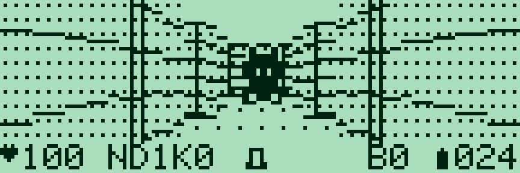

# Pocket Depths — 0.3.0

[Français](#francais) · [English](#english) · [Collection](../../README.md)

<a id="francais"></a>

## Français

FPS d’exploration par cases en assembleur Z80 pour **PC-G801 / PC-G805 / PC-G850**. Sécuriser une base de **trois étages**, avec salles à colonnes, couloirs, portes et deux types de gardes. À chaque étage : récupérer la clé, activer deux balises et atteindre la sortie. Les ennemis deviennent plus résistants au fil de la campagne.


### Télécharger et charger

| Édition | Français | English | Réservation |
|---|---|---|---|
| G801/G805 Lite | [IHX FR](build/g80x/depths_lite_FR.ihx) | [IHX EN](build/g80x/depths_lite_EN.ihx) | `USER17E2` |
| G805 complète | [IHX FR](build/g80x/depths_FR.ihx) | [IHX EN](build/g80x/depths_EN.ihx) | `USER19FF` |
| G850 native | [IHX FR](build/g850/depths_g850_FR.ihx) | [IHX EN](build/g850/depths_g850_EN.ihx) | `USER1EFF` |

La Lite conserve **toutes les règles de combat et les trois étages**, avec une disposition fixe, des monstres proches plus petits et sans décor de sol. Elle tient dans les **5 859 octets disponibles du G801**, sans extension. La complète et la native G850 disposent de **255 dispositions modulaires** ; la disposition évolue entre étages. Le G850 utilise une vue **144 × 40 pixels**, 48 rayons et des monstres proches jusqu’à 21 × 30 pixels ; le G80X conserve ses 120 × 28 pixels à cellules et 40 rayons. Tailles et adresses exactes dans les manifestes de chaque dossier `build/`.

Avec [Sharp PC-G Link](https://github.com/pR-0000/Sharp-PC-G-Link), sélectionner le modèle exact. Accorder les réglages dans **TEXT → Sio → Format** et sur le PC : **4800 / 8N1 / RS/CS / CR LF / EOF 1A** conseillés. Sauvegarder les programmes à conserver. Depuis BASIC RUN : **MON**, la commande **USER** du tableau, puis **R**, avec ENTRÉE après chaque commande. Envoyer le fichier IHX avec **Envoyer ASM**, attendre la fin sur le Sharp, puis saisir **G100**. **CALL &H100** fonctionne aussi depuis BASIC après chargement. [Guide détaillé](../../docs/LOADING.md).

### Commandes

| Touche | Action |
|---|---|
| ENTRÉE / ESPACE au titre | Commencer |
| ↑ / ↓ | Avancer / reculer |
| ← / → | Tourner de 90° |
| , / ; ou A / D | Pas latéral gauche / droite |
| ESPACE | Tirer / frapper |
| 1 | Couteau : contact, 1 dégât, sans munition |
| 2 | Pistolet : dans l’axe, 1 dégât, 1 munition |
| 3 | Fusil : jusqu’à trois cases, cône ±1 case, 3 dégâts, 2 munitions |
| **X** | Garde pour ce tour : dégâts divisés par deux |
| E | Ouvrir la porte devant soi avec la clé |
| M | Aide et objectifs ; une touche revient |
| ENTRÉE après une sortie | Étage suivant ; nouvelle campagne après le troisième |
| R | Recommencer la campagne |
| N, hors Lite | Nouvelle disposition et nouvelle campagne |
| Q / BREAK | Retour à l’appelant |

Relâcher les touches entre les actions. Une rotation, un déplacement réussi, une porte ouverte, la garde ou un tir font avancer les ennemis. L’aide, le changement d’arme, une collision contre un mur ou un tir sans munition ne leur donnent pas de tour. Le jeu attend vos actions : le laisser immobile permet de prendre une photo en plein combat.

### Combat et progression

Les gardes frappent au contact ; les monstres cornus tirent dans un axe dégagé. Le **!** annonce une attaque au tour suivant. Les murs et colonnes bloquent les tirs. Se décaler, prendre un couvert ou utiliser **X** permet de répondre à la menace. Un tir réussi interrompt l’attaque préparée ; le **fusil repousse également un survivant d’une case**, sauf si un obstacle ou un autre ennemi bloque le recul.

Chaque étage commence à **100 PV et 24 munitions**. Une boîte ajoute 12 munitions ; un soin rend 25 PV. Chaque balise activée donne aussi **15 PV et 6 munitions**, une seule fois. Plafonds : 100 PV et 99 munitions. À chaque étage, les ennemis gagnent un PV supplémentaire. Les trois armes restent disponibles dès le départ ; aucune sauvegarde de campagne.

Le panneau du bas affiche **cœur + PV**, **N/E/S/O**, **E** et l’étage, **C** et l’état de la clé, arme, **X** pendant la garde, **B** et le nombre de balises, puis **balle + munitions**. Lettres et chiffres utilisent la police Sharp. Le cœur clignote après un dégât ; le bref négatif du décor est logiciel, sans modifier le contraste LCD. [Explication](docs/CONTRAST.md).

Les niveaux de 16 × 16 assemblent quatre modules de 7 × 7 : salle à colonnes, croisement de couloirs, pièce compartimentée et alcôves. Les passages coïncident et les objectifs restent accessibles. **R** reprend la disposition initiale de la campagne ; **N** choisit une autre graine. La Lite garde sa carte fixe avec la même progression de résistance des ennemis.

### Modifier et reconstruire

- `depths.asm` : règles communes, campagne, garde, armes et ennemis.
- `level_chunks.py` / `level.asm` : modules, objets, référence Python et générateur Z80 ; carte compacte Lite.
- `render.asm` / `interface.asm` : perspective par rayons précalculés, masquage, effets et panneau.
- `sprites.bmp` : atlas éditable **7 × 63**, sept motifs de **7 × 9** empilés, noir/blanc, BMP 24 bits non compressé. Ordre dans `sprites.json` ; noir = point allumé. Le constructeur préserve le fichier et adapte les échelles à chaque écran.
- `generated.inc` / `targets/g850/generated.inc` : tables produites par `build_depths.py`. Les bandes entièrement vides des sprites ne sont pas stockées.

```text
python games/pocket-depths/build_depths.py --lang fr --assembler "sjasmplus.exe"
python games/pocket-depths/check_depths.py --lang fr
python games/pocket-depths/check_g850.py --lang fr
python tools/play_depths.py --lang fr --model PC-G850 --emulator "g800.exe"
```

Python 3.10+ et SjASMPlus suffisent pour construire les **six binaires FR/EN**. `--target g80x` ou `--target g850` limite la cible. Vérifications CPU : `tests/requirements.txt`. g800 s’installe séparément et fonctionne ici sans ROM ; `--lite` lance le profil G801, `--model PC-G805` la complète. Les sources et les règles sont communes aux éditions.

---

<a id="english"></a>

## English

A grid-based Z80 exploration FPS for **PC-G801 / PC-G805 / PC-G850**. Secure a base across **three floors**, with pillared halls, corridors, doors and two guard types. On each floor, collect the key, activate both beacons and reach the exit. Enemies become tougher as the campaign progresses.



### Download and load

| Edition | French | English | Reservation |
|---|---|---|---|
| G801/G805 Lite | [FR IHX](build/g80x/depths_lite_FR.ihx) | [EN IHX](build/g80x/depths_lite_EN.ihx) | `USER17E2` |
| G805 Full | [FR IHX](build/g80x/depths_FR.ihx) | [EN IHX](build/g80x/depths_EN.ihx) | `USER19FF` |
| G850 Native | [FR IHX](build/g850/depths_g850_FR.ihx) | [EN IHX](build/g850/depths_g850_EN.ihx) | `USER1EFF` |

Lite keeps **all combat rules and three floors**, using a fixed layout, smaller close-range monsters and no floor scenery. It fits within the G801’s **5,859-byte budget**, without expansion. Full and G850 offer **255 modular layouts**, changing between floors. G850 uses a **144 × 40 viewport**, 48 rays and close monsters up to 21 × 30 pixels; G80X keeps its 120 × 28 cell display and 40 rays. Each `build/` manifest lists exact sizes and addresses.

Use [Sharp PC-G Link](https://github.com/pR-0000/Sharp-PC-G-Link), select the actual model and match the PC settings to **TEXT → Sio → Format**: **4800 / 8N1 / RS/CS / CR LF / EOF 1A** recommended. Back up programs you want to keep. From BASIC RUN: **MON**, the table’s **USER** command, then **R**, pressing ENTER after each. Send the IHX file with **Send ASM**, wait for reception to finish on the Sharp, then enter **G100**. **CALL &H100** also works from BASIC after loading. [Detailed guide](../../docs/LOADING_EN.md).

### Controls

| Key | Action |
|---|---|
| ENTER / SPACE on title | Start |
| ↑ / ↓ | Forward / backward |
| ← / → | Turn 90° |
| , / ; or A / D | Strafe left / right |
| SPACE | Shoot / strike |
| 1 | Knife: contact, 1 damage, no ammunition |
| 2 | Pistol: straight ahead, 1 damage, 1 ammunition |
| 3 | Shotgun: up to three cells, ±1-cell cone, 3 damage, 2 ammunition |
| **X** | Guard for this turn: incoming damage halved |
| E | Open the door ahead with the key |
| M | Help and objectives; any key returns |
| ENTER after an exit | Next floor; new campaign after floor three |
| R | Restart campaign |
| N, except Lite | New layout and campaign |
| Q / BREAK | Return to caller |

Release keys between actions. Turning, successful movement, opening a door, guarding or firing advances enemies. Help, weapon changes, blocked movement and empty shots do not. The game waits for your actions: leave it idle to take a photo during combat.

### Combat and progression

Guards attack at contact; horned monsters fire along a clear axis. A **!** warns of an attack on the next turn. Walls and pillars block shots. Strafe, use cover or press **X** to respond. A successful hit interrupts a prepared attack; a **shotgun also pushes a surviving target back one cell**, unless a wall or another enemy blocks it.

Each floor starts at **100 health and 24 ammunition**. Ammo boxes give 12 rounds and healing gives 25 health. Each activated beacon also supplies **15 health and 6 rounds**, once. Caps are 100 health and 99 ammunition. Enemies gain one extra hit point on each subsequent floor. All three weapons are available from the start; there is no campaign save.

The bottom HUD shows **heart + health**, **N/E/S/W**, **D** and floor number, **K** and key state, weapon, **X** while guarding, **B** and beacon count, then **bullet + ammunition**. Letters and numbers use the Sharp font. The heart blinks after damage; the brief inverted scenery is a software effect, without changing LCD contrast. [Explanation](docs/CONTRAST_EN.md).

Each 16 × 16 level combines four 7 × 7 modules: pillared hall, corridor crossing, divided room and alcoves. Doorways align and objectives remain reachable. **R** reuses the campaign’s starting layout; **N** selects another seed. Lite keeps its fixed map and the same enemy-health progression.

### Edit and build

- `depths.asm`: shared campaign, guard, weapons and enemies.
- `level_chunks.py` / `level.asm`: modules, objects, Python reference and Z80 generator; packed Lite map.
- `render.asm` / `interface.asm`: precomputed-ray perspective, occlusion, effects and HUD.
- `sprites.bmp`: editable **7 × 63** atlas, seven stacked **7 × 9** black/white patterns, uncompressed 24-bit BMP. Order in `sprites.json`; black means a lit pixel. The builder preserves it and scales graphics for each screen.
- `generated.inc` / `targets/g850/generated.inc`: tables produced by `build_depths.py`. Entirely empty sprite bands are omitted from storage.

```text
python games/pocket-depths/build_depths.py --lang en --assembler "sjasmplus.exe"
python games/pocket-depths/check_depths.py --lang en
python games/pocket-depths/check_g850.py --lang en
python tools/play_depths.py --lang en --model PC-G850 --emulator "g800.exe"
```

Python 3.10+ and SjASMPlus build all **six FR/EN binaries**. Use `--target g80x` or `--target g850` to select one family. CPU checks use `tests/requirements.txt`. g800 is installed separately and needs no ROM here; `--lite` selects G801, `--model PC-G805` Full. Sources and rules are shared across editions.
