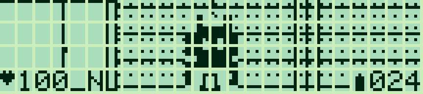
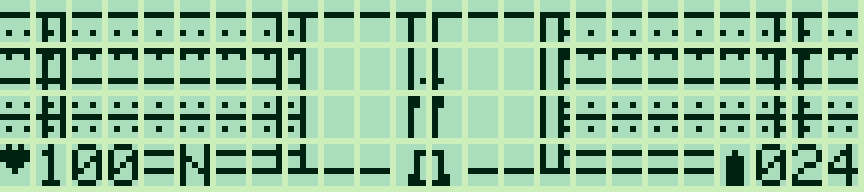
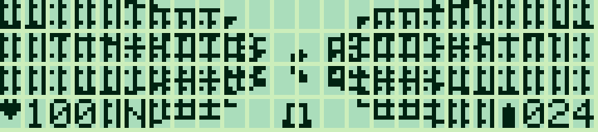

# Pocket Depths — 0.2.2

[Français](#francais) · [English](#english)

<a id="francais"></a>

## Français

[Collection](../../README.md#francais)

FPS d'exploration en **assembleur Z80** : salle à colonnes, couloirs, petites pièces, alcôves, portes, deux types de monstres, trois armes, soins et munitions. Récupérer la clé, activer les deux balises et rejoindre la sortie.

| Salle et orientation | Rencontre rapprochée |
|---|---|
|  |  |

Captures LCD : **g800**.

### Portes — 0.2.2

Les portes ont désormais un encadrement continu, une séparation entre les deux battants et une poignée. Leurs panneaux sont distincts de la texture en briques des murs, dans les éditions complète et Lite. Le comportement des clés, de l’ouverture et de la sortie est conservé.



### Deux éditions

| Édition | Cible | FR / EN | Carte | Réservation |
|---|---|---|---|---|
| Complète | PC-G805 | 6 295 / 6 286 octets | Modules pseudo-aléatoires, N change le niveau | `USER19FF` |
| Lite | PC-G801, aussi G805 | 5 818 / 5 805 octets | Une carte fixe avec les quatre types de modules | `USER17E2` |

La Lite garde les objectifs, les quatre monstres, les trois armes, l'orientation, les commandes et le signal de dégâts. Elle réduit les deux grandes silhouettes à 9 × 14 au lieu de 15 × 21, et retire les points du sol. Les tables d'orientation et motifs en double ont été supprimés dans les deux éditions. La Lite tient sous **17E2h**, code, variables et tampon inclus. Elle ne demande pas d'extension RAM.



### Charger et lancer

Dans le [dépôt Sharp-PC-G-Link](https://github.com/pR-0000/Sharp-PC-G-Link), choisir le modèle réel et régler les deux côtés en **4800 / 8N1 / RS/CS / CR LF / EOF 1A**. Sauvegarder les programmes à conserver : charger à 0100h remplace Quest et sa sauvegarde RAM.

Depuis BASIC RUN : `MON`, puis **`USER19FF` pour la complète**, ou **`USER17E2` pour la Lite**, puis `R`, chaque commande suivie d'ENTER. Envoyer le HEX avec **Assembleur → Envoyer ASM** :

- Complète : [FR](build/depths_FR.hex) · [EN](build/depths_EN.hex).
- Lite : [FR](build/depths_lite_FR.hex) · [EN](build/depths_lite_EN.hex).

Après réception : **`G100`**. Les BIN correspondants utilisent chargement/entrée **0100**. Depuis BASIC, après chargement et réservation, **`CALL &H100`** convient aussi. Le jeu conserve la pile et BC, DE, HL, IX, IY, puis revient par RET. Voir [chargement](../../docs/LOADING.md) et [lancement BASIC](../../docs/BASIC_CALL.md).

### Commandes

| Touche | Action |
|---|---|
| ENTER / ESPACE au titre | Commencer |
| ↑ / ↓ | Avancer / reculer |
| ← / → | Tourner de 90° |
| **, / ;** ou A / D | Pas latéral gauche / droite |
| ESPACE | Tirer ou frapper |
| 1 | Couteau : contact, 1 dégât, sans munition |
| 2 | Pistolet : cible dans l'axe, 1 dégât, 1 munition |
| 3 | Fusil : cible la plus proche jusqu'à trois cases, cône ±1 case, 3 dégâts, 2 munitions |
| E | Ouvrir la porte devant soi avec la clé |
| M | Aide et état des objectifs ; une touche revient |
| R | Recommencer **la même disposition** |
| N, complète uniquement | Nouvelle disposition et nouvelle partie |
| Q / BREAK | Retour à l'appelant |

Relâcher la touche entre les actions. Une rotation, un déplacement réussi, une porte ouverte ou un tir font avancer les ennemis. Aide, changement d'arme, collision et tir sans munition ne leur donnent pas de tour.

Le bas de l'écran affiche **cœur + PV**, **N/E/S/O**, arme et **balle + munitions** avec les chiffres de la ROM Sharp. Les murs proches restent texturés, même lorsque leurs bords sortent du champ. Un dégât provoque un bref négatif logiciel du décor ; le panneau reste lisible. Le réglage de contraste matériel n'est pas modifié : [explication et sources](docs/CONTRAST.md).

### Labyrinthe et combats

Le donjon de **16 × 16** assemble quatre modules de **7 × 7**, entourés d'une bordure. Leurs passages nord/sud/est/ouest coïncident : salle à quatre colonnes, croisement de couloirs, petite salle compartimentée et alcôves. Le départ est une salle à colonnes dans la disposition initiale, commune aux deux éditions.

La complète emploie un générateur pseudo-aléatoire de 8 bits : **255 dispositions distinctes**. N mélange l'état avec le temps passé à lire les touches. Ce n'est pas une génération libre case par case : la connectivité vient des modules compatibles. Les objectifs et rencontres gardent leurs emplacements, tandis que les obstacles et couverts changent. R réutilise la graine courante. La Lite conserve la disposition initiale.

La clé est accessible avant toute porte ; les deux balises et la sortie restent accessibles après récupération de la clé. Une porte se commande avec E ; une balise s'active en marchant dessus. M montre l'état de la clé et le nombre de balises.

Le héros commence à **100 PV / 24 munitions**. Une boîte ajoute 12 munitions (maximum 99), un soin rend 25 PV (maximum 100). Un **!** annonce une attaque : les gardes frappent au contact, les monstres cornus tirent dans un axe dégagé. Les murs et colonnes bloquent les tirs. Les ennemis approchent une action sur deux. Pas de sauvegarde de campagne ; R ou N réinitialisent la partie.

### Modifier et reconstruire

- `depths.asm` : commandes, déplacements, armes, ennemis et objectifs.
- `level_chunks.py` : quatre modules éditables, objets, positions et référence du générateur.
- `level.asm` : génération Z80 ; décompression de la carte fixe Lite.
- `render.asm` : quarante rayons, bandes de trois colonnes, texture, masquage et effet de dégâts.
- `interface.asm` : textes, chiffres Sharp et orientation.
- `sprites.bmp` : atlas éditable **7 × 63**, sept motifs **7 × 9** empilés, noir/blanc, BMP 24 bits non compressé. Noir = point allumé ; ordre dans `sprites.json`.
- `build_depths.py` / `generated.inc` : tables et assemblage ; le BMP existant est conservé.

Le rendu utilise **120 × 28 points utiles** dans 24 × 4 cellules 5 × 7, avec les interstices réels du LCD. Visibilité jusqu'à sept cases. Depuis la racine avec Python 3.10+ et SjASMPlus :

```text
python games/pocket-depths/build_depths.py --lang fr --assembler "chemin/vers/sjasmplus.exe"
python -m pip install -r tests/requirements.txt
python games/pocket-depths/check_depths.py --lang fr
python tools/play_depths.py --lang fr --lite --emulator "chemin/vers/g800.exe"
```

Le constructeur produit les quatre binaires FR/EN, complète/Lite. L'assemblage ne demande aucune bibliothèque d'image. Retirer `--lite` pour le profil G805.

Depuis la version 0.2.1, le **cœur clignote deux fois à chaque coup reçu**, dans les éditions complète et Lite. Les chiffres des PV restent visibles. Cet effet est dessiné par le jeu, sans commande de contraste LCD.

---

<a id="english"></a>

## English

[Collection](../../README.md#english)

An exploration shooter in **Z80 assembly**: pillared hall, corridors, small rooms, alcoves, doors, two monster types, three weapons, healing and ammunition. Find the key, activate both beacons and reach the exit.

| Hall and compass | Close encounter |
|---|---|
|  |  |

LCD screenshots: **g800**.

### Doors — 0.2.2

Doors now have a continuous frame, a central leaf separation and a handle. Their panels are distinct from the brick walls in both full and Lite builds. Keys, opening and exit behaviour are retained.


### Two editions

| Edition | Target | FR / EN | Map | Reservation |
|---|---|---|---|---|
| Full | PC-G805 | 6,295 / 6,286 bytes | Pseudorandom modules; N changes the level | `USER19FF` |
| Lite | PC-G801, also G805 | 5,818 / 5,805 bytes | One fixed map using all four module types | `USER17E2` |

Lite retains objectives, four monsters, three weapons, compass, controls and damage feedback. The two largest silhouettes shrink to 9 × 14 from 15 × 21; floor dots are omitted. Orientation tables and duplicate graphics are removed in both editions. Lite fits below **17E2h**, including code, state and buffer. It does not require a RAM expansion.


### Load and run

In the separate [Sharp-PC-G-Link repository](https://github.com/pR-0000/Sharp-PC-G-Link), select the actual model and match **4800 / 8N1 / RS/CS / CR LF / EOF 1A** on both sides. Back up anything important: loading at 0100h replaces Quest and its RAM save.

From BASIC RUN: `MON`, **`USER19FF` for Full**, or **`USER17E2` for Lite**, then `R`, each followed by ENTER. Send the HEX using **Assembler → Send ASM**:

- Full: [FR](build/depths_FR.hex) · [EN](build/depths_EN.hex).
- Lite: [FR](build/depths_lite_FR.hex) · [EN](build/depths_lite_EN.hex).

After reception: **`G100`**. Matching BIN files use load/entry address **0100**. After loading and reserving memory, BASIC can use **`CALL &H100`**. The game preserves the caller's stack and BC, DE, HL, IX, IY, then returns with RET. See [loading](../../docs/LOADING_EN.md) and [BASIC launch](../../docs/BASIC_CALL_EN.md).

### Controls

| Key | Action |
|---|---|
| ENTER / SPACE at title | Start |
| ↑ / ↓ | Forward / backward |
| ← / → | Turn 90° |
| **, / ;** or A / D | Strafe left / right |
| SPACE | Fire / strike |
| 1 | Knife: contact, 1 damage, no ammunition |
| 2 | Pistol: target straight ahead, 1 damage, 1 round |
| 3 | Shotgun: nearest target up to three cells away, ±1-cell cone, 3 damage, 2 rounds |
| E | Open the door ahead with the key |
| M | Help and objectives; any key returns |
| R | Restart **the same layout** |
| N, Full only | Generate another layout and restart |
| Q / BREAK | Return to caller |

Release keys between actions. Turning, a successful move, opening a door or firing advances enemies. Help, changing weapons, bumping a wall and dry firing do not.

The bottom panel shows **heart + HP**, **N/E/S/W**, weapon and **bullet + ammunition** using Sharp ROM digits. Nearby walls remain textured even when their edges leave the viewport. Damage briefly inverts the scene in software while keeping the HUD readable. Hardware contrast is unchanged: [explanation and sources](docs/CONTRAST_EN.md).

### Dungeon and combat

The **16 × 16** dungeon combines four **7 × 7** modules within a border. Matching doorways join a four-pillar hall, crossing corridors, a partitioned room and alcoves. The initial layout starts in a pillared hall and is shared by both editions.

Full uses an 8-bit pseudorandom generator with **255 distinct layouts**. N mixes its state with keyboard-poll timing. This is modular generation: connectivity comes from compatible entrances. Objectives and encounters retain their locations while obstacles and cover change. R reuses the current seed. Lite retains the initial layout.

The key is reachable before any door; both beacons and the exit are reachable once it is collected. E opens a door; walking onto a beacon activates it. M shows key and beacon progress.

The player starts with **100 HP / 24 rounds**. Ammo adds 12 (maximum 99), healing adds 25 HP (maximum 100). **!** warns of an attack: guards hit at contact range, horned monsters fire along a clear axis. Walls and pillars block shots. Approaching enemies move every other action. No campaign save; R or N resets the run.

### Edit and rebuild

- `depths.asm`: input, movement, weapons, enemies and objectives.
- `level_chunks.py`: four editable modules, objects, positions and generator reference.
- `level.asm`: Z80 generation; fixed Lite map decompression.
- `render.asm`: forty rays, three-column strips, textures, clipping and damage feedback.
- `interface.asm`: text, Sharp digits and compass.
- `sprites.bmp`: editable **7 × 63** atlas, seven stacked **7 × 9** shapes, black/white, uncompressed 24-bit BMP. Black = lit pixel; order in `sprites.json`.
- `build_depths.py` / `generated.inc`: tables and assembly; preserves the existing BMP.

Rendering uses **120 × 28 useful pixels** in 24 × 4 cells of 5 × 7, retaining physical LCD gaps. Visibility extends seven cells ahead. From the repository root with Python 3.10+ and SjASMPlus:

```text
python games/pocket-depths/build_depths.py --lang en --assembler "path/to/sjasmplus.exe"
python -m pip install -r tests/requirements.txt
python games/pocket-depths/check_depths.py --lang en
python tools/play_depths.py --lang en --lite --emulator "path/to/g800.exe"
```

The builder creates all four FR/EN, Full/Lite binaries. Building needs no image library. Omit `--lite` for the G805 profile.

Since version 0.2.1, the **heart blinks twice after each hit**, in both full and Lite editions. Health digits remain visible. The game draws this effect without LCD contrast commands.
