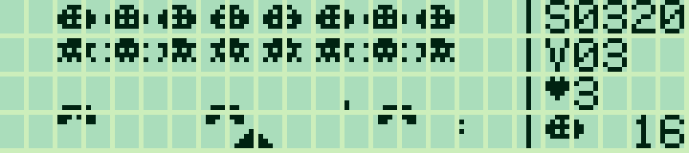
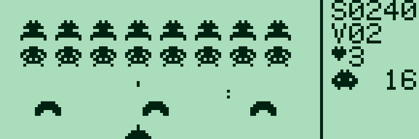
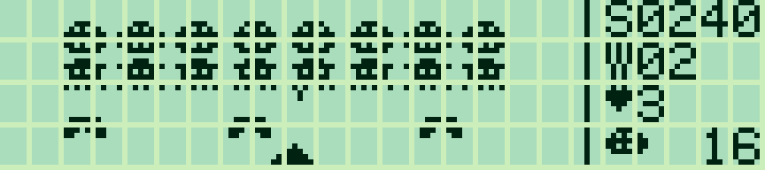
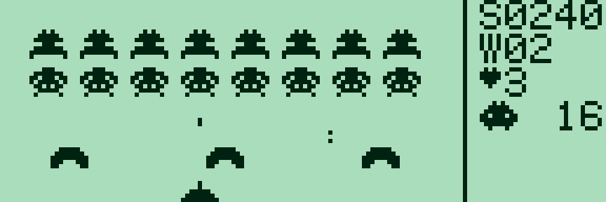

# Pocket Invaders 0.3.0

[Français](#francais) · [English](#english)

<a id="francais"></a>

## Français

[Collection](../../README.md#francais)

Un jeu d’arcade original en assembleur Z80 pour **Sharp PC-G801 / PC-G805 et PC-G850** : deux rangées de huit envahisseurs animés, projectiles au pixel, trois abris destructibles et vagues successives. Les ennemis accélèrent lorsque leur nombre diminue. Trois vies, protection temporaire après un coup, explosions et record conservé tant que le programme reste en RAM.



Captures LCD : **g800**.

### Versions par machine

| Machine | Fenêtre | Français | English | Réservation |
|---|---|---|---|---|
| PC-G801 / PC-G805 | 90 × 28, aliens 7 × 5 | [G80X FR](build/g80x/invaders_FR.ihx) | [G80X EN](build/g80x/invaders_EN.ihx) | `USER0BFF` |
| PC-G850 | 108 × 48, aliens 9 × 7 | [G850 FR](build/g850/invaders_g850_FR.ihx) | [G850 EN](build/g850/invaders_g850_EN.ihx) | `USER0DFF` |

G850 : **3 223 / 3 206 octets** FR/EN. La version G850 utilise toute la hauteur, des abris agrandis et des commandes simultanées : direction + ESPACE/ENTER. Le panneau reste à droite. TAB fige l’image sans ajouter de texte pour une photo ; TAB reprend. Les règles, vagues et scores restent communs.



### Charger sur le Sharp

[Français — IHX](build/g80x/invaders_FR.ihx) · [English — IHX](build/g80x/invaders_EN.ihx) · [Français — BIN](build/g80x/invaders_FR.bin) · [English — BIN](build/g80x/invaders_EN.bin)

1. Sauvegarder les programmes à conserver. Régler **TEXT → Sio → Format** sur **4800 / 8N1, RS/CS, CR LF, EOF 1A**, puis ENTER. Choisir les mêmes valeurs dans Sharp PC-G Link.
2. Depuis BASIC/RUN : **MON → USER0BFF (G80X) ou USER0DFF (G850) → R**, chaque commande suivie d’ENTER.
3. Sélectionner le fichier IHX dans **Envoyer ASM**, attendre la fin du transfert, puis saisir **G100** sur le Sharp.

Après réservation et chargement, **CALL &H100** depuis BASIC lance aussi le jeu. Le binaire FR occupe **2 666 octets**, l’anglais **2 653 octets** ; ils tiennent dans la mémoire du G801 sans extension. Ils remplacent le précédent programme à 0100h.

### Commandes et règles

| Touche | Action |
|---|---|
| ENTER / ESPACE à l’accueil | Commencer |
| ← / → ou A / D | Déplacer le vaisseau ; maintenir pour continuer |
| ESPACE / ENTER en jeu | Tirer ; maintenir pour répéter |
| F | Activer/désactiver le tir automatique ; indicateur A dans le panneau |
| TAB, G850 | Figer / reprendre une image propre pour une photo |
| P | Pause / reprise |
| M | Aide / retour |
| R | Recommencer ; conserver le record |
| Q / BREAK | Quitter vers l’appelant |

Sur G80X, le clavier renvoie une touche à la fois : le tir automatique permet de se déplacer en continu tout en tirant. Les tirs amis et ennemis endommagent les abris ; ceux-ci sont réparés à la vague suivante. Chaque ennemi vaut **10 points**. Le score est plafonné à **9 999**, le compteur de vagues à **99**. Si les envahisseurs atteignent la ligne du vaisseau ou si les trois vies sont perdues, la partie se termine. Le score utilise les chiffres classiques de la ROM Sharp ; le cœur et les sprites sont dessinés par le jeu.

### Construire et essayer dans g800

```text
python games/pocket-invaders/build_invaders.py --lang fr --assembler "chemin/vers/sjasmplus.exe"
```

La construction génère les deux cibles ; `--target g850` ou `--target g80x` limite la cible. Le lanceur accepte `--model PC-G850`. Les fichiers G850 sont dans `build/g850/`.

Sources : [invaders.asm](invaders.asm) et [render.asm](render.asm). Le constructeur utilise Python standard et SjASMPlus ; les tests seulement nécessitent `z80==1.2.0`. Aucun émulateur ni ROM n’est distribué.

© 2026 P.RAIMBAULT — [licence MIT](../../LICENSE.txt). Code et graphismes originaux ; aucune ressource d’un jeu commercial n’est incorporée.

---

<a id="english"></a>

## English

[Collection](../../README.md#english)

An original Z80 arcade game for **Sharp PC-G801 / PC-G805 and PC-G850**: two rows of eight animated invaders, pixel projectiles, three destructible shields and successive waves. Enemies speed up as fewer remain. Three lives, brief protection after a hit, explosions and a best score retained while the program stays in RAM.



LCD screenshots: **g800**.

### Builds by machine

| Machine | Viewport | Français | English | Reservation |
|---|---|---|---|---|
| PC-G801 / PC-G805 | 90 × 28, 7 × 5 aliens | [G80X FR](build/g80x/invaders_FR.ihx) | [G80X EN](build/g80x/invaders_EN.ihx) | `USER0BFF` |
| PC-G850 | 108 × 48, 9 × 7 aliens | [G850 FR](build/g850/invaders_g850_FR.ihx) | [G850 EN](build/g850/invaders_g850_EN.ihx) | `USER0DFF` |

G850: **3,223 / 3,206 bytes** FR/EN. The G850 build uses the entire height, larger shields and simultaneous direction + SPACE/ENTER controls. Counters stay on the right. TAB freezes a clean frame for photos; TAB resumes. Rules, waves and scoring are shared.



### Load on Sharp

[French — IHX](build/g80x/invaders_FR.ihx) · [English — IHX](build/g80x/invaders_EN.ihx) · [French — BIN](build/g80x/invaders_FR.bin) · [English — BIN](build/g80x/invaders_EN.bin)

1. Back up programs you want to keep. Set **TEXT → Sio → Format** to **4800 / 8N1, RS/CS, CR LF, EOF 1A**, then ENTER. Use matching settings in Sharp PC-G Link.
2. From BASIC/RUN: **MON → USER0BFF (G80X) or USER0DFF (G850) → R**, confirming each command with ENTER.
3. Select the IHX file using **Send ASM**, wait for transfer to finish, then run **G100** on Sharp.

After reservation and loading, **CALL &H100** from BASIC also starts the game. French occupies **2,666 bytes**, English **2,653 bytes**; both fit an unexpanded G801. Loading replaces the previous program at 0100h.

### Controls and rules

| Key | Action |
|---|---|
| ENTER / SPACE on title screen | Start |
| ← / → or A / D | Move; hold to continue |
| SPACE / ENTER in game | Fire; hold to repeat |
| F | Toggle automatic fire; A indicator in HUD |
| TAB, G850 | Freeze / resume a clean frame for photos |
| P | Pause / resume |
| M | Help / return |
| R | Restart; retain best score |
| Q / BREAK | Return to caller |

On G80X the keyboard reports one key at a time: automatic fire lets you keep moving while shooting. Friendly and enemy shots damage shields, which are repaired between waves. Each alien earns **10 points**. Score caps at **9,999**, wave number at **99**. Reaching the ship line or losing all three lives ends the game. Score digits use Sharp’s standard ROM font; the heart and sprites are drawn by the game.

### Build and try in g800

```text
python games/pocket-invaders/build_invaders.py --lang en --assembler "path/to/sjasmplus.exe"
```

The build generates both targets; `--target g850` or `--target g80x` selects one. The launcher accepts `--model PC-G850`. G850 files are in `build/g850/`.

Sources: [invaders.asm](invaders.asm) and [render.asm](render.asm). Building needs standard Python and SjASMPlus; only tests require `z80==1.2.0`. No emulator or ROM is distributed.

© 2026 P.RAIMBAULT — [MIT license](../../LICENSE.txt). Original code and graphics; no commercial-game assets are incorporated.
