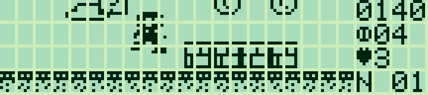
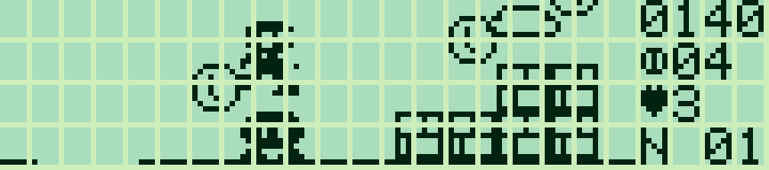
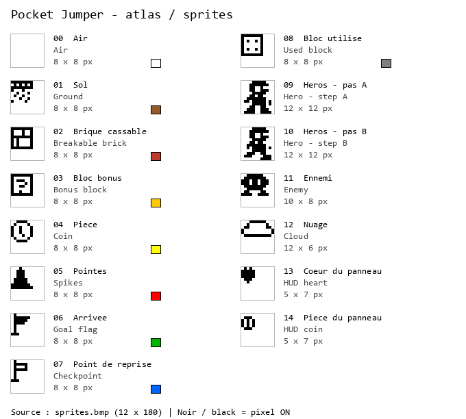
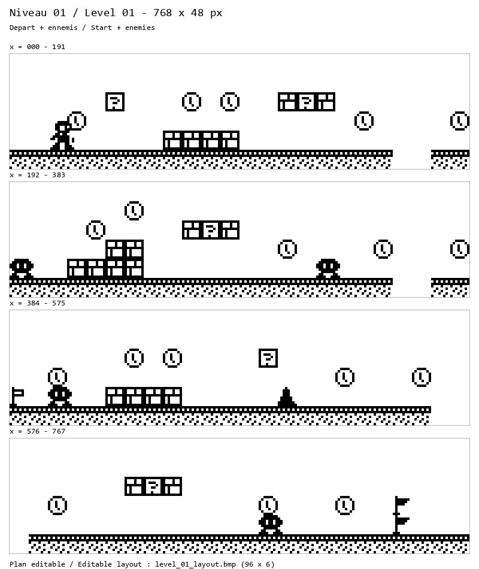

# Pocket Jumper — 0.1.1

[Français](#francais) · [English](#english)

<a id="francais"></a>

## Français

[Collection](../../README.md#francais)

Un premier jeu de plateformes original en Z80 pour Sharp PC-G801 / PC-G805. Atteindre le drapeau, ramasser les pièces, frapper les blocs bonus et sauter sur les ennemis. Un niveau de 768 × 48 points, trois vies et un point de reprise à mi-parcours.





Captures LCD : **g800**.

### Charger et jouer

[FR — HEX](build/jumper_FR.hex) · [EN — HEX](build/jumper_EN.hex) · [Manifest](build/manifest.json)

Régler TEXT → Sio → Format et Sharp PC-G Link à l’identique : **4800 / 8N1, RS/CS, CR LF, EOF 1A**. Sauvegarder les programmes utiles. Depuis BASIC RUN :

```text
MON
USER14FF
R
```

Envoyer le HEX avec **Envoyer ASM**, attendre la réception sur le Sharp, puis saisir **G100**. Après chargement, **CALL &H100** fonctionne aussi depuis BASIC. Français : **5 003 octets** ; anglais : **4 990 octets**, état, carte et tampon graphique de 480 octets inclus. Aucune extension RAM nécessaire.

### Commandes

| Touche | Action |
|---|---|
| ENTER | Commencer / nouvelle partie |
| ← / → | Marcher, accélérer et prendre de l’élan |
| SPACE / ↑ | Sauter en conservant l’élan |
| Z / X | Sauter directement à gauche / à droite |
| P | Pause |
| M | Aide ; une touche revient |
| R | Recommencer toute la partie |
| Q / BREAK | Revenir à l’appelant |

Maintenir **GAUCHE ou DROITE** et appuyer sur **ESPACE** pour sauter en continuant à se déplacer. **HAUT** fonctionne aussi simultanément avec une direction. Relâcher la touche de saut avant le saut suivant ; changer de direction en gardant ESPACE ne relance pas le saut. **Z/X** restent des raccourcis de saut directionnel. En l’air, GAUCHE/DROITE corrigent le déplacement. Sans touche, l’élan se conserve en vol et le héros ralentit au sol. Une courte mémorisation du saut et une tolérance au bord des plateformes facilitent les départs.

### Règles

Une pièce ou une brique cassée rapporte 10 points, un bloc bonus 50 points et une pièce, un ennemi écrasé 100 points et le drapeau final 500 points. Les blocs bonus utilisés restent solides. Pointes, trous et contact ennemi coûtent une vie. Après une perte, le héros revient au départ ou au point de reprise, avec une courte protection clignotante ; objets ramassés et score sont conservés. R réinitialise toute la partie avec trois vies. Le panneau de droite indique score, pièces, cœur/vies et niveau avec les chiffres classiques Sharp.

### Graphismes et sources

Le héros de 12 × 12 points et les ennemis de 10 × 8 se placent au pixel dans une fenêtre de **100 × 28 points**. La caméra défile horizontalement et suit les sauts verticalement. Le moteur compose les colonnes des sprites dans quatre bandes de sept bits avant envoi au LCD. Les interstices physiques du LCD restent visibles. Les positions utilisent la virgule fixe Q12.4 ; les collisions balayées au pixel empêchent de traverser les blocs fins. Ce prototype comprend un niveau fixe, sans son ni sauvegarde.

`input.asm`: lecture de la matrice clavier · `jumper.asm`: entrées et boucle du jeu · `physics.asm`: déplacements et collisions · `enemies.asm`: patrouilles et écrasement · `render.asm`: tampon de pixels et caméra · `assets.py`: niveau et graphismes originaux · `interface.asm`: FR/EN.

```text
python games/pocket-jumper/build_jumper.py --lang fr --assembler "chemin/vers/sjasmplus.exe"
python tools/play_jumper.py --lang fr --emulator "chemin/vers/g800.exe"
```

### Graphismes et niveau en BMP éditables

| Fichier | Usage |
|---|---|
| [sprites.bmp](sprites.bmp) | **Source éditable**, 12 × 180 pixels : quinze cellules de 12 × 12 empilées verticalement |
| [sprites_guide.bmp](sprites_guide.bmp) | Guide agrandi bilingue, dimensions et couleurs du plan |
| [level_01.bmp](level_01.bmp) | Terrain complet de **768 × 48 points** ; 96 × 6 cases de 8 × 8 |
| [level_01_entities.bmp](level_01_entities.bmp) | Carte complète avec héros au départ et ennemis, pour consultation |
| [level_01_layout.bmp](level_01_layout.bmp) | **Plan éditable**, 96 × 6 pixels : une couleur de la palette par case |
| [level_01.json](level_01.json) | Départ du héros et quatre patrouilles ennemies, en pixels du monde |





Modifier **sprites.bmp** à sa résolution d’origine, en noir et blanc purs, sans lissage. Chaque cellule commence en `(0,12×ID)` ; dessiner le motif en haut à gauche et conserver les marges inutilisées blanches. Respecter les dimensions de [sprites.json](sprites.json). Les images du héros tourné à gauche sont générées automatiquement. La reconstruction importe les modifications de ce BMP.

Pour modifier le niveau, utiliser **level_01_layout.bmp** et les neuf couleurs RVB exactes de `level_palette` dans `sprites.json`. Conserver ses dimensions de 96 × 6. Les motifs sont partagés entre toutes les cases du même type ; modifier l’atlas pour changer leur apparence.

Autre méthode : déplacer des blocs entiers de 8 × 8 dans une **copie** de `level_01.bmp`, puis importer explicitement cette copie. Ne pas dessiner le héros ou les ennemis dans cette carte de terrain :

```text
python games/pocket-jumper/asset_tool.py --lang fr --import-map "mon_niveau.bmp"
```

L’import remplace `level_01_layout.bmp` et exige que chaque bloc de 8 × 8 corresponde à un motif de terrain de l’atlas courant. Les motifs inconnus ou ambigus sont refusés avant l’écriture du plan. En conserver une copie avant import. Une reconstruction normale régénère `level_01.bmp` depuis le plan ; les modifications faites uniquement dans cet export visuel ne sont pas conservées.

```text
python games/pocket-jumper/asset_tool.py --lang fr --previews
python games/pocket-jumper/build_jumper.py --lang fr --assembler "chemin/vers/sjasmplus.exe"
```

La construction utilise Python standard et SjASMPlus. Seuls les aperçus agrandis demandent Pillow. Les BMP sources et le JSON du niveau sont conservés lors de la génération. Cette version comprend **un niveau** ; les quatre bandes ci-dessus sont des portions successives de cette même carte. Les nuages forment un arrière-plan défilant pendant le jeu, indépendant du terrain.

© 2026 P.RAIMBAULT — [MIT](../../LICENSE.txt). Code, niveau et graphismes originaux ; aucun élément graphique Nintendo.

---

<a id="english"></a>

## English

[Collection](../../README.md#english)

An original Z80 platformer prototype for Sharp PC-G801 / PC-G805. Reach the flag, collect coins, bump bonus blocks and stomp enemies. One 768 × 48 pixel level, three lives and a checkpoint halfway through.


LCD screenshots: **g800**.

### Load and play

[FR — HEX](build/jumper_FR.hex) · [EN — HEX](build/jumper_EN.hex) · [Manifest](build/manifest.json)

Match TEXT → Sio → Format and Sharp PC-G Link: **4800 / 8N1, RS/CS, CR LF, EOF 1A**. Back up existing programs. From BASIC RUN:

```text
MON
USER14FF
R
```

Send the HEX with **Send ASM**, wait for reception on the Sharp, then enter **G100**. After loading, **CALL &H100** also works from BASIC. French: **5,003 bytes**; English: **4,990 bytes**, including state, map and 480-byte framebuffer. No RAM expansion required.

### Controls

| Key | Action |
|---|---|
| ENTER | Start / new game |
| ← / → | Walk, accelerate and build momentum |
| SPACE / ↑ | Jump while preserving momentum |
| Z / X | Jump left / right directly |
| P | Pause |
| M | Help; any key returns |
| R | Restart the whole game |
| Q / BREAK | Return to caller |

Hold **LEFT or RIGHT**, then press **SPACE** to jump while moving. **UP** also works simultaneously with a direction. Release the jump key before the next jump; changing direction while holding SPACE does not start another jump. **Z/X** remain directional-jump shortcuts. LEFT/RIGHT adjust airborne movement. With no key, momentum continues in the air and ground friction slows the hero. A short jump buffer and coyote time make take-off more forgiving.

### Rules

Coins and broken bricks earn 10 points, bonus blocks 50 points and a coin, stomped enemies 100 points, and the final flag 500 points. Used bonus blocks remain solid. Spikes, pits and enemy contact cost one life. After a loss, the hero returns to the start or the checkpoint, with brief blinking protection; collected items and score remain. R starts over with all three lives. The right-hand HUD shows score, coins, heart/lives and level using standard Sharp digits.

### Graphics and sources

The 12 × 12 hero and 10 × 8 enemies are positioned at individual pixels in a **100 × 28** playfield. The camera scrolls horizontally and follows jumps vertically. A column blitter composes arbitrary sprite positions into four seven-bit bands before LCD upload. Physical LCD cell gaps remain visible. Positions use Q12.4 fixed point; per-pixel swept collision checks prevent crossing thin blocks. This prototype has one fixed level, no audio and no saved progress.

`input.asm`: matrix keyboard input · `jumper.asm`: input and game loop · `physics.asm`: movement and collisions · `enemies.asm`: patrols and stomps · `render.asm`: pixel buffer and camera · `assets.py`: level and original pixel art · `interface.asm`: FR/EN.

```text
python games/pocket-jumper/build_jumper.py --lang en --assembler "path/to/sjasmplus.exe"
python tools/play_jumper.py --lang en --emulator "path/to/g800.exe"
```

### Editable BMP graphics and level

| File | Use |
|---|---|
| [sprites.bmp](sprites.bmp) | **Editable source**, 12 × 180 pixels: fifteen 12 × 12 cells stacked vertically |
| [sprites_guide.bmp](sprites_guide.bmp) | Enlarged bilingual sprite guide, dimensions and map colours |
| [level_01.bmp](level_01.bmp) | Complete **768 × 48** terrain bitmap; 96 × 6 tiles of 8 × 8 pixels |
| [level_01_entities.bmp](level_01_entities.bmp) | Complete map with the starting hero and enemies, for reference |
| [level_01_layout.bmp](level_01_layout.bmp) | **Editable layout**, 96 × 6 pixels: one palette colour per tile |
| [level_01.json](level_01.json) | Hero start and four enemy patrols, using world-pixel coordinates |


Edit **sprites.bmp** at native resolution, in pure black and white, without smoothing. Each cell starts at `(0,12×ID)`; place the sprite at its top-left and keep unused margins white. Respect the sizes shown in [sprites.json](sprites.json). Mirrored hero frames are generated automatically. Changes to this BMP are imported during the next build.

To edit the level, use **level_01_layout.bmp** and the exact nine RGB colours listed under `level_palette` in `sprites.json`. Keep its 96 × 6 dimensions. Tile images are shared by all cells of that type; edit the atlas to change their appearance.

Alternatively, arrange whole 8 × 8 tiles in a **copy** of `level_01.bmp`, then explicitly import that copy. Do not add hero/enemy drawings to the terrain map:

```text
python games/pocket-jumper/asset_tool.py --lang en --import-map "my_level.bmp"
```

Import replaces `level_01_layout.bmp`; it requires every 8 × 8 block to match a terrain pattern in the current atlas. Unknown or ambiguous patterns are rejected before the layout is written. Back up your layout first. Normal builds regenerate `level_01.bmp` from the layout; edits made only to that visual export are not retained.

```text
python games/pocket-jumper/asset_tool.py --lang en --previews
python games/pocket-jumper/build_jumper.py --lang en --assembler "path/to/sjasmplus.exe"
```

The build uses standard Python and SjASMPlus. Only enlarged previews require Pillow. Source BMP files and the level JSON are preserved during generation. This version contains **one level**; the four strips above are consecutive portions of that same map. Clouds are a scrolling background generated during play and are separate from terrain.

© 2026 P.RAIMBAULT — [MIT](../../LICENSE.txt). Original code, level and graphics; no Nintendo assets.
