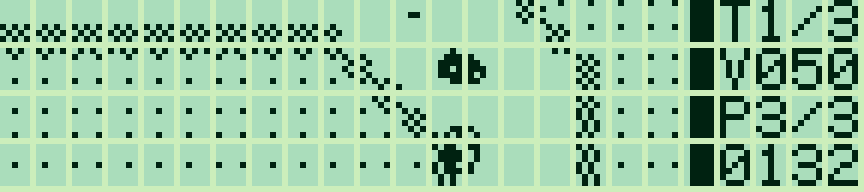
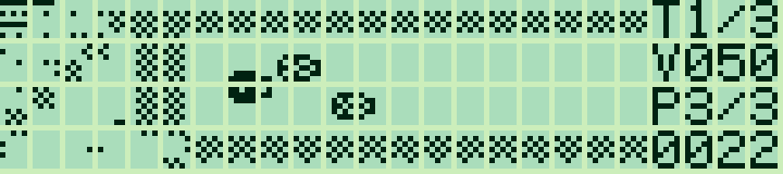
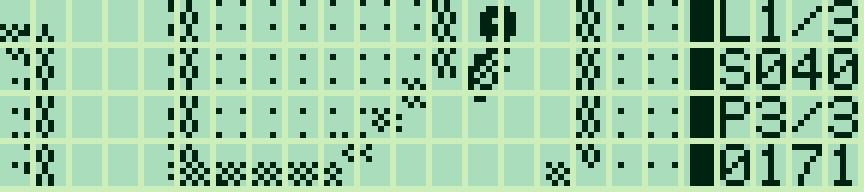
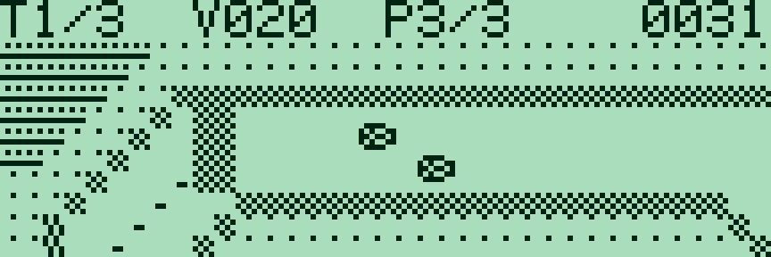
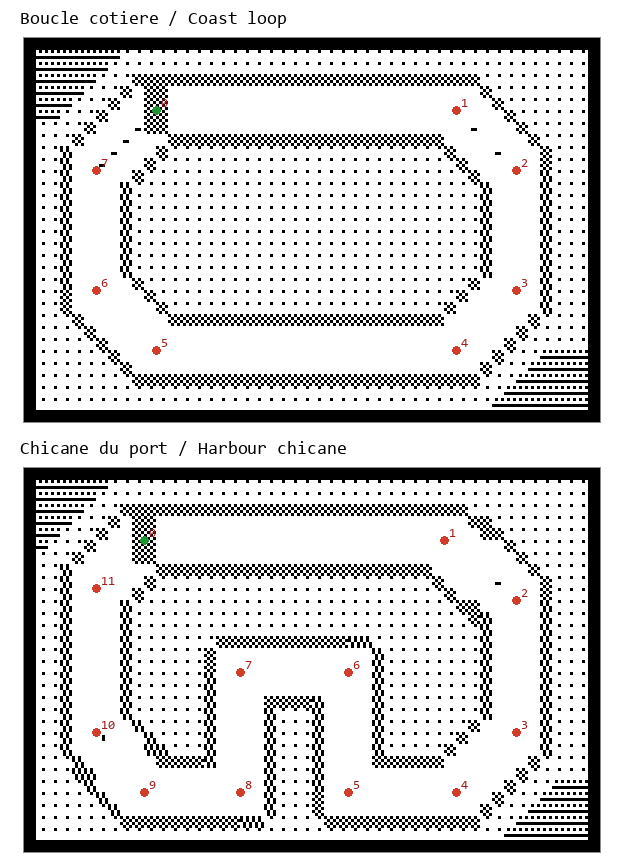
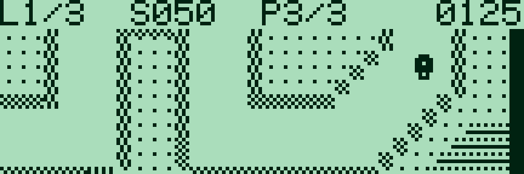

# Pocket Rally — 0.2.0

[Français](#francais) · [English](#english)

<a id="francais"></a>

## Français

Les animations G850 sont capturées dans g800, limitées au LCD ; leur cadence est indicative.

[Collection](../../README.md#francais)

Un jeu de course en assembleur Z80 pour Sharp PC-G801 / PC-G805 et PC-G850 : deux circuits originaux, deux adversaires, trois tours, seize orientations et défilement au pixel sur les deux axes. La voiture pleine est celle du joueur ; les adversaires sont dessinés en contour. Les sprites de 7 × 7 points et le décor épuré privilégient la lisibilité du LCD.

Le jeu s’inspire de **[Tiny CarZ de Léo Ducas](https://www.ticalc.org/archives/files/fileinfo/391/39185.html)**. Son code, ses graphismes et ses circuits sont originaux et propres au Sharp ; aucun élément de l’archive TI n’est inclus. Voir [les crédits](NOTICE.md).



| Départ | Chicane |
|---|---|
|  |  |

Captures LCD : **g800**. L’animation présente des images successives du rendu.

### Versions par machine

| Machine | Fenêtre de jeu | Français | English | Réservation |
|---|---|---|---|---|
| PC-G801 / PC-G805 | 100 × 28, panneau à droite | [G80X FR](build/g80x/rally_FR.ihx) | [G80X EN](build/g80x/rally_EN.ihx) | `USER17E2` |
| PC-G850 | 144 × 40, panneau au-dessus | [G850 FR](build/g850/rally_g850_FR.ihx) | [G850 EN](build/g850/rally_g850_EN.ihx) | `USER19FF` |

Le G850 conserve les **deux circuits**, les voitures 7 × 7, les règles et les commandes simultanées du G80X, avec une caméra et un tilemapper adaptés aux cinq bandes de huit pixels. Le défilement reste fluide **au pixel sur les deux axes**. Les compteurs utilisent la police native Sharp. **TAB** fige une image sans inscription pour les photos ; TAB reprend.



[Grille G850](docs/rally_g850_grid_g800.png) · [Circuit G850 en anglais](docs/rally_g850_en_g800.png). Tailles G850 FR/EN, tampons compris : **6 294 / 6 269 octets**. Dans Sharp PC-G Link, choisir PC-G850 et son fichier ; suivre le chargement ci-dessous avec **`USER19FF`**. Après réception : **`G100`**.

### Charger et lancer sur G801/G805

[Français — IHX](build/g80x/rally_FR.ihx) · [English — IHX](build/g80x/rally_EN.ihx) · [Tailles et SHA-256](build/g80x/manifest.json)

1. Sauvegarder les programmes utiles. Régler **TEXT → Sio → Format** et Sharp PC-G Link sur **4800 / 8N1, RS/CS, CR LF, EOF 1A**.
2. Depuis BASIC RUN, saisir **`MON`**, **`USER17E2`**, puis **`R`**, en validant chaque commande.
3. Envoyer `rally_FR.ihx` avec **Envoyer ASM**, puis attendre la réception sur le Sharp.
4. Saisir **`G100`**, puis ENTER au titre. Après chargement, **`CALL &H100`** fonctionne également depuis BASIC.

| Langue | Taille, état et tampons inclus | Réservation |
|---|---:|---|
| Français | 5 783 octets | `USER17E2` |
| Anglais | 5 762 octets | `USER17E2` |

Aucune extension RAM nécessaire. Origine et entrée : **0100h**. Charger un autre jeu remplace celui-ci. [Chargement et dépannage](../../docs/LOADING.md).

### Commandes

| Touche | Action |
|---|---|
| ENTER | Commencer / nouvelle course |
| N, au titre ou après l’arrivée | Choisir l’autre circuit |
| ← / → | Braquer à gauche / à droite, par rapport à la voiture |
| ↑ ou ESPACE | Accélérer ; maintenir avec ←/→ pour tourner en accélérant |
| ↓ ou Z | Freiner, y compris avec une direction maintenue |
| F | Activer/désactiver l’accélérateur automatique |
| TAB, G850 | Figer / reprendre une photo sans inscription |
| P | Pause / reprise |
| M | Aide ; une touche revient |
| R | Recommencer la même course |
| Q / BREAK | Retour à l’appelant |

Les flèches horizontales modifient l’orientation de la voiture : elles ne désignent pas une direction fixe de l’écran. La voiture peut braquer à l’arrêt. Sans accélération, elle ralentit progressivement. **F maintient les gaz, sans piloter la direction** ; le frein garde la priorité.

### Course et panneau

Le joueur part derrière les deux adversaires. Effectuer **trois tours**, en passant les points de contrôle dans l’ordre. La ligne d’arrivée doit ensuite être franchie vers la droite. Repasser simplement sur la ligne ou parcourir le circuit à l’envers ne valide pas un tour.

La pelouse et le sable limitent la vitesse. Les murs et l’eau arrêtent la voiture ; braquer pour repartir. Un contact avec un adversaire fait perdre de la vitesse et provoque un bref clignotement. Les adversaires suivent les points de passage, avec deux vitesses de croisière différentes.

Le panneau utilise les chiffres classiques du Sharp :

- **T1/3** : tour en cours, sur trois.
- **V000–V070** : indice de vitesse du jeu, sans équivalence en km/h ; **A** indique les gaz automatiques.
- **P1/3** : place parmi les trois voitures, calculée avec la progression et la distance au prochain point.
- **0000–9999** : temps en **unités de jeu**, une unité par étape de simulation. Ce compteur ne représente pas des secondes.

À l’arrivée, le classement et le temps de course sont affichés. Il n’y a pas de sauvegarde de championnat, de mode multijoueur ni de compatibilité avec les fichiers de circuits TI.

### Tilemapper et sources

Chaque circuit couvre **192 × 128 pixels**, soit **48 × 32 tuiles de 4 × 4**. Une fenêtre de **100 × 28 points** défile au pixel, avec une caméra anticipée dans la direction de la voiture et un rattrapage limité à deux pixels par image. Les interstices physiques du LCD restent visibles.

Les circuits sont compressés par lignes en RLE. Trois petits caches de lignes alimentent le tilemapper ; les fragments de colonnes sont précalculés pour les quatre décalages verticaux possibles, puis assemblés dans le tampon à chaque image. La caméra, la conduite et les trajectoires restent calculées pendant le jeu. Les coordonnées sont en Q12.4 ; huit vitesses et seize orientations remplacent les multiplications à l’exécution par une petite table entière.

| Fichier | Contenu |
|---|---|
| [rally.asm](rally.asm) | Boucle du jeu, commandes et état |
| [driving.asm](driving.asm) | Accélération, freinage, surfaces et collisions |
| [race.asm](race.asm) | Adversaires, points de contrôle et classement |
| [render.asm](render.asm) | Caméra, caches et tilemapper |
| [input.asm](input.asm) | Lecture simultanée des commandes |
| [assets.py](assets.py) | Motifs, voitures, points de passage et génération des données |
| [interface.asm](interface.asm) | Textes FR/EN et chiffres Sharp |

Depuis la racine de la collection :

```text
python games/pocket-rally/build_rally.py --lang fr --assembler "chemin/vers/sjasmplus.exe"
python games/pocket-rally/build_rally.py --lang fr --target g850 --assembler "chemin/vers/sjasmplus.exe"
python tools/play_rally.py --lang fr --emulator "chemin/vers/g800.exe"
python tools/play_rally.py --lang fr --model PC-G850 --emulator "chemin/vers/g800.exe"
```

Python standard et SjASMPlus suffisent pour construire les deux langues. g800 s’installe séparément ; aucune ROM n’est nécessaire à son mode IOCS simulés.

### Circuits et graphismes

[Boucle côtière — BMP](track_01.bmp) · [Chicane du port — BMP](track_02.bmp) · [Voitures — BMP](cars.bmp) · [Tuiles — BMP](tiles.bmp)



Les **sources éditables du terrain** sont [track_01_layout.bmp](track_01_layout.bmp) et [track_02_layout.bmp](track_02_layout.bmp), en **48 × 32 pixels**, une couleur par case. La palette RVB figure dans [tracks.json](tracks.json). Les BMP rendus en noir et blanc et `tracks.json` sont des exports de consultation. Les points de passage `ROUTES` et les motifs `PATTERNS` se modifient dans `assets.py` ; adapter aussi le parcours des adversaires si la piste change. Les images des voitures sont générées depuis la silhouette de `car_patterns()`.

Une reconstruction conserve les plans colorés existants. La complexité des circuits influe sur leur taille compressée ; l’assemblage signale un dépassement de la limite G801. Pour régénérer les exports et les aperçus agrandis :

```text
python games/pocket-rally/asset_tool.py --lang fr --previews
```

Seuls les aperçus agrandis demandent Pillow.

© 2026 P.RAIMBAULT — [MIT](../../LICENSE.txt).

---

<a id="english"></a>

## English

G850 animations are captured in g800, cropped to the LCD; their timing is illustrative.

[Collection](../../README.md#english)

A Z80 racing game for Sharp PC-G801 / PC-G805 and PC-G850: two original circuits, two opponents, three laps, sixteen headings and pixel scrolling on both axes. The solid car belongs to the player; opponents use outlines. Small 7 × 7 cars and uncluttered scenery suit the Sharp LCD.

Inspired by **[Tiny CarZ by Léo Ducas](https://www.ticalc.org/archives/files/fileinfo/391/39185.html)**. Its code, graphics and circuits are original and specific to the Sharp; no contents of the TI archive are included. See [credits](NOTICE_EN.md).


| Starting grid | Chicane |
|---|---|
|  |  |

LCD screenshots: **g800**. The animation presents successive rendered frames.

### Builds by machine

| Machine | Viewport | Français | English | Reservation |
|---|---|---|---|---|
| PC-G801 / PC-G805 | 100 × 28, right HUD | [G80X FR](build/g80x/rally_FR.ihx) | [G80X EN](build/g80x/rally_EN.ihx) | `USER17E2` |
| PC-G850 | 144 × 40, top HUD | [G850 FR](build/g850/rally_g850_FR.ihx) | [G850 EN](build/g850/rally_g850_EN.ihx) | `USER19FF` |

G850 retains the G80X build’s **two circuits**, 7 × 7 cars, rules and simultaneous controls, adapting its camera and tilemapper to five eight-pixel pages. Scrolling remains **pixel-smooth on both axes**. Counters use Sharp’s native font. **TAB** freezes a clean image for photos; TAB resumes.



[G850 grid](docs/rally_g850_grid_g800.png) · [G850 corner](docs/rally_g850_scroll_g800.gif). G850 FR/EN sizes including buffers: **6,294 / 6,269 bytes**. Select PC-G850 and its file in Sharp PC-G Link; follow the loading procedure below using **`USER19FF`**. After reception: **`G100`**.

### Load and play on G801/G805

[French — IHX](build/g80x/rally_FR.ihx) · [English — IHX](build/g80x/rally_EN.ihx) · [Sizes and SHA-256](build/g80x/manifest.json)

1. Back up programs you want to keep. Match **TEXT → Sio → Format** and Sharp PC-G Link: **4800 / 8N1, RS/CS, CR LF, EOF 1A**.
2. From BASIC RUN, enter **`MON`**, **`USER17E2`**, then **`R`**, confirming each command.
3. Send `rally_EN.ihx` with **Send ASM**, then wait for reception on the Sharp.
4. Enter **`G100`**, then ENTER on the title screen. Once loaded, **`CALL &H100`** also works from BASIC.

| Language | Bytes, including state and buffers | Reservation |
|---|---:|---|
| French | 5,783 | `USER17E2` |
| English | 5,762 | `USER17E2` |

No RAM expansion required. Origin and entry: **0100h**. Loading another game replaces this one. [Loading and troubleshooting](../../docs/LOADING_EN.md).

### Controls

| Key | Action |
|---|---|
| ENTER | Start / new race |
| N, on title or after finishing | Select the other circuit |
| ← / → | Steer left / right relative to the car |
| ↑ or SPACE | Accelerate; combine with ←/→ to steer while accelerating |
| ↓ or Z | Brake, including while holding a steering key |
| F | Toggle automatic throttle |
| TAB, G850 | Freeze / resume a clean photo frame |
| P | Pause / resume |
| M | Help; any key returns |
| R | Restart the same race |
| Q / BREAK | Return to caller |

Horizontal arrows rotate the car rather than selecting fixed screen directions. Steering also works while stationary. Without throttle, speed falls gradually. **F holds the throttle without steering**; braking takes priority.

### Racing and HUD

The player starts behind the two opponents. Complete **three laps**, passing checkpoints in order before crossing the finish line towards the right. Crossing the line repeatedly or driving the course backwards does not count as a lap.

Grass and sand limit speed. Walls and water stop the car; steer to move away. Contact with an opponent reduces speed and briefly blinks the player car. Opponents follow checkpoints with two different cruising speeds.

The HUD uses standard Sharp digits:

- **L1/3**: current lap, out of three.
- **S000–S070**: game speed index, without a km/h conversion; **A** indicates automatic throttle.
- **P1/3**: position among the three cars, based on progress and distance to the next checkpoint.
- **0000–9999**: time in **game units**, one unit per simulation step. These are not seconds.

Finishing displays race position and time. There is no championship save, multiplayer or compatibility with TI circuit files.

### Tilemapper and sources

Each circuit spans **192 × 128 pixels**, or **48 × 32 tiles of 4 × 4 pixels**. A **100 × 28** playfield scrolls by pixels. The camera looks ahead in the car's direction and catches up by at most two pixels per frame. Physical LCD cell gaps remain visible.

Circuits use row-based RLE compression. Three small row caches feed the tilemapper; column fragments are pre-shifted for the four possible vertical offsets and composed into the framebuffer each frame. Camera positions, driving and trajectories are calculated during play. Positions use Q12.4; eight speeds and sixteen headings use a small integer lookup table instead of runtime multiplication.

| File | Contents |
|---|---|
| [rally.asm](rally.asm) | Game loop, commands and state |
| [driving.asm](driving.asm) | Acceleration, braking, surfaces and collisions |
| [race.asm](race.asm) | Opponents, checkpoints and ranking |
| [render.asm](render.asm) | Camera, caches and tilemapper |
| [input.asm](input.asm) | Simultaneous controls |
| [assets.py](assets.py) | Tiles, cars, checkpoints and data generation |
| [interface.asm](interface.asm) | FR/EN text and Sharp digits |

From the collection root:

```text
python games/pocket-rally/build_rally.py --lang en --assembler "path/to/sjasmplus.exe"
python games/pocket-rally/build_rally.py --lang en --target g850 --assembler "path/to/sjasmplus.exe"
python tools/play_rally.py --lang en --emulator "path/to/g800.exe"
python tools/play_rally.py --lang en --model PC-G850 --emulator "path/to/g800.exe"
```

Standard Python and SjASMPlus build both languages. Install g800 separately; its simulated IOCS mode needs no ROM.

### Circuits and graphics

[Coast loop — BMP](track_01.bmp) · [Harbour chicane — BMP](track_02.bmp) · [Cars — BMP](cars.bmp) · [Tiles — BMP](tiles.bmp)


The **editable terrain sources** are [track_01_layout.bmp](track_01_layout.bmp) and [track_02_layout.bmp](track_02_layout.bmp): **48 × 32 pixels**, one palette colour per cell. RGB colours are listed in [tracks.json](tracks.json). Rendered monochrome BMP files and `tracks.json` are reference exports. Edit `ROUTES` checkpoints and `PATTERNS` artwork in `assets.py`; adjust opponent routes if the road changes. Car frames are generated from the silhouette in `car_patterns()`.

Rebuilding preserves existing colour layouts. Track complexity affects compressed size; assembly reports any G801 allocation overflow. Regenerate exports and enlarged previews with:

```text
python games/pocket-rally/asset_tool.py --lang en --previews
```

Only enlarged previews require Pillow.

© 2026 P.RAIMBAULT — [MIT](../../LICENSE.txt).
