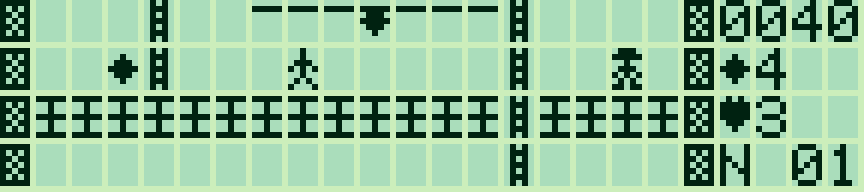
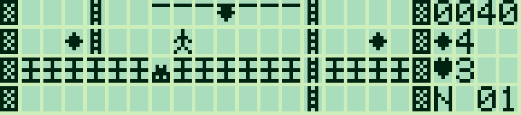
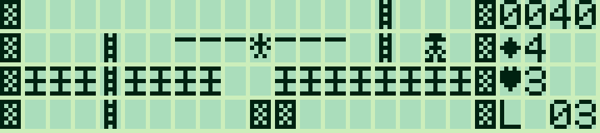

# Pocket Runner — 0.1.0

[Français](#francais) · [English](#english)

<a id="francais"></a>

## Français

[Collection](../../README.md#francais)

Un jeu de plateformes et de poursuite en **assembleur Z80**, inspiré des mécaniques de **Lode Runner**, avec code, niveaux et graphismes originaux. Ramasser tout l'or, creuser des pièges pour les gardes et rejoindre l'échelle de sortie. Versions française et anglaise, pour les budgets mémoire des **PC-G801/G805**.

| Galerie et corde | Garde pris au piège |
|---|---|
|  |  |

Captures LCD : **g800**.

Le terrain de **20 × 12 cases** défile verticalement dans une fenêtre de **20 × 4 cases**, avec des motifs de **5 × 7 points**. Les quatre colonnes de droite affichent le score, l'or restant, les vies et le niveau, en caractères Sharp normaux.

### Charger et lancer

[HEX français](build/runner_FR.hex) · [English HEX](build/runner_EN.hex) · [Tailles et SHA-256](build/manifest.json)

1. Sauvegarder les programmes utiles. Régler **TEXT → Sio → Format** et Sharp PC-G Link sur **4800 / 8N1, RS/CS, CR LF, EOF 1A**. Les réglages initiaux sont 1200 / 7N1 ; modifier les deux côtés pour accélérer le transfert.
2. Depuis BASIC RUN, saisir **`MON`**, **`USER0FFF`**, puis **`R`**, en validant chaque commande.
3. Dans Sharp PC-G Link, choisir `runner_FR.hex`, puis **Envoyer ASM**. Attendre la réception sur le Sharp.
4. Saisir **`G100`**, puis ENTER sur le titre. Après chargement, **`CALL &H100`** lance également le jeu depuis BASIC.

| Version | Taille, état et tampons inclus | Réservation |
|---|---:|---|
| Français | 3 704 octets | `USER0FFF` |
| Anglais | 3 684 octets | `USER0FFF` |

Le programme tient sous la limite G801 de 5 859 octets, sans extension RAM. Il utilise les IOCS graphiques et clavier communs, sans accès aux ports LCD ni aux routines internes du firmware. Son chargement à 0100h remplace le jeu précédent. [Guide de transfert et dépannage](../../docs/LOADING.md).

Pour g800 installé séparément :

```text
python tools/play_runner.py --lang fr --emulator "chemin/vers/g800.exe"
```

Le profil par défaut est PC-G805 ; `--model PC-G801` sélectionne l'autre cible. Aucun dump ROM n'est nécessaire pour cet aperçu.

### Commandes

| Touche | Action |
|---|---|
| ← / → | Marcher ou se déplacer le long d'une corde |
| ↑ / ↓ | Monter / descendre une échelle ; ↓ lâche une corde |
| Z / X | Creuser en diagonale sous la case de gauche / droite |
| P | Pause / reprise |
| M | Aide ; une touche reprend |
| R | Recommencer le niveau **en consommant une vie** |
| Q / BREAK | Revenir à l'appelant |
| ENTER | Nouvelle partie depuis le titre ou le résultat |

Maintenir une flèche répète les déplacements. **Relâcher Z/X avant de creuser à nouveau.** Un seul code de touche est traité à la fois. Il n'y a pas de saut : utiliser les échelles, les cordes et la gravité. Les chutes ne coûtent pas de vie, mais tomber dans son propre trou peut enfermer le joueur.

### Règles et niveaux

Chaque niveau contient **huit lingots** et **trois gardes**. Tout l'or doit être ramassé pour faire apparaître l'échelle de sortie en haut à droite. Le panneau remplace alors le compteur d'or par **SORT**. Une partie comprend trois niveaux : galerie, passerelles avec brèches et parcours suspendu. La caméra suit le joueur par lignes entières ; les gardes continuent leur poursuite hors écran.

Les briques peuvent être creusées si la case située à côté du joueur est libre. La pierre est indestructible. Quatre trous peuvent rester ouverts simultanément ; ils se rebouchent après **96 étapes du monde**. Un garde tombé dedans est immobilisé durant quatre mises à jour des gardes, puis tente de remonter. Le joueur peut marcher sur sa tête. Si le trou se ferme sur le garde, celui-ci réapparaît à sa position de départ, ou sur une case libre de la même ligne si elle est occupée ; s'il se ferme sur le joueur, une vie est perdue.

Les gardes cherchent un chemin vers le joueur en tenant compte des échelles, des cordes et des chutes. Un contact avec un garde libre coûte une vie. Le niveau est alors réinitialisé, avec son or et ses gardes ; le score est conservé. Départ : **trois vies**. Un lingot rapporte **10 points**, un garde enseveli **25 points**, une sortie **100 points**. Le score s'arrête à 9999. Après les trois sorties, ENTER permet de recommencer une partie.

Pour un premier piège : attendre un garde sur une plateforme de briques, creuser de son côté, puis le laisser tomber avant de traverser au-dessus de lui. Ne pas entrer dans la case où se trouve encore un garde libre.

Cette première version reprend ces mécaniques avec des niveaux originaux ; elle ne reprend pas les cartes du jeu commercial. Les gardes ne transportent pas l'or, et il n'y a pas encore d'éditeur de niveaux ou de sauvegarde de partie.

### Sources et vérifications

| Fichier | Rôle |
|---|---|
| [runner.asm](runner.asm) | Entrées, gravité, creusement, temporisation, or, vies et progression |
| [guards.asm](guards.asm) | Recherche de chemins par parcours en largeur et gardes piégés |
| [render.asm](render.asm) | Caméra verticale et composition des motifs |
| [interface.asm](interface.asm) | Textes FR/EN et chiffres natifs |
| [assets.py](assets.py) | Trois niveaux, compression RLE et sprites originaux |
| [check_runner.py](check_runner.py) | Exécution des binaires Z80 et références indépendantes |

Depuis la racine de la collection :

```text
python games/pocket-runner/build_runner.py --lang fr --assembler "chemin/vers/sjasmplus.exe"
python games/pocket-runner/check_runner.py --lang fr
```

Construction : Python standard et SjASMPlus. Vérifications : `z80==1.2.0`. Pour reproduire les captures sous Windows : `python tools/capture_runner.py --lang fr --emulator "chemin/vers/g800.exe"`, avec Pillow et z80. Aucun assembleur, émulateur ou ROM n'est redistribué.

Le tampon graphique de 480 octets sert aussi de deux tableaux de 240 octets pour l'IA, puis est entièrement redessiné avant son envoi au LCD. Aucun espace de travail du firmware n'est emprunté. Les périodes sont de trois étapes pour le joueur et sept pour les gardes, avec un délai de base et le coût des IOCS..

© 2026 P.RAIMBAULT — [MIT](../../LICENSE.txt). Inspiration : Lode Runner. Code, niveaux et motifs propres à Pocket Runner.

---

<a id="english"></a>

## English

[Collection](../../README.md#english)

A **Z80 assembly** platform-and-chase game inspired by **Lode Runner**, with original code, levels and graphics. Collect all the gold, dig traps for the guards and reach the exit ladder. French and English builds fit the **PC-G801/G805** memory budgets.

| Platforms and rope | Trapped guard |
|---|---|
|  |  |

LCD screenshots: **g800**.

The **20 × 12 cell** world scrolls vertically within a **20 × 4 cell** window, using **5 × 7 pixel** patterns. Four right-hand columns show score, remaining gold, lives and level, in standard Sharp characters.

### Loading and starting

[French HEX](build/runner_FR.hex) · [English HEX](build/runner_EN.hex) · [Sizes and SHA-256](build/manifest.json)

1. Back up useful programs. Set **TEXT → Sio → Format** and Sharp PC-G Link to **4800 / 8N1, RS/CS, CR LF, EOF 1A**. The observed reset defaults are 1200 / 7N1; change both ends for faster transfer.
2. From BASIC RUN, enter **`MON`**, **`USER0FFF`**, then **`R`**, confirming each command.
3. In Sharp PC-G Link, choose `runner_EN.hex` and click **Send ASM**. Wait for Sharp reception to finish.
4. Enter **`G100`**, then press ENTER on the title. After loading, BASIC can also start it with **`CALL &H100`**.

| Version | Size including state and buffers | Reservation |
|---|---:|---|
| French | 3,704 bytes | `USER0FFF` |
| English | 3,684 bytes | `USER0FFF` |

The program fits the 5,859-byte G801 budget without RAM expansion. It uses common graphics/keyboard IOCS, without LCD ports or internal firmware routines. Loading at 0100h replaces the previous game. [Transfer and troubleshooting guide](../../docs/LOADING_EN.md).

For a separately installed g800:

```text
python tools/play_runner.py --lang en --emulator "path/to/g800.exe"
```

PC-G805 is the default profile; `--model PC-G801` selects the other target. No ROM dump is needed for this preview.

### Controls

| Key | Action |
|---|---|
| ← / → | Walk or travel along a rope |
| ↑ / ↓ | Climb up/down ladders; ↓ releases a rope |
| Z / X | Dig diagonally below the left/right neighbouring cell |
| P | Pause / resume |
| M | Help; any key resumes |
| R | Retry the level **at the cost of one life** |
| Q / BREAK | Return to caller |
| ENTER | New game from the title or result screen |

Hold arrows to repeat movement. **Release Z/X before digging again.** One key code is processed at a time. There is no jump: use ladders, ropes and gravity. Falling has no damage penalty, but falling into your own hole may leave you trapped.

### Rules and levels

Each level has **eight gold pieces** and **three guards**. Collect all gold to reveal the exit ladder at the top right. The HUD then replaces the gold counter with **EXIT**. A game has three original levels: gallery, catwalks with gaps, and hanging routes. The camera follows in whole cell rows; guards continue chasing off screen.

Bricks can be dug when the cell beside the player is clear. Stone is indestructible. Four holes may be open simultaneously; they close after **96 world ticks**. A guard that falls in is trapped for four guard updates, then attempts to climb out. The player may walk across its head. A guard buried by a closing hole respawns at its starting position, or a free cell on that row if occupied; a buried player loses a life.

Guards find routes towards the player using ladders, ropes and falls. Contact with a free guard costs a life. That level's gold, terrain and guards reset, while score is retained. Start with **three lives**. Gold awards **10 points**, burying a guard **25**, and reaching an exit **100**. Score caps at 9999. After all three exits, ENTER starts a new game.

For a first trap, wait for a guard on a brick platform, dig on its side and let it fall before crossing over its head. Do not enter a cell still occupied by a free guard.

This initial version implements those mechanics using original levels rather than the commercial game's maps. Guards do not carry gold; no level editor or game save is included yet.

### Sources and verification

| File | Purpose |
|---|---|
| [runner.asm](runner.asm) | Input, gravity, digging, timing, gold, lives and progression |
| [guards.asm](guards.asm) | Breadth-first pathfinding and trapped guards |
| [render.asm](render.asm) | Vertical camera and pattern composition |
| [interface.asm](interface.asm) | FR/EN text and native digits |
| [assets.py](assets.py) | Three levels, RLE compression and original sprites |
| [check_runner.py](check_runner.py) | Z80 binary execution and independent references |

From the collection root:

```text
python games/pocket-runner/build_runner.py --lang en --assembler "path/to/sjasmplus.exe"
python games/pocket-runner/check_runner.py --lang en
```

Building requires standard Python and SjASMPlus; tests require `z80==1.2.0`. Reproduce Windows captures with `python tools/capture_runner.py --lang en --emulator "path/to/g800.exe"`, with Pillow and z80 installed. No assembler, emulator or ROM is redistributed.

The 480-byte graphics buffer doubles as two 240-byte AI work arrays, then is fully rebuilt before LCD upload. No firmware workspace is borrowed. Player/guard periods are three/seven world ticks, with a base delay plus IOCS overhead.

© 2026 P.RAIMBAULT — [MIT](../../LICENSE.txt). Inspired by Lode Runner. Code, levels and patterns are original to Pocket Runner.
