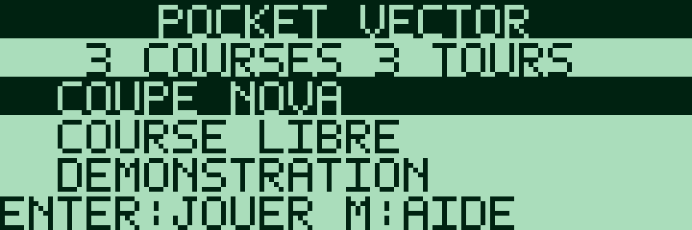
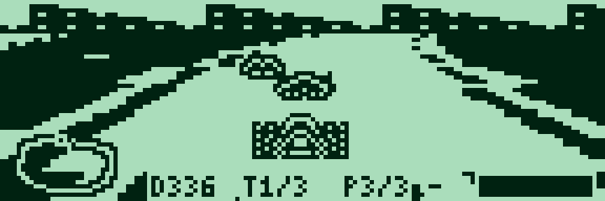
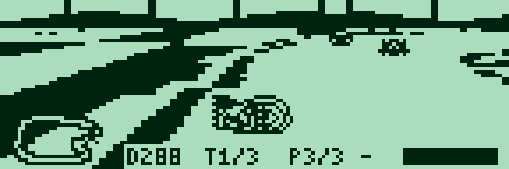
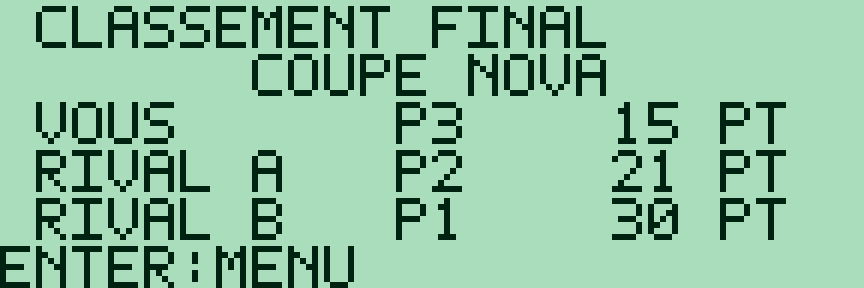
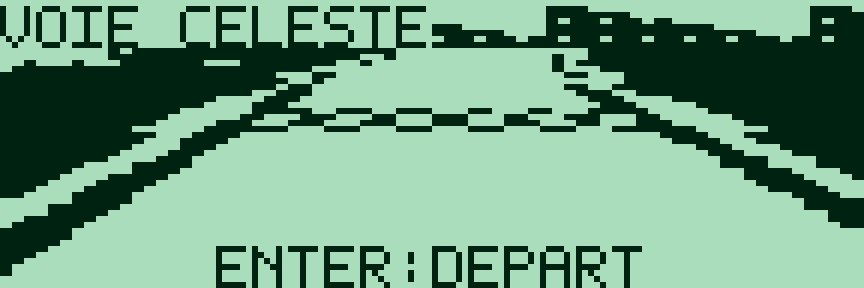
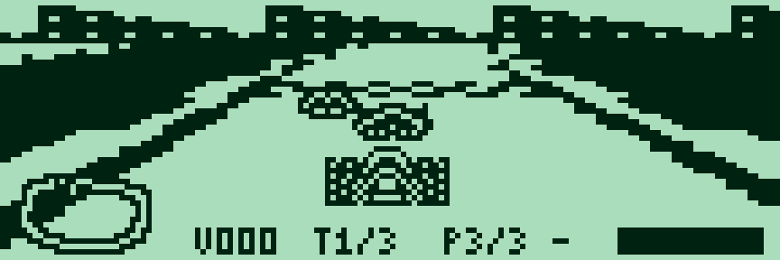
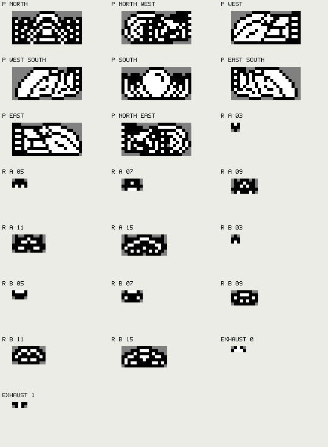
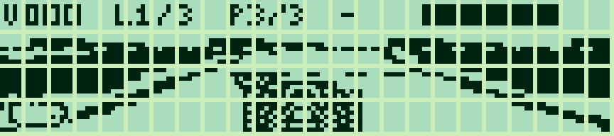

# Pocket Vector — prototype 0.7.0

[Français](#francais) · [English](#english)

<a id="francais"></a>

## Français

Les animations G850 sont capturées dans g800, limitées au LCD ; leur cadence est indicative.

[Collection](../../README.md#francais)

Course futuriste monochrome en assembleur Z80 pour **Sharp PC-G850** : trois circuits larges, deux adversaires et un menu **Coupe Nova / Course libre / Démonstration**. Un floorcaster Q8.8 projette le sol avec 64 orientations et un échantillonnage 2 × 1. Vaisseaux et panneau utilisent les **144 × 48 pixels continus** de l’écran.







Captures du programme dans **g800**, limitées au LCD. L’[animation](docs/vector_demo_z80.gif) exécute le même code Z80 sur CPU simulée, avec une cadence de présentation illustrative. La vitesse perçue et la rémanence dépendent du LCD et de la machine.

### Version G80X — 32 Ko

Version distincte pour **G801/G805 avec 32 Kio de RAM reconnus** :

| Français | English | Octets FR / EN | Réservation |
|---|---|---:|---|
| [IHX FR](build/g80x-32k/vector_g80x_32k_FR.ihx) | [IHX EN](build/g80x-32k/vector_g80x_32k_EN.ihx) | 27 392 / 27 392 | **USER6BFF** |


Les trois circuits, les adversaires, la coupe, la vrille et le turbo sont conservés. Le sol est calculé en 2 × 2 puis adapté à une scène 120 × 21 ; le vaisseau 23 × 11, le HUD et la minimap 16 × 8 sont dessinés à résolution native. Les menus tiennent sur quatre lignes. **MON → USER6BFF → R**, Envoyer ASM, puis **G100**. Sur G801 étendu, activer **Extension RAM 32 Ko (G80X)** dans PC-G Link. [Mémoire et chargement G80X 32 Ko](../../docs/G80X_32K.md#francais).

### Charger sur PC-G850

[Français — IHX](build/g850/vector_FR.ihx) · [English — IHX](build/g850/vector_EN.ihx) · [Tailles et empreintes](build/g850/manifest.json)

1. Sauvegarder les programmes à conserver. Régler **TEXT → Sio → Format** et [Sharp PC-G Link](https://github.com/pR-0000/Sharp-PC-G-Link) sur des paramètres identiques, par exemple **4800 / 8N1, RS/CS, CR LF, EOF 1A**.
2. Depuis BASIC RUN, saisir **`MON`**, puis **`USER6DFF`** et **`R`**, en validant chaque commande.
3. Envoyer `vector_FR.ihx` avec **Envoyer ASM**, puis attendre la fin de réception sur le Sharp.
4. Saisir **`G100`**. Choisir le mode avec ↑/↓, puis valider avec ENTER. En course libre et démonstration, ←/→ choisit le circuit.

Les deux versions occupent **27 904 octets**, à partir de **0100h**, tampons et données de travail compris. **`USER6DFF` convient aux deux versions** et laisse **2 275 octets** sur les 30 179 octets utilisateur d’un G850 vide. Après chargement, **`CALL &H100`** permet également un lancement depuis BASIC. Ces fichiers ciblent le **G850**, avec son format graphique propre. Utiliser les fichiers **g80x_32k** ci-dessus sur G801/G805 32 Ko.

**MEMORY ERROR après USER :** sauvegarder les données utiles et vérifier la place disponible avec `FRE`, ainsi que les réservations avec `USER`. Les 32 Kio physiques comprennent la RAM du firmware ; ils ne sont pas entièrement réservables par USER. Utiliser les fichiers de cette version et la réservation ci-dessus. La réservation doit couvrir tout le fichier chargé. Voir les [limites mémoire du G850](../../docs/G850.md#francais).

Si la réception échoue ou si **R** revient directement au moniteur, revérifier **TEXT → Sio → Format**, les paramètres PC et les signaux RS/CS. Voir le [guide de chargement](../../docs/LOADING.md).

### Coupe et circuits

La **Coupe Nova** enchaîne trois manches de **trois tours** :

| Circuit | Décor | Plan BMP |
|---|---|---|
| Voie Céleste / Skyway | Skyline urbaine, longues courbes | [Circuit 1](docs/track1.bmp) |
| Port Ion / Ion Port | Installations industrielles, enchaînements de virages | [Circuit 2](docs/track2.bmp) |
| Anneau Nova / Nova Ring | Décor spatial, tracé plus sinueux | [Circuit 3](docs/track3.bmp) |

Chaque manche attribue **10 / 7 / 5 points** selon la place ; un abandon rapporte **0 point**. L’ordre d’arrivée reste fixé lorsqu’un pilote franchit la ligne. ENTER passe à la manche suivante, avec énergie restaurée, puis au classement final après la troisième course. Une égalité de points est départagée par le classement de la dernière manche. Les résultats restent en mémoire pendant la partie, sans sauvegarde permanente. **Relâcher ENTER entre deux écrans** : le jeu exige un relâchement stable avant une nouvelle validation ; un maintien ou un rebond bref ne traverse pas les résultats et le menu.



Le mode **Course libre** permet de choisir une piste et de courir trois tours. **Démonstration** utilise le pilote automatique sur la piste choisie.

### Introduction et départ

Chaque manche commence par une orbite de caméra autour de la **ligne de départ, sans vaisseaux**. La caméra reprend ensuite sa place ; les trois vaisseaux arrivent **depuis le bas de l’écran** pour se placer **derrière la ligne**, puis le décompte **3, 2, 1, GO!** commence. Les positions dans le circuit, vitesses, tours et énergie restent figés jusqu’au GO : les adversaires accélèrent ensuite progressivement, en même temps que le joueur. Le premier franchissement de la ligne démarre le premier tour ; il n’en valide pas un. Il est possible de maintenir ↑ avant le départ.

**ENTER passe l’orbite et conserve l’arrivée des vaisseaux et le compte à rebours.** P met aussi cette présentation en pause ; F fige une image pour les photos. La séquence est rejouée après R et au début de chaque manche de coupe.



La grille et la ligne sont sur une portion horizontale de chaque circuit ; la caméra est alignée sur cette portion au départ.

### Adversaires et rebonds

Les adversaires utilisent les sprites existants de **15 et 11 pixels de large sur la grille de départ**, selon leur distance, puis les variantes plus petites avec la distance. Leur point d’appui sur la piste est conservé et les sprites restent partiellement visibles aux bords de l’écran.

Les contacts utilisent une normale locale : le masque de la route pour les bordures, la ligne entre les vaisseaux pour les adversaires. Ces normales sont approchées en huit directions. Le rebond conserve l’élan tangent ; la reprise par l’accélérateur est atténuée pendant **10 images**, pour laisser le vaisseau ricocher. Chaque contact avec un adversaire repousse les deux vaisseaux, y compris hors vrille. La vrille conserve sa protection et ses dégâts renforcés.



### Commandes

| Touche | Action |
|---|---|
| ↑ / ↓ au menu | Choisir Coupe / Course libre / Démonstration |
| ← / → au menu | Choisir le circuit en course libre ou démonstration |
| ENTER | Valider ; passer l’orbite ; passer au résultat suivant ; fermer l’aide ; reprendre une pause |
| ← / → en course | Braquer par rapport au vaisseau |
| ↑ / ↓ en course | Accélérer / freiner |
| ESPACE | Turbo à partir du deuxième tour ; fournit aussi la poussée |
| X | Attaque tournoyante |
| P | Pause / reprise |
| F | Figer une image sans message de pause, pour les photos ; F ou P reprend |
| D | Démonstration depuis le menu ; activer/désactiver le pilote automatique en course |
| M | Aide / retour |
| R en course | Recommencer la manche en pilotage manuel, en conservant les points des manches précédentes |
| R depuis un résultat | Revenir au menu |
| Q / ON-BREAK | Revenir à l’appelant |

L’accélération est doublée par rapport à la version 0.3, la vitesse normale maximale augmente d’environ 17 % et le braquage manuel est plus direct. Une inertie reste présente. Les flèches et les actions se combinent. Le frein est prioritaire sur le turbo. Sans accélération, le vaisseau ralentit ; son inertie produit une légère dérive dans les virages. Les collisions restent actives pendant la vrille.

### Règles et panneau

- **Trois tours**, avec trois secteurs à franchir dans l’ordre. Reculer sur la ligne ou couper le circuit ne suffit pas à valider un tour.
- **Bordures rebondissantes** : un choc inverse la composante de déplacement perpendiculaire à la piste, en conservant l’élan le long de la bordure. Hors vrille, le choc réduit la vitesse et consomme de l’énergie ; une courte protection évite les dégâts répétés au même contact. En vrille, le rebond ne consomme pas d’énergie et conserve l’indice de vitesse.
- **Turbo au deuxième tour** : vitesse supérieure contre de l’énergie. Il s’interrompt avant d’épuiser seul la jauge ; les collisions peuvent néanmoins détruire le vaisseau.
- **Recharge** : la bande tramée du circuit restaure de l’énergie, y compris à l’arrêt.
- **Vrille** : deux rotations complètes en **huit images de jeu au total**, deux fois plus rapides qu’en version 0.5, avec la séquence Nord/Ouest/Sud/Est répétée deux fois, maintien de la vitesse réelle et de l’orientation, direction et turbo suspendus. Elle protège des dégâts de contact avec les adversaires et leur inflige davantage de dégâts. Elle permet aussi de rebondir sur les bordures sans dégâts, tout en gardant la direction du vaisseau bloquée et son inertie active. Un délai de récupération empêche les attaques continues ; relâcher puis appuyer de nouveau sur X.
- **Adversaires** : deux pilotes avec des vitesses différentes et des trajectoires décalées. Leur progression tient compte de la longueur du circuit : ils accélèrent dans les lignes droites, ralentissent dans les virages et utilisent des turbos courts à partir du deuxième tour, en consommant leur énergie. La zone de recharge leur est également utile. Les contacts les ralentissent et les repoussent immédiatement, puis ils retrouvent progressivement leur trajectoire. Trois impacts de vrille peuvent retirer un adversaire intact de la course. Ils ne lancent pas de vrille.

Le HUD utilise une police **3 × 5**, une jauge d’énergie de **25 segments** et une **minimap 32 × 16 en bas à gauche**. **V** précède la vitesse, **T1/3** indique le tour, **P1/3** la place et **B** le turbo débloqué (**-** au premier tour). **D** remplace V en pilotage automatique. Le repère du joueur clignote sur la minimap ; les deux adversaires y figurent tant qu’ils sont en course.

Le circuit reste visible entre les groupes du HUD et autour du contour de la minimap. Un liseré blanc assure le contraste des symboles sur les zones sombres. Le sol s’étend jusqu’à la dernière ligne de l’écran ; les noms de course sont réservés au menu et aux résultats. La jauge clignote après un choc ; le vaisseau clignote aussi hors vrille.


Les règles reprennent l’esprit de [QL-Zero](https://github.com/pR-0000/QL-Zero), avec une implémentation Z80 et trois circuits originaux. La vrille garde l’élan sans tourner la caméra. Cette version reste monochrome, sans musique ni relief.

### Sprites modifiables

Les **[22 BMP individuels](graphics/README.md#francais)** sont les sources effectivement compilées : huit orientations du joueur en **23 × 11**, six tailles pour chacun des deux adversaires et deux flammes de propulsion. Les vues nord-ouest et nord-est servent aussi au braquage. Les paires exactement symétriques partagent leurs pixels grâce à un miroir horizontal au rendu. Les données sont stockées sur deux bits par pixel : transparence, blanc opaque, noir opaque ; le LCD reste monochrome.



[Planche BMP verticale](docs/sprites.bmp) · [Guide et BMP individuels](graphics/README.md#francais)

Le **gris `#808080` représente la transparence**, le noir et le blanc sont opaques. Modifier les fichiers dans `graphics/`, conserver dimensions et palette, puis reconstruire. La construction préserve les BMP existants et réimporte leurs modifications. La planche verticale est un export de consultation. Les trois plans de piste sont également des exports ; leurs tracés sources sont dans `tracks.json`.


Pour construire ou lancer la version 32 Ko, ajouter **`--target g80x-32k`** aux commandes correspondantes. `--target g850` sélectionne le G850 ; sans sélecteur, la construction produit les deux profils. [Contrôles G80X 32 Ko](../../docs/DEVELOPMENT.md).

### Émulateur et développement

g800 s’installe séparément. Aucun dump ROM n’est requis avec ses IOCS simulés :

```text
python games/pocket-vector/build_vector.py --lang fr --assembler "chemin/vers/sjasmplus.exe"
```


Sources : `physics.asm` pour les règles, `collisions.asm` pour les normales de contact et les impulsions, `cup.asm` pour les manches et classements, `start.asm` pour l’orbite, l’arrivée et le compte à rebours, `floor.asm` pour la projection, `render.asm` pour l’affichage, `keyboard.asm` pour le clavier simultané. `assets.py` prépare les cartes compressées par références LZ et les tables ; `graphics.py` importe les BMP. La décompression restitue les cartes complètes avant la course. La construction impose une fin de programme à **7000h au maximum**, pour garder une marge sous les espaces système et la pile. Les définitions matérielles sont dans [sharp_pc_g850.inc](../../include/sharp_pc_g850.inc).

---

<a id="english"></a>

## English

G850 animations are captured in g800, cropped to the LCD; their timing is illustrative.

[Collection](../../README.md#english)

A monochrome Z80 futuristic racer for **Sharp PC-G850**: three wide circuits, two opponents and a **Nova Cup / Single Race / Demonstration** menu. A Q8.8 floorcaster projects the ground with 64 headings and 2 × 1 sampling. Ships and HUD use the screen’s **144 × 48 continuous pixels**.


Screenshots show the program in **g800**, cropped to the LCD. The [animation](docs/vector_demo_z80.gif) executes the same Z80 code on a simulated CPU with an illustrative presentation cadence. Perceived speed and persistence depend on the LCD and machine.

### G80X version — 32 KiB

Separate build for **G801/G805 with 32 KiB of recognized RAM**:

| French | English | Bytes FR / EN | Reservation |
|---|---|---:|---|
| [FR IHX](build/g80x-32k/vector_g80x_32k_FR.ihx) | [EN IHX](build/g80x-32k/vector_g80x_32k_EN.ihx) | 27,392 / 27,392 | **USER6BFF** |



Three circuits, rivals, cup, spin and boost are retained. A 2 × 2 floor is adapted to a 120 × 21 scene; the 23 × 11 ship, HUD and 16 × 8 minimap use native pixels. Menus fit four rows. **MON → USER6BFF → R**, Send ASM, then **G100**. For an expanded G801, enable **32 KiB RAM expansion (G80X)** in PC-G Link. [G80X 32 KiB memory and loading](../../docs/G80X_32K.md#english).

### Load on PC-G850

[French — IHX](build/g850/vector_FR.ihx) · [English — IHX](build/g850/vector_EN.ihx) · [Sizes and hashes](build/g850/manifest.json)

1. Save programs you want to keep. Match **TEXT → Sio → Format** and [Sharp PC-G Link](https://github.com/pR-0000/Sharp-PC-G-Link), for example **4800 / 8N1, RS/CS, CR LF, EOF 1A**.
2. From BASIC RUN, enter **`MON`**, **`USER6DFF`**, then **`R`**, confirming each command.
3. Send `vector_EN.ihx` using **Send ASM**, and wait for reception to finish on the Sharp.
4. Enter **`G100`**. Choose a mode with ↑/↓ and confirm with ENTER. In Single Race and Demonstration, ←/→ selects a circuit.

Both versions occupy **27,904 bytes**, starting at **0100h**, including runtime data and buffers. **`USER6DFF` works for both versions**, leaving **2,275 bytes** out of an empty G850's 30,179 user bytes. After loading, **`CALL &H100`** can also start it from BASIC. These files target **G850** with its own display format. Use the separate **g80x_32k** files above on a 32 KiB G801/G805.

**MEMORY ERROR after USER:** save important data and check available space with `FRE` and existing reservations with `USER`. The physical 32 KiB includes firmware RAM; it is not all available to USER. Use this version's files and the reservation above. The reservation must cover the entire loaded file. See the [G850 memory limits](../../docs/G850.md#english).

For reception errors or an immediate return from **R**, check **TEXT → Sio → Format**, PC settings and RS/CS signals. See the [loading guide](../../docs/LOADING_EN.md).

### Cup and circuits

The **Nova Cup** consists of three **three-lap** rounds:

| Circuit | Setting | BMP map |
|---|---|---|
| Skyway / Voie Céleste | City skyline, long bends | [Track 1](docs/track1.bmp) |
| Ion Port / Port Ion | Industrial structures, linked corners | [Track 2](docs/track2.bmp) |
| Nova Ring / Anneau Nova | Space setting, more winding layout | [Track 3](docs/track3.bmp) |

Each round awards **10 / 7 / 5 points** by position; retirement scores **0**. Finish order is fixed when a driver crosses the line. ENTER advances to the next round with restored energy, then shows the final standings after race three. Tied totals are resolved by last-round position. Results stay in memory during the session without persistent storage. **Release ENTER between screens**: a stable release is required before the next confirmation; holding or briefly bouncing the key cannot skip results or the menu.

**Single Race** lets you choose one circuit for three laps. **Demonstration** uses the automatic driver on the selected circuit.

### Introduction and start

Each round opens with a camera orbit around the **starting line without ships**. The camera then returns to the driving view; all three ships slide in **from the bottom of the screen** and settle **behind the line**, before **3, 2, 1, GO!** begins. World positions, speeds, laps and energy stay frozen until GO. Opponents then accelerate gradually alongside the player. The first line crossing starts lap one; it does not complete a lap. You may hold ↑ before the start.

**ENTER skips the orbit but keeps the ship arrival and countdown.** P also pauses the presentation; F freezes a photo frame. Restarting with R and advancing to the next cup round replay the sequence.

[Introduction and start, actual Z80 program](docs/vector_start_z80.gif)

Each circuit has a horizontal starting straight shared by the grid and line; the camera is aligned with it at the start.

### Opponents and rebounds

Opponents use the existing **15- and 11-pixel-wide sprites on the starting grid**, according to distance, followed by smaller variants as distance increases. Their road contact point is preserved, with partial clipping at screen edges.

Contacts use a local normal: the road mask at borders, the line between ships for opponents. Normals use an eight-direction approximation. Rebounds retain tangential momentum; throttle recovery is softened for **10 frames**, allowing the ship to ricochet. Every opponent contact pushes both ships apart, including outside a spin. Spins retain their protection and increased damage.


### Controls

| Key | Action |
|---|---|
| ↑ / ↓ in menu | Choose Cup / Single Race / Demonstration |
| ← / → in menu | Choose a circuit for Single Race or Demonstration |
| ENTER | Confirm; skip orbit; advance results; close help; resume pause |
| ← / → racing | Steer relative to the ship |
| ↑ / ↓ racing | Accelerate / brake |
| SPACE | Boost from lap two; also provides thrust |
| X | Spin attack |
| P | Pause / resume |
| F | Freeze a clean photo frame; F or P resumes |
| D | Demonstration from menu; toggle automatic driving during a race |
| M | Help / return |
| R racing | Restart this round manually, retaining points from previous rounds |
| R on a results screen | Return to menu |
| Q / ON-BREAK | Return to caller |

Acceleration is doubled compared with version 0.3, normal top speed rises by about 17% and manual steering is more direct, while retaining inertia. Steering and actions work simultaneously. Braking overrides boost. The ship coasts when throttle is released; inertia provides modest drift. Collisions remain active during spins.

### Rules and HUD

- **Three laps**, with three ordered sectors. Reversing over the line or cutting the track does not complete a lap.
- **Bouncing borders** reflect motion perpendicular to the road while preserving momentum along the border. Outside a spin, impact reduces speed and consumes energy; a short damage cooldown prevents repeated losses. During a spin, rebounds cost no energy and preserve the speed index.
- **Boost from lap two** exchanges energy for speed. It stops before exhausting the gauge by itself; collisions can still destroy the ship.
- **Striped recharge zone** on each circuit restores energy, including while stationary.
- **Spin attack** shows two complete rotations in **eight game frames total**, twice as fast as version 0.5, using north/west/south/east twice while retaining actual velocity and heading; steering and boost are suspended. It prevents opponent contact damage and hits them harder. Border rebounds are also harmless during the spin; ship heading stays locked while its inertia remains active. A cooldown prevents continuous attacks; release X before pressing it again.
- **Opponents** use different cruising speeds and offset paths. Their progress accounts for circuit length: they accelerate on straights, brake for corners and use short energy-consuming boosts from lap two. They also benefit from the recharge zone. Contact slows them and immediately knocks them away before they gradually recover their racing line. Three spin hits can retire an undamaged opponent. They do not launch spins. Normal cruising speed is approximately **14%** higher than version 0.5; cornering and boosts are faster too.

The HUD uses a **3 × 5 font**, a **25-segment energy gauge** and a **32 × 16 minimap at bottom left**. **V** precedes speed, **L1/3** shows laps, **P1/3** shows position and **B** means boost is unlocked (**-** on lap one). **D** replaces V during automatic driving. The player marker blinks on the minimap; both opponents appear while still racing.

The scene remains visible between HUD groups and around the minimap contour. White outlines keep symbols readable over dark areas. The floor extends to the last LCD row; course names appear only in the menu and results. The gauge blinks after damage; the ship also blinks when not spinning.

[Two complete rotations, actual Z80 code](docs/vector_spin_z80.gif)

Rules draw inspiration from [QL-Zero](https://github.com/pR-0000/QL-Zero), with original Z80 code and three original circuits. Spins retain momentum without rotating the camera. This version remains monochrome, without music or terrain height.

### Editable sprites

The **[22 individual BMP files](graphics/README.md#english)** are the actual compilation inputs: eight **23 × 11** player orientations, six sizes for each of two opponents and two exhaust frames. North-west and north-east views are also used for steering. Exactly symmetric pairs share pixel data through runtime horizontal mirroring. Assets use two bits per pixel for transparency, opaque white and opaque black; the LCD remains monochrome.

[Vertical BMP sheet](docs/sprites.bmp) · [Enlarged preview](docs/sprites_preview.png) · [Individual BMP files and guide](graphics/README.md#english)

**Grey `#808080` means transparency**; black and white are opaque. Edit files in `graphics/`, preserve dimensions and palette, then rebuild. Building preserves existing BMPs and imports your changes. The vertical sheet is a viewing export. Track BMPs are also exports; edit `tracks.json` to change their layouts.


Add **`--target g80x-32k`** to build or launch the 32 KiB profile. `--target g850` selects G850; builds without a selector produce both profiles. [G80X 32 KiB checks](../../docs/DEVELOPMENT_EN.md).

### Emulator and development

Install g800 separately; its simulated IOCS need no Sharp ROM:

```text
python games/pocket-vector/build_vector.py --lang en --assembler "path/to/sjasmplus.exe"
```


Sources: `physics.asm` for rules, `collisions.asm` for contact normals and impulses, `cup.asm` for rounds and standings, `start.asm` for orbit, arrival and countdown, `floor.asm` for projection, `render.asm` for display, and `keyboard.asm` for simultaneous input. `assets.py` prepares LZ back-reference compressed maps and tables; `graphics.py` imports BMPs. Maps are fully restored before racing. Building enforces a **7000h maximum program end** to leave room below system workspaces and the stack. Hardware definitions are in [sharp_pc_g850.inc](../../include/sharp_pc_g850.inc).
