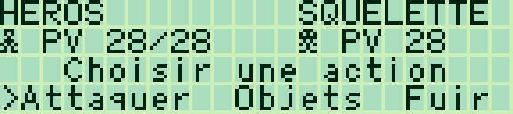
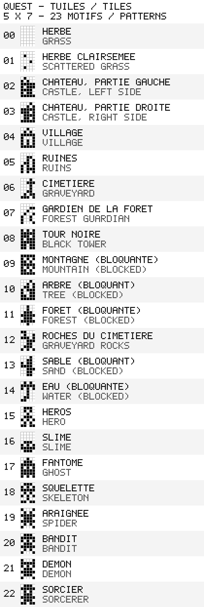
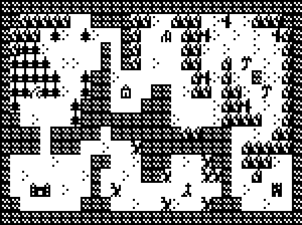

# Sharp PC-G80X Quest — 0.1.6

[Français](#francais) · [English](#english)

<a id="francais"></a>

## Français

[Collection](../../README.md#francais)

Portage Z80 du **[Canon X-07 Quest](https://github.com/pR-0000/Canon_X-07_RPG)** . La carte de **30 × 16 cases**, les huit écrans de **15 × 4 cases**, les sept apparences d'ennemis, les cinq boss, la progression, les magasins, les auberges et les combats avec défi de frappe sont conservés.

La musique, les bruitages et leur gestion d'interruptions ont été supprimés. Chaque tuile/sprite utilise désormais une cellule **5 × 7 points**, avec 23 motifs redessinés. La carte occupe les 15 premières colonnes ; les colonnes de droite indiquent les PV, le niveau, l'or et l'accès aux statistiques. Les deux langues sont fournies ; les textes français utilisent une translittération ASCII des accents.

Le jeu conserve les motifs originaux et réorganise les combats : noms sur la première ligne, sprites séparés des PV sur la deuxième, aide sur la troisième et actions complètes sur la quatrième. Les statistiques, les boutiques et les dialogues utilisent davantage les 24 colonnes. La version **0.1.4** corrige les équipements du village : épée et armure **+2**, après celles du château **+1**.




Autres captures : [statistiques avec les valeurs maximales](docs/quest_status_g800.png), [dialogue d'introduction](docs/quest_intro_g800.png).

Captures LCD : **g800**.

### Chargement

Commencer par les tests `pcg801_signature` et `glyph_demo` si la liaison et les appels IOCS n'ont pas encore été vérifiés sur le Sharp. **Sauvegarder les programmes à conserver avant USER et le chargement.**

Les fichiers prêts à envoyer sont dans `build/` :

| Fichier | Taille chargée, variables et buffers compris | Adresses |
|---|---:|---|
| `quest_FR.hex` / `quest_FR.bin` | 5 848 octets | 0100–17D7h |
| `quest_EN.hex` / `quest_EN.bin` | 5 783 octets | 0100–1796h |

Dans BASIC puis le moniteur du G801 :

```text
MON
USER17E2
R
```

Dans **Sharp PC-G Link**, choisir **PC-G801 ou PC-G805**, **4800 bauds**, et un de ces fichiers dans **Assembleur → Parcourir → Envoyer ASM**. Régler le Sharp de la même façon : **8N1, RS/CS, CR LF, EOF 1A**. Pour un BIN, laisser **Chargement BIN = 0100**, **Entrée = 0100**. Après réception complète sur le Sharp :

```text
G100
```

Ne pas employer les adresses 2000h/1F00h ni le chargeur du Canon. Les HEX ont déjà leurs adresses. Le programme et tout son état tiennent dans la zone 0100–17E2h acceptée par l'utilitaire pour le G801. Le portage conserve la pile du moniteur et revient par RET ; aucun ancien emplacement RAM du Canon n'est utilisé.

### Commandes

| Contexte | Commandes |
|---|---|
| Titre et menus verticaux | ↑/↓ pour choisir ; ENTER ou ESPACE pour valider |
| Carte | Quatre flèches ; une case par pression |
| Statistiques | M ou TAB sur la carte ; ENTER ou ESPACE pour revenir |
| Combat | ←/→ : Atq / Obj / Fuir ; ENTER pour valider |
| Objets, magasins, auberges | ↑/↓ puis ENTER |
| Annuler un sous-menu | BACKSPACE ou CLS |
| Dialogue ou résultat | ENTER ou ESPACE |
| Défi de frappe | Retaper le mot affiché ; relâcher entre deux lettres identiques |
| Quitter | Q sur la carte ; BREAK à tout moment ; option Quitter au titre |

Q reste une lettre pendant les défis de frappe. Les touches maintenues ne produisent pas de répétition automatique.

L'aventure démarre près du château. Le roi donne les indications ; les boss se suivent dans l'ordre **cimetière → forêt → ruines → oasis → tour noire**. La quête est suivie par les drapeaux internes et les dialogues du roi. Les boutiques et les formules de statistiques sont reprises du jeu d'origine.

### Statistiques, dégâts et équipement

Au **niveau 4 avec l'épée +1**, l'attaque vaut **5**, comme sur le X-07. Voici les dégâts totaux pour une saisie réussie :

| Ennemi | Réussite normale | Réussite rapide |
|---|---:|---:|
| Slime | 5 | 5 |
| Fantôme | 6 | 7 |
| Squelette du cimetière | 5 | 6 |

L'affichage « Infligés » sépare la part principale et le bonus : **4+1 et 3+2 valent tous deux 5**. Les coups sont plafonnés à la moitié des PV maximum d'un ennemi ordinaire, arrondie au supérieur, ou au quart des PV maximum d'un boss, arrondi à l'inférieur (minimum 1). Le slime a 10 PV, d'où le plafond à 5. Le défi raccourci peut aussi transformer une réussite rapide (+2) en réussite normale (+1).

Les boutiques proposent désormais **+1 au château (48 pièces)** et **+2 au village (144 pièces)**, pour l'épée comme pour l'armure. Les bonus réels, les textes FR/EN et la sauvegarde sont cohérents. Un achat déjà possédé ou une rétrogradation est refusé sans prélever d'or. Les prix sont conservés.

### Sauvegarde en RAM

La progression est copiée automatiquement dans un petit bloc situé **dans l'image du jeu**. Après Q/BREAK, relancer `G100`, puis **Continuer**, permet de la reprendre tant que cette RAM est intacte. **Nouvelle partie** réinitialise la progression. Recharger le BIN/HEX d'origine ou réutiliser cette mémoire efface la sauvegarde. Aucune sauvegarde automatique sur le PC n'est implémentée.

Une défaite soigne le héros et le ramène au château, comme dans l'original. La pile est remise à son niveau d'entrée pour éviter d'accumuler les appels de menus. La victoire contre le sorcier affiche la fin, attend une validation puis revient au moniteur.

### Reconstruction et organisation

#### Modifier les tuiles et sprites

**Le fichier à modifier est `tiles.bmp`**, un BMP noir et blanc non compressé de **5 × 161 pixels**, à une seule colonne : **23 motifs de 5 × 7 pixels**, numérotés de 0 à 22 du haut vers le bas. Il n'y a ni marge ni espace entre eux. Le premier motif, l'herbe, est entièrement blanc. Noir = point allumé ; blanc = point éteint.



Ouvrir le BMP dans un éditeur de pixels et agrandir fortement l'affichage. Garder les dimensions, l'ordre et les couleurs noir/blanc, sans lissage. Le héros est le motif **15** ; les ennemis occupent **16 à 22**. La légende complète est dans `tiles.json` ; `tiles.tsx` permet d'utiliser l'atlas dans Tiled. L'aperçu PNG contient une grille et des noms pour la lecture ; modifier le BMP natif pour changer le jeu.

Après enregistrement, lancer la reconstruction ci-dessous : **`tiles.inc` et l'aperçu PNG sont régénérés automatiquement depuis le BMP**, puis les deux langues sont assemblées. Les modifications directes de `tiles.inc` sont remplacées par cette génération.

Les conversions peuvent aussi être lancées séparément depuis ce dossier :

```text
python tiles_tool.py import --lang fr
python tiles_tool.py preview --lang fr
python tiles_tool.py export --lang fr --output autre-atlas.bmp
```

`export` relit le fichier INC et crée un BMP. Il refuse d'écraser un BMP existant sans `--force`. L'import accepte les BMP non compressés 1/4/8/24/32 bits, avec exclusivement du noir et du blanc. Aucune bibliothèque d'image supplémentaire n'est nécessaire.

#### Carte complète en bitmap

[`map.bmp`](map.bmp) réunit les **huit chunks**, disposés en **2 colonnes × 4 rangées**, sans séparation : **30 × 16 cases**, soit **150 × 112 pixels** avec les motifs actuels. Le rendu contient le terrain seul, sans héros ni panneau de statistiques.



Pour régénérer le BMP et son aperçu PNG agrandi ×4, depuis ce dossier :

```text
python tiles_tool.py map --lang fr
```

La reconstruction du jeu les régénère également depuis `tiles.bmp` et `map_packed.inc`. `map.bmp` est un **export de visualisation** : pour modifier les motifs, éditer `tiles.bmp` ; pour modifier la disposition des cases, éditer `map_packed.inc`. Les modifications du bitmap de carte ne sont pas réimportées.

#### Reconstruire le jeu

Depuis la racine du dépôt, avec Python 3.10+ et [SjASMPlus](https://github.com/z00m128/sjasmplus) :

```text
python games/quest/build_quest.py --lang fr --assembler "chemin/vers/sjasmplus.exe"
```

`--assembler` peut être omis si l'exécutable est dans PATH ; `SJASMPLUS` est également reconnu. Aucun téléchargement n'est effectué. Le script reconstruit les deux langues, le BIN, le HEX, les symboles, le listing et `build/manifest.json`. Une assertion à l'assemblage interdit de dépasser 17E2h, état compris.

#### Délai des défis de frappe

La version **0.1.6** passe de **5 à 6 lectures clavier par unité de délai**, soit environ **20 % de temps supplémentaire** pour la réussite normale et le bonus rapide. La limite reste globale pour le mot ; elle n'est pas réinitialisée à chaque lettre. Le défi expire dès que son compteur atteint zéro. Pour reproduire le modèle de temporisation, fixer g800 à **4 MHz**, fréquence de référence utilisée ici. Le rafraîchissement de l'affichage ne change pas cette fréquence CPU.

Pour ajuster ensuite le délai, ajouter **`--typing-reload 6`** à la commande de reconstruction. Valeurs acceptées : 1 à 64 ; augmenter ce nombre allonge le délai. Les deux langues utilisent le même réglage.

Les textes occupent au maximum **24 caractères × 4 lignes**. Les dialogues ont été développés, mais la mémoire reste presque pleine : la version française termine à **17D7h**, soit **11 octets libres** avant la limite du chargeur. Des dialogues sensiblement plus longs demanderont d'autres économies ou un système de pages/compression.

Les outils proposent `--lang fr` ou `--lang en` pour leur aide et leurs messages. Le choix concerne les outils ; les deux langues du jeu sont toujours construites. Les messages propres à l'assembleur et les identifiants techniques des tests gardent leur format d'origine. Sur la carte, neuf colonnes affichent les PV, le niveau, l’or et le raccourci des statistiques, avec des libellés FR/EN.

- `quest.asm` : entrée, boucle principale, constantes, titre et traduction ASCII.
- `platform.asm`, `display.asm`, `menu.asm` : interface Sharp, affichage et clavier ; les coordonnées virtuelles 8 × 8 restent internes aux règles, puis deviennent des cellules 5 × 7.
- `tiles.bmp` : atlas éditable ; `tiles.json` : légende FR/EN ; `tiles.inc` : données générées ; `map_packed.inc` : carte d'origine, inchangée dans ses données.
- `movement.inc`, `events.inc`, `progression.inc`, `typing.inc`, `battle.inc` : logique adaptée des sources Canon.
- `save.inc`, `state.asm` : état compact, contigu et entièrement réservé par USER.
- `upstream.json`, `NOTICE.md` : provenance des sources et empreintes des fichiers originaux.

Le code utilise le même `sharp_pc_g801.inc` et les wrappers IOCS partagés que Star Lane. Aucun appel de ROM Canon, accès au T6834, pilote musical ou vecteur d'interruption Canon ne subsiste. Les confirmations redondantes d'entrée de combat et de coup final ont été retirées pour économiser la mémoire ; le menu, les résultats de tour et les récompenses sont conservés. Le panneau détaillé des objets reste accessible par M ; les boutiques affichent l'or disponible.

Deux corrections de cohérence accompagnent l'adaptation : le calcul de zone utilise les coordonnées réelles de la case, et le boss de l'oasis exige le drapeau des ruines. La potion est plafonnée correctement même avec 255 PV maximum, avant la riposte ennemie.

---

<a id="english"></a>

## English

[Collection](../../README.md#english)

This Z80 port is based on the author's **[Canon X-07 Quest](https://github.com/pR-0000/Canon_X-07_RPG)** sources. It retains the complete **30 × 16 world**, eight **15 × 4 tile screens**, seven enemy appearances, five bosses, progression, shops, inns and battles with typing challenges.

Music, sound effects and their interrupt driver have been removed. The 23 tile/sprite patterns have been redrawn as **5 × 7 cells**. The map uses the first 15 columns; the right side shows health, level, gold and the status shortcut. French and English binaries are supplied. French text uses ASCII equivalents for accented characters.

Battles show names on row one, sprites separated from health on row two, guidance on row three and complete action names on row four. Status, shops and dialogue use all 24 columns. Village equipment offers sword/armor **+2**, following the castle's **+1** tier.


More captures: [status with maximum values](docs/quest_status_g800.png), [introductory dialogue](docs/quest_intro_g800.png).

LCD screenshots: **g800**.

### Loading

Try `pcg801_signature` and `glyph_demo` first if the link and IOCS calls have not yet been checked on your Sharp. **Back up programs you want to keep before changing USER or loading code.**

Ready-made files are in `build/`:

| File | Loaded size, including variables and buffers | Addresses |
|---|---:|---|
| `quest_FR.hex` / `quest_FR.bin` | 5,848 bytes | 0100–17D7h |
| `quest_EN.hex` / `quest_EN.bin` | 5,783 bytes | 0100–1796h |

Enter BASIC and then the G801 monitor:

```text
MON
USER17E2
R
```

In **Sharp PC-G Link**, select **PC-G801 or PC-G805**, **4800 baud**, then choose the file under **Assembly → Browse → Send ASM**. Use matching Sharp settings: **8N1, RS/CS, CR LF, EOF 1A**. For a BIN, keep **BIN load address = 0100** and **Entry point = 0100**. After reception has finished on the Sharp:

```text
G100
```

Use these Sharp addresses rather than the Canon loader's 2000h/1F00h addresses. HEX files already contain their addresses. All code and state fit within the G801 uploader's 0100–17E2h range. The game uses the monitor stack and returns with RET; Canon RAM addresses are not used.

### Controls

| Context | Controls |
|---|---|
| Title and vertical menus | ↑/↓ to select; ENTER or SPACE to confirm |
| Map | Four arrow keys; one tile per press |
| Status | M or TAB on the map; ENTER or SPACE to return |
| Battle | ←/→: Atk / Obj / Flee; ENTER to confirm |
| Objects, shops and inns | ↑/↓, then ENTER |
| Cancel a submenu | BACKSPACE or CLS |
| Dialogue or result | ENTER or SPACE |
| Typing challenge | Type the displayed word; release between repeated letters |
| Quit | Q on the map; BREAK anywhere; Quit on the title screen |

Q remains a letter during typing challenges. Held keys do not repeat automatically. The adventure starts near the castle. Follow the king's clues through **graveyard → forest → ruins → oasis → black tower**. Internal flags and the king's dialogue track progress. Shops and stat formulas come from the original game.

### Statistics, damage and equipment

At **level 4 with a +1 sword**, attack is **5**, matching the X-07. Total damage on successful typing:

| Enemy | Normal success | Fast success |
|---|---:|---:|
| Slime | 5 | 5 |
| Ghost | 6 | 7 |
| Graveyard skeleton | 5 | 6 |

The damage display separates the main portion and typing bonus: **4+1 and 3+2 both total 5**. Hits are capped at half a normal enemy's maximum HP, rounded up, or one quarter of a boss's maximum HP, rounded down (minimum 1). A slime has 10 HP, so its cap is 5. The shorter typing deadline can also turn a fast success (+2) into a normal success (+1).

Shops now sell **+1 equipment at the castle (48 gold)** and **+2 equipment at the village (144 gold)**, for both sword and armor. Actual bonuses, FR/EN labels and the RAM save agree. Duplicate purchases and downgrades are rejected without charging gold. Prices are unchanged.

### RAM save

Progress is automatically copied into a small block **inside the game image**. After Q/BREAK, run `G100` again and choose **Continue** to resume while this RAM remains intact. **New game** resets progress. Reloading the original BIN/HEX or reusing its memory erases the save. There is no automatic save file on the PC.

Defeat heals the hero and returns them to the castle. The stack is reset to its entry level to avoid accumulating menu calls. Defeating the sorcerer displays the ending, waits for confirmation and returns to the monitor.

### Editing tiles and sprites

**Edit `tiles.bmp`**: an uncompressed black-and-white **5 × 161 pixel BMP**, containing one vertical column of **23 patterns, 5 × 7 pixels each**. IDs run from 0 to 22, top to bottom, with no margins or gaps. The first grass tile is entirely white. Black means an active LCD dot; white means an inactive dot.


Use a pixel editor at high zoom. Keep the dimensions, order and black/white colors; disable antialiasing. The hero is **15**, enemies are **16–22**. `tiles.json` contains the bilingual legend; `tiles.tsx` describes the atlas for Tiled. The labelled PNG is a reading aid; edit the native BMP to change the game.

**The build regenerates `tiles.inc` and the PNG preview from the BMP automatically**, then assembles both game languages. Direct edits to `tiles.inc` are replaced by that generation.

You can also run the conversion commands separately from this directory:

```text
python tiles_tool.py import --lang en
python tiles_tool.py preview --lang en
python tiles_tool.py export --lang en --output another-atlas.bmp
```

`export` reads the INC and creates a BMP. It refuses to overwrite an existing BMP without `--force`. Import supports uncompressed 1/4/8/24/32-bit BMP files containing only black and white. No additional imaging library is required.

### Full world map bitmap

[`map.bmp`](map.bmp) joins all **eight chunks** in **2 columns × 4 rows**, with no gaps: **30 × 16 tiles**, or **150 × 112 pixels** using the current patterns. It shows terrain only, without the hero or status panel.


Regenerate the BMP and its ×4 PNG preview from this directory:

```text
python tiles_tool.py map --lang en
```

Building the game also regenerates both files from `tiles.bmp` and `map_packed.inc`. `map.bmp` is a **visual export**: edit `tiles.bmp` to change patterns, or `map_packed.inc` to change the tile layout. Edits to the world map bitmap are not imported back into the game.

### Building and source layout

From the repository root, with Python 3.10+ and [SjASMPlus](https://github.com/z00m128/sjasmplus):

```text
python games/quest/build_quest.py --lang en --assembler "path/to/sjasmplus.exe"
```

Omit `--assembler` when the executable is in PATH, or set `SJASMPLUS`. The script downloads nothing. It builds both languages, BIN, HEX, symbols, listings and `build/manifest.json`. An assembly assertion rejects images extending beyond 17E2h, including all state.

### Typing challenge timing

Version **0.1.6** increases the default from **5 to 6 keyboard polls per timeout unit**, allowing approximately **20% more typing time** for normal and fast-success windows. The timeout remains a limit for the whole word, rather than resetting after every letter. The challenge now expires as soon as its counter reaches zero. Use g800 at **4 MHz** to reproduce the timing model used here. Display refresh does not change the CPU clock.

To calibrate later on a physical Sharp, add **`--typing-reload 6`** to the build command. Valid values are 1–64; higher values allow more time. Both languages use the same setting.

Each dialogue can use **24 characters × 4 rows**. Dialogue has been expanded, but memory is nearly full: the French version ends at **17D7h**, leaving **11 bytes** before the loader limit. Substantially longer dialogue will require further savings or paging/compression.

Tools provide `--lang fr` / `--lang en` for help and messages. This option controls the tools; both game languages are always built. External assembler diagnostics and technical test identifiers keep their original format. The nine-column map panel shows health, level, gold and the status shortcut using FR/EN labels.

- `quest.asm`: entry, main loop, constants, title and ASCII translation.
- `platform.asm`, `display.asm`, `menu.asm`: Sharp IO, drawing and keyboard. Original virtual 8 × 8 coordinates remain internal to the rules and are rendered as 5 × 7 cells.
- `tiles.bmp`, `tiles.json`, `tiles.inc`: editable atlas, FR/EN legend and generated data. `map_packed.inc` retains the original map data.
- `movement.inc`, `events.inc`, `progression.inc`, `typing.inc`, `battle.inc`: adapted Canon game rules.
- `save.inc`, `state.asm`: compact contiguous state, fully covered by USER.
- `upstream.json`, [NOTICE_EN.md](NOTICE_EN.md): source provenance and original file hashes.

The port shares `sharp_pc_g801.inc` and IOCS wrappers with Star Lane. Canon ROM calls, T6834 access, the sound driver and Canon interrupt vectors have been removed. Redundant battle-entry and final-hit confirmations were removed to save memory; menus, round results and rewards remain. M opens detailed inventory/status; shops display available gold.

The adaptation also corrects the zone calculation to use the actual tile coordinates, requires the ruins flag for the oasis boss, and caps potion healing correctly even with a maximum of 255 HP before the enemy's turn.
