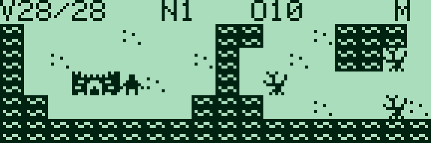
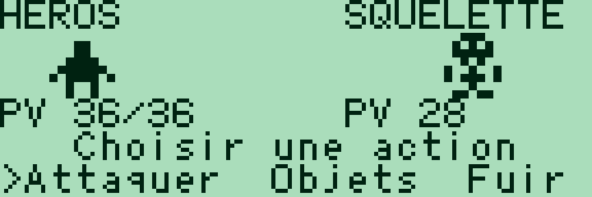
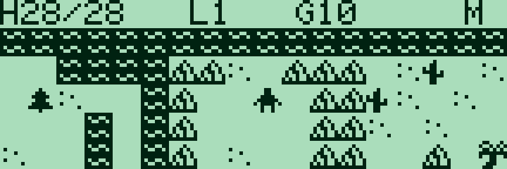
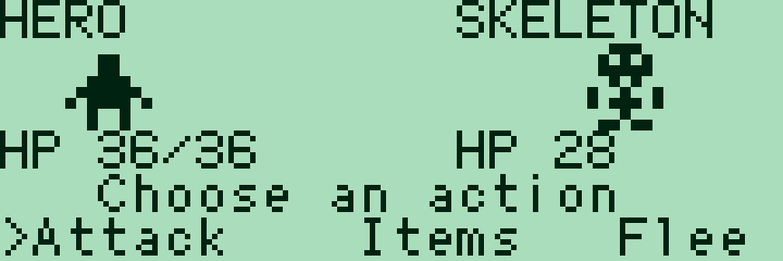

# Sharp PC-G Quest — 0.2.0

[Français](#francais) · [English](#english)

<a id="francais"></a>

## Français

[Collection](../../README.md#francais)

Un RPG en assembleur Z80 pour **PC-G801 / PC-G805 et PC-G850**, dérivé de **[Canon X-07 Quest](https://github.com/pR-0000/Canon_X-07_RPG)**. Explorer une carte de 30 × 16 cases, visiter le château et le village, acheter de l’équipement et vaincre cinq boss. Les combats demandent de taper un mot pour réussir une attaque, avec un bonus pour une frappe rapide.

Les déplacements, collisions, événements, boutiques, inventaire, statistiques, combats et textes sont communs aux deux versions. L’épée et l’armure du château sont **+1**, celles du village **+2**. La musique et le pilote sonore Canon ne sont pas inclus.

| Machine | Affichage | Français | English | Réservation, deux langues |
|---|---|---|---|---|
| PC-G801 / PC-G805 | 15 × 4 cases de 5 × 7, panneau à droite | [HEX G80X FR](build/g80x/quest_FR.ihx) | [HEX G80X EN](build/g80x/quest_EN.ihx) | `USER17E2` |
| PC-G850 | 18 × 5 cases de 8 × 8, HUD au-dessus | [HEX G850 FR](build/g850/quest_g850_FR.ihx) | [HEX G850 EN](build/g850/quest_g850_EN.ihx) | `USER1FFF` |

### Version PC-G850

La caméra suit le héros sur une fenêtre de **144 × 40 pixels** ; elle reste indépendante des huit secteurs logiques du monde. Les **23 motifs 8 × 8 du Canon X-07** sont conservés, avec des portraits **16 × 16** pendant les combats. Les noms, portraits, PV, défi de frappe et actions disposent de lignes distinctes. Les compteurs utilisent la police native Sharp.





[Forêt](docs/quest_g850_forest_g800.png) · [Carte complète G850](docs/map_g850.png) · [Atlas G850](docs/tiles_g850.png) · [Aperçu G80X](docs/quest_map_g800.png). Captures LCD : **g800**, sans bordure de fenêtre.

### Charger et lancer

Utiliser **[Sharp PC-G Link](https://github.com/pR-0000/Sharp-PC-G-Link)** et une interface série compatible. Choisir le fichier destiné à la machine ; aucune ROM ou installation d’assembleur n’est nécessaire pour jouer.

1. Sauvegarder les programmes à conserver. Régler **TEXT → Sio → Format** sur **4800 / 8N1, RS/CS, CR LF, EOF 1A**, et choisir les mêmes paramètres dans PC-G Link.
2. Depuis BASIC RUN : **`MON`**, puis la commande **`USER` du tableau**, puis **`R`**, en validant chaque commande avec ENTER.
3. Dans PC-G Link, choisir le modèle réel et le fichier IHX dans **Assembleur → Envoyer ASM**. Attendre la fin de réception sur le Sharp.
4. Saisir **`G100`**. Après chargement, **`CALL &H100`** lance aussi le jeu depuis BASIC.

Les BIN correspondants sont fournis à côté des HEX ; chargement et entrée sont **0100h**. Tailles, variables et tampons inclus : G80X **5 848 / 5 783 octets** FR/EN ; G850 **7 739 / 7 674 octets**. Les [manifestes G80X](build/g80x/manifest.json) et [G850](build/g850/manifest.json) contiennent les empreintes. Charger un autre programme à 0100h remplace le jeu et sa sauvegarde RAM. [Dépannage du transfert](../../docs/LOADING.md).

### Jouer

| Touche | Action |
|---|---|
| Flèches | Marcher ; sélectionner une option dans les menus |
| ENTER / ESPACE | Valider, continuer un dialogue |
| M / TAB sur la carte | Statistiques et inventaire |
| Lettres pendant un combat | Taper exactement le mot affiché |
| Retour arrière / CLS | Revenir au menu précédent lorsque c’est proposé |
| Q sur la carte | Quitter vers l’appelant |
| BREAK / OFF | Quitter depuis les menus ou un combat |

Relâcher une touche avant de la répéter, notamment pour deux lettres identiques. Le délai concerne **le mot entier**. Une frappe correcte donne une attaque normale ; une frappe rapide ajoute un bonus. Les potions rendent des PV et la fumée permet la fuite. La progression est conservée **en RAM** : « Continuer » la reprend si le même programme est relancé ; « Nouvelle partie » l’efface. Elle ne survit pas à un RESET ou au rechargement du jeu.

Pour une photo de carte, il suffit de relâcher les touches : le monde attend un déplacement. Dans un combat, le menu d’actions reste affiché tant qu’une option n’est pas validée.

### Graphismes modifiables

- **G80X : [`tiles.bmp`](tiles.bmp)**, 5 × 161 pixels, 23 motifs de 5 × 7 les uns sous les autres. [Atlas annoté](docs/tiles_preview.png).
- **G850 : [`targets/g850/tiles.bmp`](targets/g850/tiles.bmp)**, 8 × 184 pixels, 23 motifs de 8 × 8. Le héros porte l’identifiant 15 ; les ennemis vont de 16 à 22. Les portraits sont générés automatiquement à l’échelle ×2.
- Conserver les dimensions, l’ordre et le noir/blanc pur, sans lissage. La construction lit le BMP et régénère les données assembleur ; elle ne remplace pas les BMP sources.
- **[`map_packed.inc`](map_packed.inc)** est la carte commune. [`map.bmp`](map.bmp) et [`docs/map_g850.bmp`](docs/map_g850.bmp) sont des exports visuels, pas des fichiers de disposition à importer.

### Construire et simuler

Python 3.10+ standard et [SjASMPlus](https://github.com/z00m128/sjasmplus) suffisent à construire les deux cibles, dans les deux langues :

```text
python games/quest/build_quest.py --lang fr --assembler "sjasmplus.exe"
python tools/play_quest.py --lang fr --model PC-G850 --emulator "g800.exe"
```

Ajouter `--target g80x` ou `--target g850` à la construction pour limiter la cible. G80X : `build/` ; G850 : `build/g850/`. Le lanceur utilise les IOCS simulés sans ROM et choisit 4 MHz pour G80X, 8 MHz pour G850. g800 s’installe séparément.

Le délai de frappe utilise **6 lectures clavier par unité sur G80X**, **12 sur G850**, pour conserver un budget comparable à ces fréquences. `--typing-reload N` remplace ce réglage pour la cible construite : 1–64, plus grand = plus de temps. La vitesse réelle reste à apprécier sur la machine.

Les règles restent dans `movement.inc`, `events.inc`, `progression.inc`, `typing.inc`, `battle.inc` et `save.inc`. `targets/g850/` contient le rendu, les portraits et l’atlas natif ; `platform.asm` adapte les coordonnées des menus. Le profil G850 n’importe aucun pointeur interne du firmware G805. [Développement](../../docs/DEVELOPMENT.md) · [Provenance et conditions des éléments hérités](NOTICE.md).

---

<a id="english"></a>

## English

[Collection](../../README.md#english)

A Z80 RPG for **PC-G801 / PC-G805 and PC-G850**, derived from **[Canon X-07 Quest](https://github.com/pR-0000/Canon_X-07_RPG)**. Explore a 30 × 16 world, visit the castle and village, buy equipment and defeat five bosses. Battles use a typing challenge to land attacks, with an extra bonus for fast typing.

Movement, collisions, events, shops, inventory, statistics, battles and text are shared between targets. Castle weapons and armour are **+1**; village equipment is **+2**. Canon music and its sound driver are omitted.

| Machine | Display | Français | English | Reservation, both languages |
|---|---|---|---|---|
| PC-G801 / PC-G805 | 15 × 4 tiles, 5 × 7 pixels, right sidebar | [G80X FR IHX](build/g80x/quest_FR.ihx) | [G80X EN IHX](build/g80x/quest_EN.ihx) | `USER17E2` |
| PC-G850 | 18 × 5 tiles, 8 × 8 pixels, top HUD | [G850 FR IHX](build/g850/quest_g850_FR.ihx) | [G850 EN IHX](build/g850/quest_g850_EN.ihx) | `USER1FFF` |

### PC-G850 version

The camera follows the hero across a **144 × 40 pixel viewport**, independently of the world's eight logical sectors. All **23 original Canon X-07 8 × 8 patterns** return, with **16 × 16 portraits** in battle. Names, portraits, health, typing and actions occupy separate rows. Counters use Sharp’s native font.





[Forest](docs/quest_g850_forest_g800.png) · [Full G850 world map](docs/map_g850.png) · [G850 atlas](docs/tiles_g850.png) · [G80X preview](docs/quest_map_g800.png). LCD screenshots: **g800**, with window borders removed.

### Loading and starting

Use **[Sharp PC-G Link](https://github.com/pR-0000/Sharp-PC-G-Link)** and a compatible serial interface. Choose the build for your machine. Playing requires no ROM dump or assembler installation.

1. Back up programs you want to keep. Set **TEXT → Sio → Format** to **4800 / 8N1, RS/CS, CR LF, EOF 1A**, with matching settings in PC-G Link.
2. From BASIC RUN, enter **`MON`**, then the table’s **`USER` command**, then **`R`**, confirming each with ENTER.
3. In PC-G Link, select the actual model and the IHX file under **Assembler → Send ASM**. Wait for reception to finish on Sharp.
4. Run **`G100`**. After loading, **`CALL &H100`** also starts the game from BASIC.

Matching BIN files are next to the IHX file files; loading and entry addresses are **0100h**. Sizes including state and buffers: G80X **5,848 / 5,783 bytes** FR/EN; G850 **7,739 / 7,674 bytes**. [G80X](build/g80x/manifest.json) and [G850](build/g850/manifest.json) manifests include hashes. Loading another program at 0100h replaces the game and its RAM save. [Transfer troubleshooting](../../docs/LOADING_EN.md).

### Playing

| Key | Action |
|---|---|
| Arrows | Walk; select a menu option |
| ENTER / SPACE | Confirm; continue a dialogue |
| M / TAB on the map | Statistics and inventory |
| Letters during battle | Type the displayed word exactly |
| Backspace / CLS | Return to the previous menu where offered |
| Q on the map | Return to the caller |
| BREAK / OFF | Exit from menus or battle |

Release keys before repeating them, including doubled letters. The deadline applies to **the entire word**. Correct typing produces a normal attack; fast typing adds a bonus. Potions restore health and smoke allows escape. Progress is retained **in RAM**: “Continue” resumes it when the same program is launched again; “New game” clears it. RESET or reloading the program loses that save.

For a map photo, simply release the keys: the world waits for movement. In battle, the action menu stays visible until an option is confirmed.

### Editable graphics

- **G80X: [`tiles.bmp`](tiles.bmp)**, 5 × 161 pixels, 23 vertically stacked 5 × 7 patterns. [Labelled atlas](docs/tiles_preview.png).
- **G850: [`targets/g850/tiles.bmp`](targets/g850/tiles.bmp)**, 8 × 184 pixels, 23 stacked 8 × 8 patterns. Hero ID 15; enemies 16–22. Portraits are generated automatically at ×2 scale.
- Keep dimensions, order and pure black/white, without antialiasing. Building regenerates assembly data from the BMP without replacing source BMP files.
- **[`map_packed.inc`](map_packed.inc)** is the shared world map. [`map.bmp`](map.bmp) and [`docs/map_g850.bmp`](docs/map_g850.bmp) are visual exports, rather than editable layouts imported by the game.

### Building and simulation

Standard Python 3.10+ and [SjASMPlus](https://github.com/z00m128/sjasmplus) build both targets and both languages:

```text
python games/quest/build_quest.py --lang en --assembler "sjasmplus.exe"
python tools/play_quest.py --lang en --model PC-G850 --emulator "g800.exe"
```

Add `--target g80x` or `--target g850` to build a single target. G80X uses `build/`; G850 uses `build/g850/`. The launcher uses simulated IOCS without a ROM, selecting 4 MHz for G80X and 8 MHz for G850. Install g800 separately.

Typing uses **6 keyboard polls per timeout unit on G80X** and **12 on G850**, retaining comparable timing at those clocks. `--typing-reload N` overrides this for the selected build: 1–64, higher gives more time. Actual pacing still needs judging on the device.

Rules remain in `movement.inc`, `events.inc`, `progression.inc`, `typing.inc`, `battle.inc` and `save.inc`. `targets/g850/` holds native drawing, portraits and artwork; `platform.asm` adapts menu coordinates. The G850 profile imports no internal G805 firmware pointers. [Development](../../docs/DEVELOPMENT_EN.md) · [Provenance and inherited material terms](NOTICE_EN.md).
