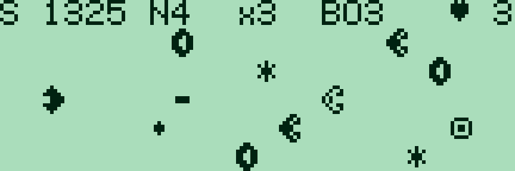
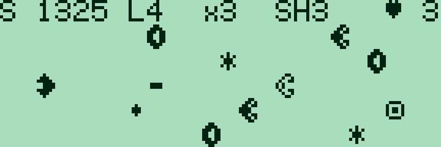

# Star Lane — 0.2.0

[Français](#francais) · [English](#english) · [Collection](../../README.md)

<a id="francais"></a>

## Français

Shoot’em up à couloirs pour **PC-G801 / PC-G805 / PC-G850**. Détruire les astéroïdes et les pirates, éviter leurs tirs et enchaîner les étoiles pour augmenter son score. Trois couloirs sur G80X ; **cinq sur G850**, avec un espace de jeu de 144 × 40 pixels et un panneau en haut.



### Télécharger et charger

| Machine | Français | English | Réservation |
|---|---|---|---|
| PC-G801 / PC-G805 | [IHX FR](../../games/star-lane/build/g80x/star_lane_FR.ihx) | [IHX EN](../../games/star-lane/build/g80x/star_lane_EN.ihx) | `USER09FF` |
| PC-G850 | [IHX FR](build/g850/star_lane_g850_FR.ihx) | [IHX EN](build/g850/star_lane_g850_EN.ihx) | `USER0BFF` |

Avec [Sharp PC-G Link](https://github.com/pR-0000/Sharp-PC-G-Link), choisir le modèle exact et les mêmes paramètres dans **TEXT → Sio → Format** : **4800 / 8N1 / RS/CS / CR LF / EOF 1A** conseillés. Sauvegarder les programmes à conserver. Depuis BASIC RUN : **MON**, la commande **USER** du tableau, puis **R**. Envoyer le fichier IHX avec **Envoyer ASM**, attendre la fin sur le Sharp, puis saisir **G100**. Après chargement, **CALL &H100** fonctionne également depuis BASIC. [Guide détaillé](../../docs/LOADING.md).

### Commandes et règles

| Touche | Action |
|---|---|
| ENTRÉE / ESPACE au titre | Commencer ou rejouer |
| ↑ / ↓ ou W / S, Z | Changer de couloir ; Z monte aussi |
| ESPACE | Tirer ; un projectile à la fois |
| F | Activer/désactiver le tir automatique |
| X | Bouclier temporaire, consommant une charge |
| P | Pause / reprise |
| TAB | Gel photo sans texte au milieu de l’écran / reprise |
| R | Nouvelle partie |
| Q / BREAK | Revenir à l’appelant |

Relâcher les touches entre les actions. Le tir automatique reste actif pendant les déplacements. Le bouclier protège des collisions ; ses trois charges se récupèrent avec les cellules d’énergie, figurées par un petit boîtier. Une charge ne s’active pas si le bouclier est déjà déployé.

Un astéroïde rapporte **10 points**. Un pirate demande **deux tirs**, change d’apparence au premier impact et rapporte **50 points** à sa destruction. Les pirates tirent vers le joueur. Les étoiles donnent **25 × le multiplicateur**, qui augmente jusqu’à **×4** et retombe à ×1 après un dégât. Le panneau affiche score, secteur, multiplicateur, charges de bouclier et vies. Trois vies ; score plafonné à 9999.

Tous les 64 pas, le secteur augmente et le défilement accélère, jusqu’au secteur 9. À partir du secteur 3, certaines vagues occupent deux couloirs dangereux ; une voie praticable reste disponible. Après un dégât, le vaisseau clignote pendant un court délai de protection.

### Sources et simulation

Les règles sont communes aux deux profils. `star_lane.asm` gère jeu/rendu, `combat.asm` les tirs et vagues. Motifs dans le source : 5 × 7 sur G80X, 6 × 8 sur G850. `STEP_POLLS` ajuste la cadence de base ; le profil G850 tient compte de son horloge plus rapide. Les manifestes donnent tailles, adresses et empreintes exactes.

```text
python games/star-lane/build_star.py --lang fr --assembler "sjasmplus.exe"
python games/star-lane/check_star.py --lang fr
python games/star-lane/check_g850.py --lang fr
python tools/play_star.py --lang fr --model PC-G850 --emulator "g800.exe"
```

Construction : Python 3.10+ et SjASMPlus. Vérifications CPU : `tests/requirements.txt`. Simulation : g800 installé séparément, sans ROM Sharp. `--target g80x` ou `--target g850` limite la construction ; omettre `--model PC-G850` dans le lanceur pour le profil G805.

---

<a id="english"></a>

## English

Lane shoot’em up for **PC-G801 / PC-G805 / PC-G850**. Destroy asteroids and pirates, dodge their shots and chain stars to build your score. Three lanes on G80X; **five on G850**, using a 144 × 40 playfield below the top HUD.



### Download and load

| Machine | French | English | Reservation |
|---|---|---|---|
| PC-G801 / PC-G805 | [FR IHX](../../games/star-lane/build/g80x/star_lane_FR.ihx) | [EN IHX](../../games/star-lane/build/g80x/star_lane_EN.ihx) | `USER09FF` |
| PC-G850 | [FR IHX](build/g850/star_lane_g850_FR.ihx) | [EN IHX](build/g850/star_lane_g850_EN.ihx) | `USER0BFF` |

Use [Sharp PC-G Link](https://github.com/pR-0000/Sharp-PC-G-Link), select the actual model and match **TEXT → Sio → Format** on both sides: **4800 / 8N1 / RS/CS / CR LF / EOF 1A** recommended. Back up programs you want to keep. From BASIC RUN: **MON**, the table’s **USER** command, then **R**. Send the IHX file with **Send ASM**, wait for reception to finish on the Sharp, then enter **G100**. **CALL &H100** also works from BASIC after loading. [Detailed guide](../../docs/LOADING_EN.md).

### Controls and rules

| Key | Action |
|---|---|
| ENTER / SPACE on title | Start / retry |
| ↑ / ↓ or W / S, Z | Change lane; Z also moves up |
| SPACE | Fire; one projectile at a time |
| F | Toggle autofire |
| X | Temporary shield, using one charge |
| P | Pause / resume |
| TAB | Clean photo freeze / resume |
| R | New game |
| Q / BREAK | Return to caller |

Release keys between actions. Autofire stays active while changing lanes. The shield protects against collisions; energy cells, shown as small boxes, replenish its maximum of three charges. An active shield cannot consume another charge.

Asteroids award **10 points**. Pirates take **two hits**, change appearance after the first and award **50 points** when destroyed. Pirates shoot toward the player. Stars award **25 × the multiplier**, which rises to **×4** and resets after taking damage. The HUD shows score, sector, multiplier, shield charges and lives. Three lives; score capped at 9999.

Every 64 steps the sector increases and scrolling speeds up, capped at sector 9. From sector 3 some waves block two lanes, always leaving a safe route. After a hit the ship blinks during a short protection period.

### Sources and simulation

Both profiles share their rules: `star_lane.asm` handles game/rendering, `combat.asm` shots and waves. Source patterns use 5 × 7 columns on G80X or 6 × 8 on G850. `STEP_POLLS` sets base pace; the G850 profile accounts for its faster clock. Manifests provide exact sizes, addresses and hashes.

```text
python games/star-lane/build_star.py --lang en --assembler "sjasmplus.exe"
python games/star-lane/check_star.py --lang en
python games/star-lane/check_g850.py --lang en
python tools/play_star.py --lang en --model PC-G850 --emulator "g800.exe"
```

Build requirements: Python 3.10+ and SjASMPlus. CPU checks: `tests/requirements.txt`. Simulation: separately installed g800, no Sharp ROM needed. Use `--target g80x` or `--target g850` to build one target; omit `--model PC-G850` in the launcher to use G805.
